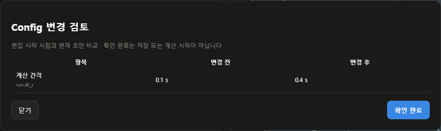

# 에이전트 협업

## 개발 목적

- CFD Studio는 **AI 에이전트로 CFD를 수행할 때 조작 비용을 줄이고, 사용자가 같은 화면에서 확인할 수 있도록 설계한 OpenFOAM CFD 인터페이스 도구**
- 에이전트가 소스 코드를 반복 분석하거나 입력칸을 하나씩 탐색하는 대신 Template JSON·공통 화면 명령·오류 코드를 사용
- 사용자는 Config·형상·변경 사항·실행 상태를 직접 확인하고 조작을 중단하거나 인계 가능
- 비용 절감은 설계 목표 · 실제 LLM 요금·토큰·작업 시간의 절감률은 모델과 작업에 따라 별도 측정 필요

## 1. 필요한 상태만 조회

- `observe()`에서 현재 화면·선택 대상·오류·검토·조작 담당 확인
- 반환된 `cursor`를 `observe({after: cursor})`에 전달 · 변화가 없으면 `changed: false`만 포함한 짧은 응답
- `waitForChange({after: cursor, timeoutMs: 30000})`: 브라우저 안에서 변화 대기 · 최대 60초, 동시 4개
- `inspect({query: "JSON", limit: 20})`: 현재 화면의 입력·버튼 검색 · 최대 100개, `offset`으로 다음 구간
- 입력값은 기본 생략 · `values: true`이면 긴 값은 300자, 선택지는 30개로 제한하고 잘림 표시
- `run(command, args, {response: "compact"})`: 전체 Config·입력 목록 없이 짧은 결과 반환
- 기존 `state()`와 기본 `run()` 응답은 호환 유지

```javascript
const observation = CFDAgent.observe();
const controls = CFDAgent.inspect({ query: 'JSON', limit: 20 });
const update = await CFDAgent.waitForChange({
  after: observation.cursor,
  timeoutMs: 30000
});
```

- 변경 감지는 간결한 상태 기준 · 프레임별 GPU 화면·전체 파일 변경 감시 기능은 아님
- 변화가 없거나 `timedOut: true`이면 계산 실패로 판단하지 않음
- 화면이 달라졌을 때만 필요한 입력·JSON·로그를 상세 조회

## 2. Config 변경 검토

1. 생성한 Template에서 내보낸 JSON을 기준으로 Config 초안 작성
2. **Config → 변경 검토** 선택 또는 `review.open` 명령 사용
3. 편집 시작 시점과 현재 초안의 항목·변경 전·변경 후 확인
4. 사용자가 **확인 완료** 선택
5. 최종 저장과 계산 시작은 별도 수행

- `CFDAgent.review.status()`: 변경 개수·확인 여부·확인 시각·반영 전 편집 여부
- 미반영 JSON이 있거나 입력이 달라지면 확인 상태 무효
- 검토 중 다른 입력이 들어오면 해당 검토 확인 거부
- 200개 초과 변경은 잘림 안내 후 확인 버튼 비활성 · 전체 JSON으로 추가 확인
- **확인 완료**는 에이전트 조작 대상에서 제외
- 확인은 해당 초안의 검토 기록 · 저장·계산 승인, 물리 검증 또는 모든 필수값 충족을 의미하지 않음
- 브라우저 내부 협업 규칙 · 외부 브라우저 자동화나 서버 호출을 차단하는 보안 경계는 아님



- 예시 입력으로 촬영한 변경 검토 화면 · 실제 계산 결과가 아님

## 3. 조작 담당과 인계

```javascript
const operator = CFDAgent.claim({
  name: 'Config agent',
  task: 'Template JSON으로 Config 초안 작성'
});
if (operator.error) throw new Error(operator.error);

const current = CFDAgent.observe();
await CFDAgent.run('config.json.open', {scope: 'config'}, {
  owner: operator.token,
  expectedContext: current.context,
  response: 'compact'
});

CFDAgent.release({
  owner: operator.token,
  summary: 'Config 초안 반영 완료 · 사용자 검토 대기 · 계산 미시작'
});
```

- 같은 탭에서 한 번에 한 에이전트가 조작 담당
- `claim()` 이후 모든 화면 조작 명령에 `owner` 필요 · 읽기 조회는 계속 가능
- 담당 유효 시간 120초 · 성공한 명령 또는 `renew({owner})`로 갱신
- 만료·해제 후에는 다시 담당을 확보해야 조작 가능
- `expectedContext`: 관측한 프로젝트·Case·편집 화면·사용자 입력 상태가 달라지면 `CONTEXT_CHANGED`로 차단
- **환경 설정 → LLM 에이전트 → 에이전트 안내 → 사용자에게 조작권 반환**: 담당 해제와 에이전트 일시정지
- `release()`의 인계 문장은 최대 2000자 · `handoff()`로 다음 담당이 조회
- 인계에는 완료·미완료·다음 확인 사항만 기록 · 전체 Config·로그·비밀정보 복사 금지
- 인계 내용은 에이전트 작성 메모 · 새 권한이나 저장·계산 승인으로 취급하지 않음
- 적용 범위: 같은 브라우저 페이지의 `CFDAgent` 명령 · 여러 PC·탭의 서버 잠금 기능은 아님
- 담당·검토·인계는 메모리 보관 · 새로고침 시 해제 · 저장된 프로젝트·Case와 구분
- 담당 미사용 시 기존 단일 에이전트 명령 유지 · 사용자 직접 조작은 계속 가능

## 작업 프롬프트

- **에이전트 안내 → 작업 안내**에서 선택 → **작업 프롬프트 복사**
- 한국어·영어·일본어 지원
- `CFDAgent.recipe("observe", "ko")`: 필요한 상태만 조회
- `CFDAgent.recipe("review", "ko")`: Config 변경 검토
- `CFDAgent.recipe("handoff", "ko")`: 조작 담당·인계
- 이미 사용자가 명확히 허용한 작업을 같은 내용으로 반복 확인하지 않음 · 대상이나 범위가 바뀌면 확인

## 협업 오류

| 코드 | 원인과 대응 |
| --- | --- |
| `OWNER_BUSY` | 다른 담당이 조작 중 · 읽기만 수행하며 인계 대기 |
| `OWNER_REQUIRED` | 현재 담당의 토큰 누락·불일치 · 본인의 claim 응답 확인 |
| `OWNER_EXPIRED` | 담당 만료·해제 · 화면 확인 후 다시 claim |
| `CONTEXT_CHANGED` | 선택 대상 또는 사용자 입력 변경 · 다시 observe |
| `USER_ACTION_REQUIRED` | 사용자 확인 버튼 · 에이전트가 대신 누르지 않음 |
| `INVALID_OWNER` | 이름·작업 내용 형식 또는 길이 오류 |
| `INVALID_HANDOFF` | 인계 문장이 2000자 초과 |
| `INVALID_QUERY` | 입력 검색 인자 오류 · limit 1~100 |
| `INVALID_WAIT` | cursor 또는 대기 시간 오류 · 0~60000 ms |
| `TOO_MANY_WAITERS` | 같은 페이지에서 대기 요청 4개 초과 |

- `CFDAgent.errorInfo(code)`로 해당 코드의 다국어 설명 조회
- `PAUSED`·`BUSY`와 [기존 명령 오류](CFD-STUDIO-AGENT-GUIDE.md)도 계속 적용

## 설계 근거

- 아래 자료에서 설계 원칙을 참고 · CFD Studio에 대한 효과를 입증한 자료는 아님
- 외부 프레임워크를 설치하거나 해당 서비스로 Config를 전송하지 않음

| 자료 | 확인한 내용 | 반영 |
| --- | --- | --- |
| [Anthropic, Writing effective tools for AI agents—using AI agents](https://www.anthropic.com/engineering/writing-tools-for-agents), 2025-09-11 | 응답 상세 수준 선택·검색·페이지 분할·도구 평가 권고 | 검색 가능한 입력 목록·간결한 응답·응답 크기 검사 |
| [Anthropic, Effective context engineering for AI agents](https://www.anthropic.com/engineering/effective-context-engineering-for-ai-agents), 2025-09-29 | 필요한 시점에 관련 정보 조회, 긴 작업에서 짧은 구조화 메모 사용 | 변경 대기·필요한 범위 조회·인계 메모 |
| [Wang & Lu, Interaction, Process, Infrastructure](https://www.microsoft.com/en-us/research/publication/interaction-process-infrastructure-a-unified-framework-for-human-agent-collaboration/), 2025-06, 프리프린트 | 협업 과정을 명시적으로 표현하고 확인 가능하게 구성하는 개념 틀 | 담당·현재 작업·다음 단계가 보이는 인계 |
| [LangGraph, Interrupts](https://docs.langchain.com/oss/python/langgraph/interrupts), 열람 2026-10-02 | 작업 도중 상태를 제시하고 사람의 검토·수정을 받는 구현 방식 | Config 변경 검토와 저장·실행 단계 구분 |

- 저비용 여부는 대표 작업의 성공률·응답 크기·호출 수·실제 토큰·실행 시간으로 평가 필요
- 현재 자동 검사는 응답 바이트 크기와 기능 정확도를 확인 · 사람 대상 UX 연구나 실사용 LLM 비용 실험을 수행한 것으로 해석하지 않음

## 확인 결과

- JavaScript 158개 · Python 30개 · 브라우저 170항목 통과
- 같은 시험 화면 응답 크기: 전체 상태 15440바이트, 간결한 관측 1438바이트
- 기능 시험용 Config 기준의 JSON UTF-8 크기 · 토큰 수·실제 LLM 요금 절감률은 미측정
- 사용자 입력 충돌·담당 경쟁·담당 회수·일시정지·인계·초안 재검토 확인
- 기존 프로젝트·원본장 보존 · CFD 계산 미실행
