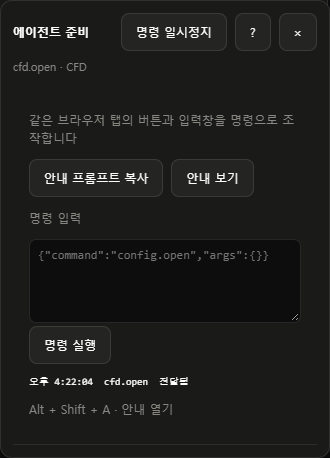

# AI 에이전트 사용법

- CFD Studio V1.0 · 에이전트 인터페이스 v1.3

[한국어](CFD-STUDIO-AGENT-GUIDE.md) · [English](CFD-STUDIO-AGENT-GUIDE.en.md) · [日本語](CFD-STUDIO-AGENT-GUIDE.ja.md)

## 협업 기능 v1.3

- 목적: OpenFOAM CFD를 AI 에이전트로 조작할 때 반복 입력·조회 부담을 줄이고 사용자가 같은 화면에서 확인하도록 지원
- **필요한 상태만 조회**: `observe({after})`, `inspect({query,limit})`, `waitForChange({after,timeoutMs})` 사용 · 변하지 않은 전체 Config 반복 조회 금지
- **Config 변경 검토**: `review.open` 호출 → 사용자에게 변경 전후와 3D 확인 안내 → `review.status()` 확인 · 검토는 저장·계산 승인이 아님
- **조작 담당·인계**: `claim({name,task})` → 반환된 token을 run의 `owner`로 전달 → `release({owner,summary})` → 다음 담당이 `handoff()`와 실제 화면 확인
- `run(command,args,{owner,expectedContext:CFDAgent.observe().context,response:"compact"})`: 기존 명령을 간결한 응답으로 사용
- 담당 유효 시간 120초 · 성공한 명령 또는 `renew({owner})`로 갱신 · 다른 담당이 있으면 읽기만 수행
- 사용자가 입력이나 선택 대상을 바꾸면 오래된 context의 작업을 재조회 · 변경된 내용을 덮어쓰지 않음
- **사용자에게 조작권 반환**은 담당 해제와 일시정지 · 현재 계산 중단과 별개
- 담당·인계·검토는 현재 페이지의 메모리 · 재시작 후 재확인 · 서버·다른 탭까지 잠그지 않음
- 인계는 참고 메모이며 권한 부여가 아님 · 이미 명확히 승인된 동일 작업을 반복 확인하지 않음
- 작업별 프롬프트: `recipe("observe"|"review"|"handoff","ko")` · 화면의 **작업 안내 → 작업 프롬프트 복사**에서도 제공
- [기능·명령·협업 오류·참고 문헌](AGENT-COLLABORATION.md)

## Template 기반 Config 작성

1. 설문과 솔버 선택으로 Template 생성
2. **양식 편집 → JSON 내보내기** 또는 `CFDAgent.configDocument()`로 생성된 JSON 양식 확보
3. 출력된 양식을 기준으로 Config 작성 · 새 문서를 임의로 만들어 대체하지 않음
4. 확장할 항목은 `config_schema`에 자료형·표시 이름·단위·`items` 등을 명시하고 `config`에 값 입력
5. JSON 초안 적용 후 사용자가 입력 목록·3D 형상·단위·미확정값을 확인하도록 안내
6. 확인 후 최종 저장 · 계산 시작은 실행 대상·종료 조건·대기열 확인을 거친 별도 단계

- Config 내보내기 문서: `format: "cfd-studio-config"`, `version: 1`, `config`, `config_schema`
- Template 내보내기는 `version`·`fields` 형식 · 공간 문서는 공간 JSON 창에서 조회한 형식 유지
- `items`로 빈 목록의 행 양식 정의 · `widget: "vector3"`로 XYZ 입력 지정
- 기존 키·단위·식별자·관계·관련 없는 값 보존 · 사용자 추가 키는 명시적으로 확장
- 입력 UI에 표시되는 것과 솔버가 계산에 사용하는 것은 별개 · 실행 어댑터 지원 확인
- [JSON 규칙](CONFIG-JSON.md) · [오류 코드](ERROR-CODES.md) · [다국어 오류 사전](config-error-codes.json)

### 간결한 상태 확인

| 조회 | 용도 |
| --- | --- |
| `CFDAgent.status()` | 화면·일시정지·오류 확인 · 전체 입력·로그 생략 |
| `CFDAgent.configRules()` | JSON 표시 규칙 1회 확인 |
| `CFDAgent.configDocument()` | 열린 편집기의 내보내기 문서 조회 · 반영 전 편집이 있으면 오류 반환 |
| `CFDAgent.errorInfo("CFG-J004")` | 해당 코드의 원인·해결 방법만 조회 |
| `CFDAgent.state()` | 화면이 바뀌었거나 조작할 입력을 찾아야 할 때 상세 조회 |

- 인터페이스 v1.3의 추가 읽기 기능 · 기존 명령과 호환
- 오류의 `code`·`path`·`action`으로 해당 입력만 수정 · 전체 소스 분석이나 같은 명령 반복부터 시작하지 않음
- `APP-X001`: 분류되지 않은 오류 · 상세 내용을 보존하고 원인 확인
- 일시정지 시 기존 대기 절차 유지 · 재개 버튼을 대신 누르거나 우회하지 않음

## 결과 확인

- Viewer에서는 Case 하나를 선택한 뒤 **3D Virtual / Data Sheet** 전환
- Data Sheet 왼쪽: 전체 평균 또는 특정 좌표의 시계열 · 최대 3개 물리량
- 오른쪽: 저장 프레임의 선상 프로파일 · 시작점·끝점·표본 수 지정
- 선상 값은 최근접 저장 셀 기준 · 공간·시간 보간 결과로 설명하지 않음
- JSON은 전체 Config·전체 공간 정의 또는 주요 분류 단위로 입력 · 개별 속성마다 JSON 버튼을 찾지 않음
- 새 Template 생성만으로 실행기가 추가되지는 않음 · 실제 실행 연결 상태 확인


## 시작 순서

1. CFD Studio를 실행하고 사용할 프로젝트 선택
2. **환경 설정 → LLM 에이전트 → 에이전트 안내 → 안내 프롬프트 복사** 선택
3. 사용하는 에이전트에 프롬프트와 작업 요청 전달 · 사용자가 보고 있는 Studio 탭에 연결
4. 상단 **에이전트 조작 중** 표시와 화면에서 진행 상황 확인
5. 멈추려면 오른쪽 상단 **에이전트 조작 중단** 선택 · 계속하려면 **에이전트 조작 재개** 선택

- 프롬프트 전달만으로 브라우저 연결이 완료되지는 않음 · 연결 방법은 사용하는 에이전트 도구에 따름
- 명령 이름과 JSON 키는 화면 언어와 관계없이 동일

## JSON 입력과 단계별 확인

- 에이전트 인터페이스 **v1.1**부터 Config·공간 형상 전용 JSON 명령 지원
- 개별 입력칸을 차례로 채우는 대신 JSON을 일괄 전달 · 같은 화면에서 Config와 3D 미리보기 확인
- 현재 탭의 편집기와 입력 검사 사용 · 파일 직접 변경이나 별도 서버 연결 불필요

| 순서 | 에이전트 작업 | 사용자 확인 |
| --- | --- | --- |
| 1 | 프로젝트·Case·CFD Template·솔버와 작업 목적 확인 | 대상과 해석 목적 확인 |
| 2 | 실제 Template 양식과 기존 공간 JSON 읽기 | 누락된 형상 치수·물성·조건 제공 |
| 3 | 공간 형상 JSON 작성 및 초안 반영 | 3D 형상·영역 이름·단위·고체/액체/기체 구분 확인 |
| 4 | 양식에 맞는 나머지 Config JSON 작성 및 초안 반영 | 각 설정의 의미·값·단위·근거·미확정값 확인 |
| 5 | 변경 전후를 요약하고 저장 여부 질문 | 확인 응답 후 Config·Case 최종 저장 |
| 6 | 종료 조건·저장 간격·대기열 대상과 순서 안내 | 계산 진행 확인 응답 후 대기열 추가·시작 |
| 7 | 로그·Case 상태·결과 확인 | 완료·실패·검증 상태 안내 |

- 각 단계 결과를 설명하고 다음 단계 안내 · Config 작성 요청만으로 계산 시작 금지
- 사용자 확인을 기다리는 절차는 에이전트 안내 규칙 · 프로그램에서 승인 응답을 강제로 검사하는 기능은 아님
- **JSON 저장**은 초안 반영 · Config 최종 저장·Case 실행 저장·대기열 시작과 구분
- 읽기 전용 실행 기록은 **이 Config로 새 Case**에서 사본을 만든 뒤 편집

### 전용 명령

| 명령 | 기능 | 인자 |
| --- | --- | --- |
| `config.json.open` | Config 또는 전체 공간 형상 JSON 열기 | `scope: "config"` 또는 `"geometry"` |
| `config.json.fill` | JSON 편집 버퍼에 일괄 입력 | `value`: JSON 문자열 · 최대 1 MB |
| `config.json.apply` | 기존 검사로 JSON을 초안에 반영 | 없음 |

- `CFDAgent.state().json`: 열린 JSON의 `scope`·`title`·`value`·`readonly`·`dirty` 조회 · 창이 닫혀 있으면 `null`
- `config.json.open` 전에 해당 Config 편집창 열기 · 명령은 프로젝트·Case를 자동 선택하지 않음
- 실제 조회된 JSON을 복사해 필요한 값만 변경 · 항목 이름·자료형·단위·식별자·관계·기존 메타데이터 유지
- Template의 `version`·`fields` 양식 정의, Config 값 객체, 전체 공간 문서는 서로 다른 형식 · 조회된 형식 그대로 수정
- 입력 양식이나 필수 자료가 없으면 사용자에게 요청 · 누락값을 임의로 확정하지 않음
- 공간 JSON에 포함되지 않은 물성·계산 조건은 Config JSON에서 입력
- `apply` 응답의 `dispatched`만으로 반영 성공 판정 금지 · `notices`, JSON 재조회, 3D 미리보기 확인
- 문법·자료형 오류는 수정 후 같은 초안에 재입력 · 읽기 전용·일시정지 상태 유지
- `apply`는 최종 저장이나 CFD 실행을 호출하지 않음

### JSON 입력 예시

- 아래 코드는 이미 열린 Config에서 전체 공간 JSON을 조회

```javascript
await CFDAgent.run('config.json.open', { scope: 'geometry' });
const current = CFDAgent.state().json;
if (!current || current.readonly) throw new Error('Editable JSON required');
const document = JSON.parse(current.value);
// document를 실제 양식과 사용자가 제공한 치수·조건에 맞게 수정
```

- 수정한 문서를 전달하는 함수 · 적용 후 사용자에게 화면 확인 요청

```javascript
async function applyDraft(document) {
  const fill = await CFDAgent.run('config.json.fill', {
    value: JSON.stringify(document, null, 2)
  });
  if (fill.status !== 'dispatched') return fill;
  return await CFDAgent.run('config.json.apply');
}
// 반환된 state.json과 state.notices 확인
// 사용자 확인 전에는 최종 저장·queue.add·queue.start 호출 금지
```

- 일반 Config에는 `scope: "config"` 사용 · 새로 읽은 문서에 같은 절차 적용
- 사용자에게 확인할 내용: 대상 형상, 치수와 단위, 재료와 물성, 초기·경계조건, 시간간격, 종료 조건, 출력 간격, 변경사항과 가정

## 준비

- CFD Studio 실행: `cfd_studio/실행.bat`
- 지원 환경: Windows 10/11 x64 · macOS 미지원
- 브라우저 조작 도구가 있는 LLM 에이전트 사용
- **사용자가 보고 있는 CFD Studio 탭**에 에이전트 연결
- 다른 브라우저 창에서 명령을 실행하면 그 창에만 화면 변경이 표시됨
- LLM 설치·계정 연결·브라우저 연결은 사용하는 에이전트 도구에서 진행
- Studio는 외부 HTTP·MCP 명령 서버나 원격 디버깅 포트를 열지 않음
- 계산 전 솔버 설치 상태와 실행 연결, Config·종료 조건·대기열 확인

## 안내 프롬프트

- 오른쪽 상단 **환경 설정 → LLM 에이전트 → 에이전트 안내**
- **안내 프롬프트 복사**를 눌러 에이전트 대화에 전달
- 복사가 제한된 브라우저에서는 **안내 보기**의 내용을 직접 복사
- 단축키 **Alt + Shift + A**: 에이전트 안내 펼치기·접기
- 안내에는 사전 준비, 명령 목록, 입력 방법, 실행·검증 상태 판독 기준 포함
- 안내 프롬프트는 에이전트용 영문 · 화면 버튼은 한국어·영어·일본어 지원

## 화면 표시

- 명령 대상 버튼·입력창을 파란 테두리로 강조
- 실제 프로젝트·Case 선택과 Config·Viewer 화면에 동작 반영
- 최상단 가운데 **에이전트 조작 중** 표시 · 천천히 깜박이며, 움직임 최소화 설정에서는 고정 표시
- 최상단 오른쪽 **에이전트 조작 중단**: 이후 명령 차단, 에이전트에 일시정지 신호 전달
- 일시정지 후 같은 위치의 **에이전트 조작 재개**로 재개 신호 전달
- 오른쪽 아래에 현재 명령과 최근 전달 기록 표시
- **명령 일시정지**: 이후 에이전트 명령 차단
- **명령 허용**: 명령 수신 재개
- 일시정지는 이미 전달한 동작이나 진행 중인 CFD 계산을 중단하지 않음
- **×**: 안내 패널만 숨김 · 에이전트 명령 차단은 **명령 일시정지** 사용
- 사용자가 동시에 선택·입력을 변경한 경우 에이전트는 현재 화면을 다시 확인한 뒤 진행




## 명령

- 연결된 탭의 JavaScript 실행 기능에서 `window.CFDAgent` 사용
- Studio 소스 분석이나 프로젝트 파일 직접 편집 없이 기존 화면 조작 가능
- `CFDAgent.describe()`: 인터페이스 버전·명령 목록·안내 프롬프트
- `CFDAgent.state()`: 현재 프로젝트·Case·대기열·화면·입력값·버튼·알림·로그
- `CFDAgent.prompt()`: 복사용 안내 프롬프트
- `CFDAgent.history()`: 최근 명령 기록 최대 100개
- `CFDAgent.waitForResume({timeoutMs:30000})`: 사용자 재개 신호 대기 · 최대 60초씩 대기 가능
- `CFDAgent.finish()`: 작업 종료 표시 · 사용자의 일시정지 상태는 유지
- `await CFDAgent.run(명령, 인자)`: 화면 조작
- 안내 패널의 **명령 입력 → 명령 실행**에서도 JSON 명령 실행 가능

```javascript
// 현재 화면과 프로젝트·Case 식별자 확인
const state = CFDAgent.state();

// 첫 프로젝트가 요청 대상인지 확인한 뒤 실제 식별자로 선택
const project = state.workspace?.projects?.[0];
if (!project) throw new Error('No project available');
await CFDAgent.run('project.select', { id: project.id });

// 선택된 Case의 Config 창 열기
await CFDAgent.run('config.open');

// 변경된 화면의 입력창과 버튼을 다시 확인
CFDAgent.state().controls;
```

| 명령 | 동작 | 인자 |
| --- | --- | --- |
| `cfd.open` | CFD 화면 | 없음 |
| `viewer.open` | 선택 Case의 Viewer 열기 또는 결과 준비 | 없음 |
| `project.select` | 프로젝트 선택 | `id` |
| `project.find` / `project.new` | 프로젝트 찾기 / 새 프로젝트 창 | 없음 · CFD 화면에서 사용 |
| `project.manage` | 프로젝트 관리 창 | 없음 |
| `case.select` | 현재 프로젝트의 Case 선택 | `id` |
| `case.new` | 새 Case Config 창 | 없음 |
| `config.open` | Config 편집 또는 읽기 | 없음 |
| `template.new` | 새 CFD Template 창 | 없음 |
| `queue.add` | 선택 초안을 대기열에 추가 | 없음 |
| `queue.start` | 표시된 전체 대기열 시작·재개 | 없음 |
| `queue.pause` | 다음 실행부터 일시정지 | 없음 |
| `case.stop` | 선택한 실행 중 Case 중단 | 없음 |
| `case.recovery` | 실패 사유·복구 창 | 없음 |
| `queue.skip` | 대기열의 실패 Case 건너뛰기 | 없음 |
| `result.open` | 생성·업데이트·열기 버튼 | 없음 |
| `result.refresh` | Viewer 결과 다시 읽기 | 없음 |
| `result.csv` | 선택 Case의 전체 CSV 추출 | 없음 |
| `viewer.mode` | Viewer 모드 선택 | `mode: "3d"` 또는 `"data"` |
| `settings.open` | 환경 설정 창 | 없음 |
| `ui.click` | 현재 화면의 버튼·접기·펼치기 조작 | `target` |
| `ui.fill` | 입력창에 문자열 입력 | `target`, `value` |
| `ui.select` | 선택 목록 변경 | `target`, `value` |
| `ui.check` | 체크박스·라디오 선택 | `target`, `checked` |

## 입력

- `state().controls`에서 `target`·`label`·`value`·`options`·`disabled`·`readonly` 확인
- 새 창·항목 전환 후 목록을 다시 읽기
- 화면에서 제거된 입력창의 `target`은 재사용 불가
- 숫자도 문자열로 전달: `value: "0.01"`
- 선택 목록은 표시 문구가 아닌 `options[].value` 사용
- 잘못된 숫자 형식은 거부 · 범위 오류는 입력창에 표시하며 수정 필요
- 파일 선택은 기존 브라우저 조작 도구의 파일 업로드 기능 사용
- 읽기 전용 실행 기록은 편집 불가 · **이 Config로 새 Case** 사용
- 입력 명령만으로는 저장되지 않음 · 같은 화면의 **저장** 버튼 사용
- 새로운 물성·경계조건·형상을 임의로 가정하지 않음

```javascript
const field = CFDAgent.state().controls.find(item => item.label === '프로젝트 이름');
if (!field) throw new Error('Read the current controls first');
await CFDAgent.run('ui.fill', { target: field.target, value: '열전달 비교' });
```

- 입력창 라벨은 표시 언어에 따라 다르므로 실제 목록에서 선택
- 안내 패널에서 실행하는 JSON 예시

```json
{"command":"config.open","args":{}}
```

## 결과 확인

- 반환값 `status: "dispatched"`: 화면 동작 전달됨
- **저장 성공·계산 시작·계산 완료를 의미하지 않음**
- 비동기 작업은 `state()`의 알림·대기열·Case 상태·로그에서 별도 확인
- 알림에 실패 사유가 있으면 입력이나 연결 상태 확인 후 진행
- `status: "rejected"`: 전달 거부 · `error` 확인
- `BUSY`: 다른 명령 전달 중 · 현재 동작을 확인하고 순차 진행
- `PAUSED`: 사용자가 명령 일시정지 선택
- `STALE_TARGET` / `CONTROL_NOT_VISIBLE`: 화면을 다시 읽고 현재 항목 선택
- `CONTROL_DISABLED`: 현재 조건에서 비활성 · 화면의 필요 조건 확인
- `INVALID_INPUT` / `INPUT_INVALID`: 입력 형식·범위 수정
- 계산·재시도·중단은 사용자가 요청한 범위에서 수행
- 대기열 시작은 다른 프로젝트의 Case에도 적용될 수 있으므로 전체 순서 확인
- 시각화율·수치 검사·계산 완료·실험 검증을 구분해서 보고

## 일시정지 신호

- 중단 시 `state().paused`가 `true`로 변경되고 `cfd-agent-pause` 이벤트 발생
- 재개 시 `cfd-agent-resume` 이벤트 발생 · 신호에 세션·순번·발생 시각 포함
- 에이전트는 매 명령 전 상태를 확인하고 일시정지 신호나 `PAUSED` 응답을 받으면 대기
- 아래 예시는 에이전트 연결 도구에서 사용하는 대기 처리

```javascript
while (CFDAgent.state().paused) {
  const signal = await CFDAgent.waitForResume({ timeoutMs: 30000 });
  if (signal.status === 'resumed') break;
}
// 현재 화면과 사용자 변경을 다시 확인한 뒤 다음 명령 결정
const current = CFDAgent.state();
```

- 작업을 마치면 `CFDAgent.finish()` 호출 · 상단 조작 표시 해제
- 에이전트가 응답하지 않으면 사용자가 **에이전트 조작 중단**으로 추가 명령 차단 가능
- Studio가 외부 LLM 프로세스 자체를 강제 정지하지는 않음 · 연결 도구가 신호를 따라 대기하도록 안내 프롬프트 적용
- 이미 전달한 화면 동작과 CFD 계산은 유지 · 계산 중단은 기존 Case의 **실행 중단** 기능 사용
- 일시정지를 우회하기 위한 새 탭 연결·새로고침·직접 UI 호출·자동 재개 금지

## 범위

- 같은 탭의 기존 버튼과 입력 이벤트 사용 · 기존 검증·저장·스냅샷 규칙 적용
- 명령 처리 중 다른 명령은 거부 · 자동 재전송 없음
- 원본 Config 값은 상태 조회에 포함되므로 연결된 에이전트에 전달할 정보 범위 확인
- 활동 기록에는 입력값을 저장하지 않음 · 명령·대상 식별자·전달 상태만 기록
- 기록은 탭 메모리에 유지 · 새로고침 시 초기화
- 세션 식별자는 새로고침마다 변경 · 이전 입력창 식별자 재사용 금지
- JavaScript 실행 기능이 없는 에이전트는 화면 조작 도구로 같은 버튼 사용
- 브라우저 연결, 파일 업로드, 네이티브 폴더 선택, 운영체제 권한은 에이전트 도구와 브라우저의 지원 범위 적용

- `CFDAgent`가 없으면 미저장 편집을 보존한 뒤 새로고침 · Studio 재시작은 대기 중에만 진행하고 실행 중인 솔버나 사용자 브라우저를 종료하지 않음
