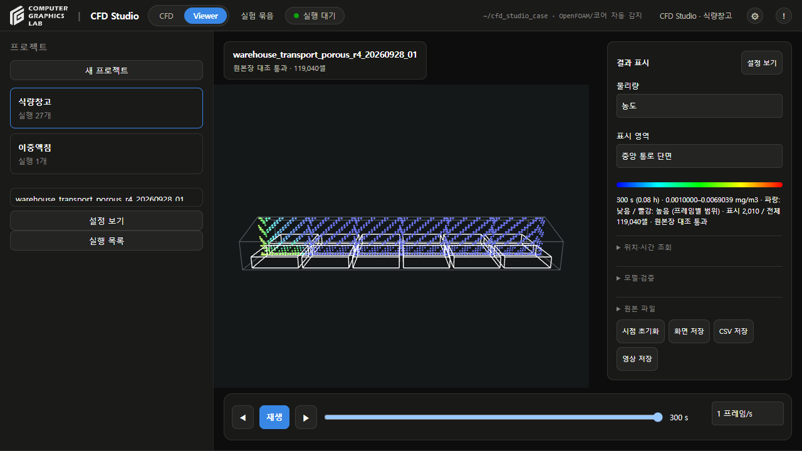
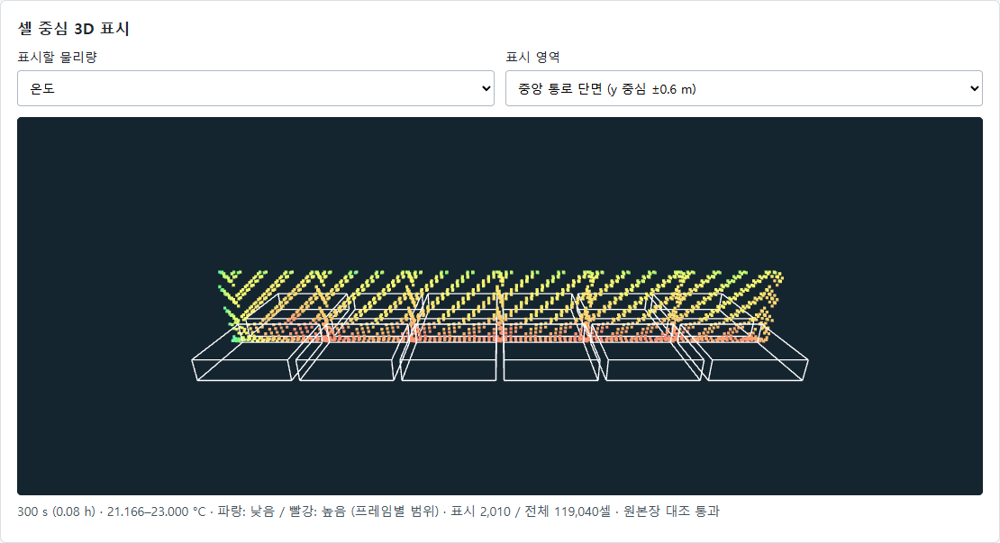

# 설명서

- 대상: 포대식 쌀 저장고
- 내용: 계산 모델, 결과 단위, 검증 상태
- 화면 조작: [사용법](CFD-STUDIO-USER-GUIDE.md)

## 계산 대상

| 항목 | 현재 정의 |
|---|---|
| 저장고 | 도면 기준 78 m × 25 m 공칭 외형, 박공지붕 |
| 곡물 | 12개 포대 적재 블록을 균질 다공성 영역으로 정의 |
| 유속 | 온도 차이에 의한 부력, 곡물의 유동 저항 반영 |
| 온도 | 공기·곡물의 열저장·열전달 계산, 문헌 도표의 외기온 시간변화 입력 |
| 농도 | 계산된 흐름에 따른 ClO₂ 이동·확산 |
| 누출 | 사용자 요청으로 제외, 외부 가스 경계 밀폐 |

- 다공성: 곡물 사이 빈 공간을 통한 공기 이동 모델
- 포대 표현: 적재 블록의 등가 영역 사용, 개별 천·작은 틈 미해상
- 공극률 0.4·투과도·곡물 및 외피 계수: **미보정 가정값**
- 초기 농도: 계산용 가정 분포
- 해석 경계: 도면 공칭 외형 사용
- 실내 순치수: 벽 두께 미반영, 미확정
- 적재 배치: 도면 조건에 따른 가정 배치
- 미포함 항목: **5 m 부속실 내부 공기, 개별 포대 막 전달, 반응·흡착**

## 물리량

| 물리량 | 화면 단위 | 의미 |
|---|---|---|
| 농도 | mg/m³ | 공극 가스 체적당 ClO₂ 질량, 원본 kg/m³ |
| 온도 | °C | 열방정식으로 계산한 셀 온도, 원본 K |
| 유속 | m/s | 겉보기 유속, 화살표 방향과 상대 크기 표시 |

- 농도 화면: 300초 중앙 통로 단면
- 파랑: 현재 표시 범위의 낮은 값
- 빨강: 현재 표시 범위의 높은 값

- 온도 화면: 같은 사례·같은 시점의 단면
- 표시값: 열방정식으로 계산한 공간 온도

## 표시와 조회

- 색 범위: 프레임마다 변경, 시점 비교 시 범례 숫자·조회값 확인
- 3D 점: 전체 셀의 표본, 셀 체적 렌더링 아님
- 화살표 길이: 현재 최대 속도에 대한 상대 크기
- 최신 다공성 사례: OpenFOAM과 대조한 **셀 체적 중심** 사용
- 위치 조회: 가장 가까운 셀 선택
- 시간 조회: 저장 시점 사이 선형 보간
- 과거 사례: 근사 대표점 사용 여부를 화면에 별도 표시

## 검증 상태

| 표시 | 의미 | 현재 다공성 사례 |
|---|---|---|
| 계산 완료 | 지정 시간까지 실행·출력 검사 완료 | 300초까지 완료 |
| 보존·원본 검사 | 질량·열수지, 저장값 일관성 확인 | 통과 |
| 격자 수렴 | 세분 격자 간 결과 차이 확인 | 기준 미달 |
| 시간간격 검사 | 계산 간격 축소에 따른 결과 차이 확인 | 기준 미달 |
| 실험 검증 | 독립 실측과 정확도 비교 | 미완료 |

- 중간·세분 격자 차이: 마지막 시점 농도 약 **33%**, 유속 약 **35%**
- 시간간격 절반 축소 시 농도 차이: 최대 **9.2%**, 목표 5% 초과
- 현재 수준: 가정 시나리오 실행·조회 가능
- 정량 예측: 수렴 판정 미완료
- 정상상태: 시간변화 외기온 사용, 계산 종료와 정상상태 도달 구분

## 결과 구분

| 결과 이름·모델 | 계산 범위 |
|---|---|
| `porous_r4` | 최신 곡물 경계 정렬 격자, 유속·온도·농도 연결, 300초 |
| `coupled_1h` | 앞선 격자의 연결 계산, 1시간 |
| `plan_20260928` | 앞선 7일 확산 계산, 유속 0, 공간 균일 기온 입력 |
| `normalized_gable_verification` | 정규화 수치시험, 단위 C/C_ref, 실제 ClO₂ 농도와 구분 |

## 자료

- [계산 기록](warehouse-porous-grid-review-20260928.md)
- [연결 모델](warehouse-coupled-cfd-20260928.md)
- [문헌 검토](clo2-literature-review-20260927.md)
- 계산 폴더: 입력, 원본 C/T/U, 화면용 배열, 검사 결과 보관
- GitHub: 코드·문서·요약 결과·그림
- 로컬: 대용량 원본장 보존
- 기준일: 2026-09-28
