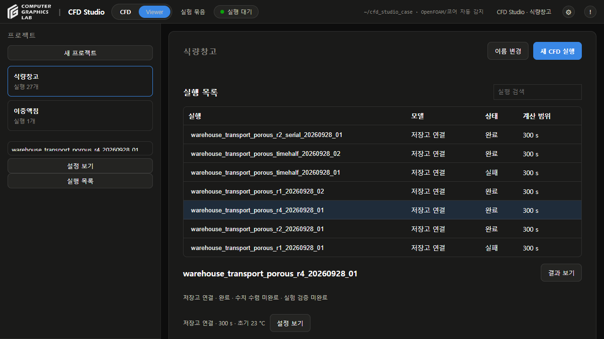
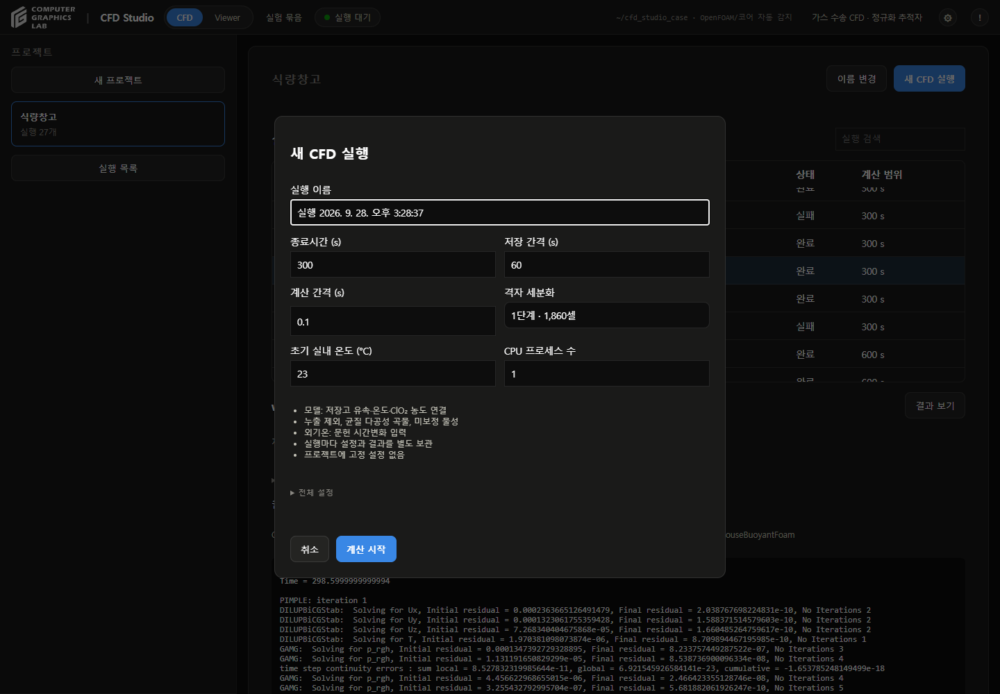
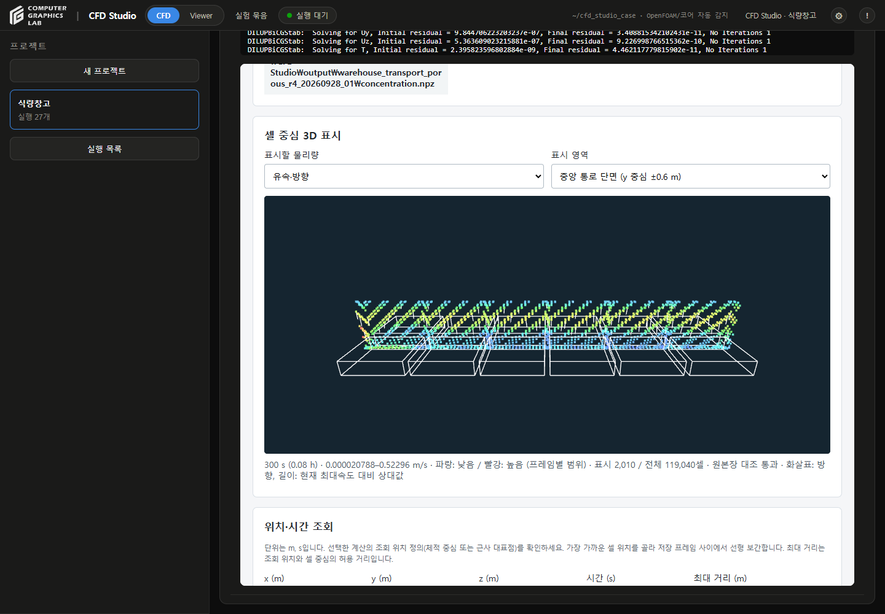
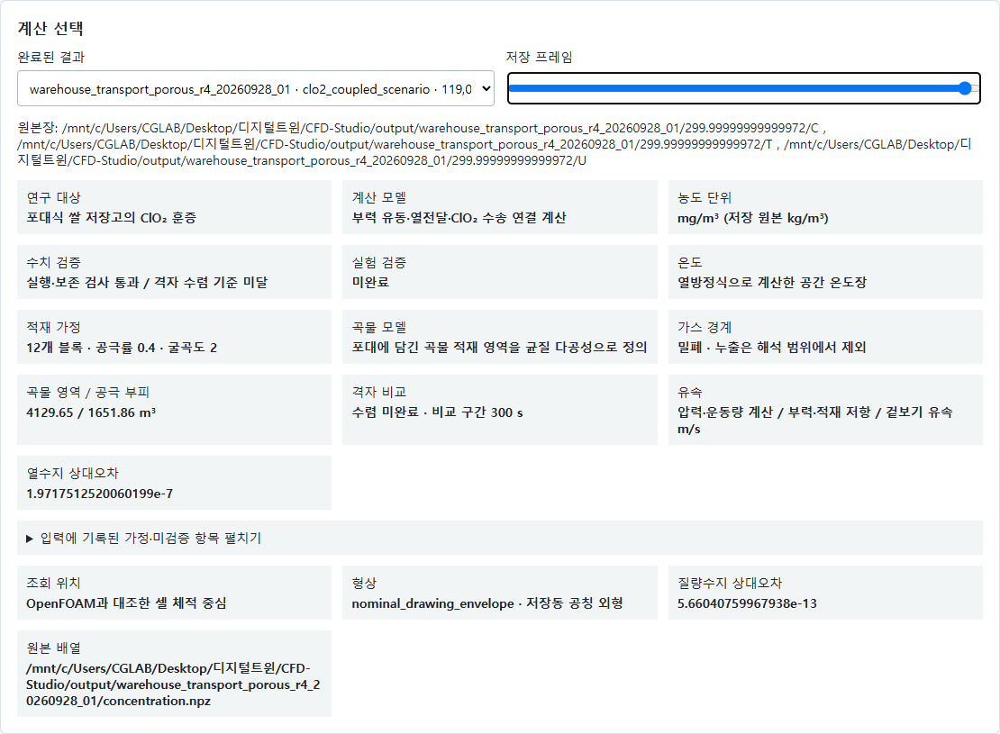
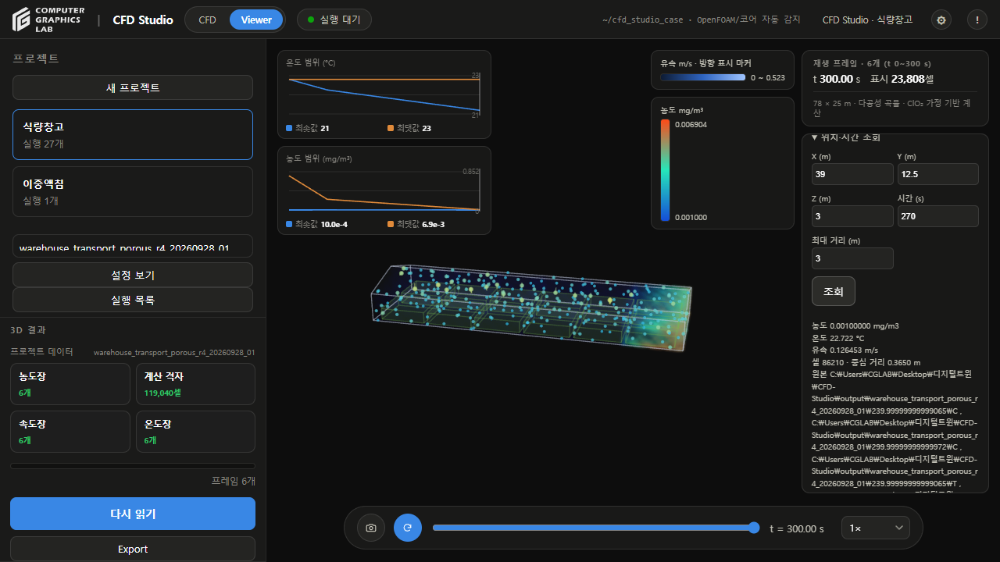

# 사용법

- 진행 순서: 프로젝트 → 새 CFD 실행 → 실행 선택 → 결과 보기 → 농도·온도·유속 표시 → 위치 조회
- 모델·단위·검증 상태: [설명서](CFD-STUDIO-MANUAL.md)

## 1. 실행

- `cfd_studio/실행.bat` 실행
- 왼쪽 **식량창고** 프로젝트 선택
- **새 CFD 실행** 선택
- 실행 이름·종료시간·저장 간격·계산 간격·격자·초기 온도 입력
- **계산 시작** 선택
- 실행 목록에서 진행 상태·솔버 로그 확인

- 그림 1: 한 프로젝트의 실행 목록과 선택한 실행의 로그
- 기존 프로젝트 카드: 실행 이력으로 통합
- 기존 설정·Raw·결과: 원래 위치에 보존
- 실행 선택: 해당 실행의 설정·로그·결과로 전환

- 그림 2: 실행할 때 설정 입력
- 프로젝트: 이름과 실행 목록만 보관
- 실행 설정: 시작 시 원본 저장, 이후 수정하지 않음
- 다음 실행: 기본 설정에서 새로 입력
- **전체 설정**: JSON 수정 후 **설정 적용** 선택
- 입력 조건: 계산 간격 ≤ 저장 간격 ≤ 종료시간
- 종료시간: 저장 간격의 배수
- 한 번에 한 실행 진행, 완료 후 같은 프로젝트에서 추가 실행
- 최초 설치: [설치 안내](../cfd_studio/README.md)

## 실행 결과

- 완료된 실행 선택 → **결과 보기**
- **실행 설정**: 해당 실행에 사용한 입력 확인
- **솔버 로그**: 해당 실행의 원본 로그 확인
- 우측 상단 **`!`**: 사용법·설명서 확인
- 기존 결과 직접 조회: `/warehouse/results`

- 선택한 실행의 결과: 같은 프로젝트 화면에서 조회
- 아래 결과 예제: `warehouse_transport_porous_r4_20260928_01`
- 예제 규모: **119,040셀 · 0–300초 · 6프레임**
- GitHub 배포: 대용량 원본 제외, 새 PC에서는 계산 후 결과 생성

## 2. 결과 선택

- **저장 프레임** 막대로 시간 선택
- 오른쪽 끝: **300초**
- 확인 항목: **다공성 곡물**, **누출 제외**, **격자 수렴 기준 미달**

- 그림 3: 계산 선택과 검증 상태
- 계산 완료: 지정 시간까지 실행·출력 완료
- 정확도 검증: 별도 판정

## 3. 물리량 표시

- **표시할 물리량**에서 항목 선택

| 선택 | 표시 내용 |
|---|---|
| 농도 | ClO₂ 농도, mg/m³ |
| 온도 | 계산된 실내 온도, °C |
| 유속·방향 | 속력과 화살표 방향, m/s |

- 내부 흐름 확인: **표시 영역 → 중앙 통로 단면**
- 회전: 마우스 드래그
- 확대·축소: 마우스 휠

- 그림 4: 300초 중앙 통로 단면의 유속·방향
- 점: 셀 표본
- 화살표: 흐름 방향
- 범례: 시간·단위·값 범위
- 색 범위: 프레임마다 변경

## 4. 위치 조회

1. **위치·시간 조회**에 아래 값 입력
2. **조회** 선택

| x | y | z | 시간 | 최대 거리 |
|---:|---:|---:|---:|---:|
| 39 m | 12.5 m | 3 m | 270 s | 3 m |

- 그림 5: 농도·온도·유속 조회 결과
- 조회값 아래: 선택한 셀까지의 거리, 원본 C/T/U 파일
- 270초 값: 저장된 240초·300초 사이 선형 보간
- 최대 거리: 조회 좌표와 가장 가까운 셀 중심 사이의 허용 거리
- 좌표 기준: 저장고 한쪽 끝 x=0, 폭 방향 y, 바닥 z=0

## 이중액침

- 왼쪽 **이중액침** 프로젝트 선택
- 실행 목록의 **3mm_Test** 선택 → **결과 보기**
- 기존 3D Viewer에서 기포·유속·온도·상분율 표시
- 보존된 재생 구간: 0~52.49초, 5,250프레임
- 원본 위치: `D:\CFD Studio\Project\3mm_Test`
- 원본 복사·이동 없이 외부 보관 폴더에 연결
- 식량창고 실행 이력과 별도 보관

## 문제 해결

| 상황 | 확인 항목 |
|---|---|
| 결과 미표시 | 계산 원본 존재 여부, 실행·출력 검사 통과 여부 |
| 300초 이후 미표시 | 해당 사례의 종료시간 300초 |
| 조회 오류 | 좌표·시간 범위, 셀까지의 거리 |
| 원본 불일치 | 원본·배열 보존, 해당 계산의 검사 기록 확인 |
| 이전 도움말 표시 | 계산 종료 후 Studio 재실행 |

## 참고

- [설명서](CFD-STUDIO-MANUAL.md)
- [계산 기록](warehouse-porous-grid-review-20260928.md)
- 촬영일: 2026-09-28
- 프로젝트·실행 설정 화면: 실제 Studio, 보존된 27개 실행 이력
- 농도·온도·유속 화면: 기존 300초 계산 기록
- 결과 출처: 보존된 실제 CFD 출력
- 스크린샷: 수치·검증 표시 변경 없음
