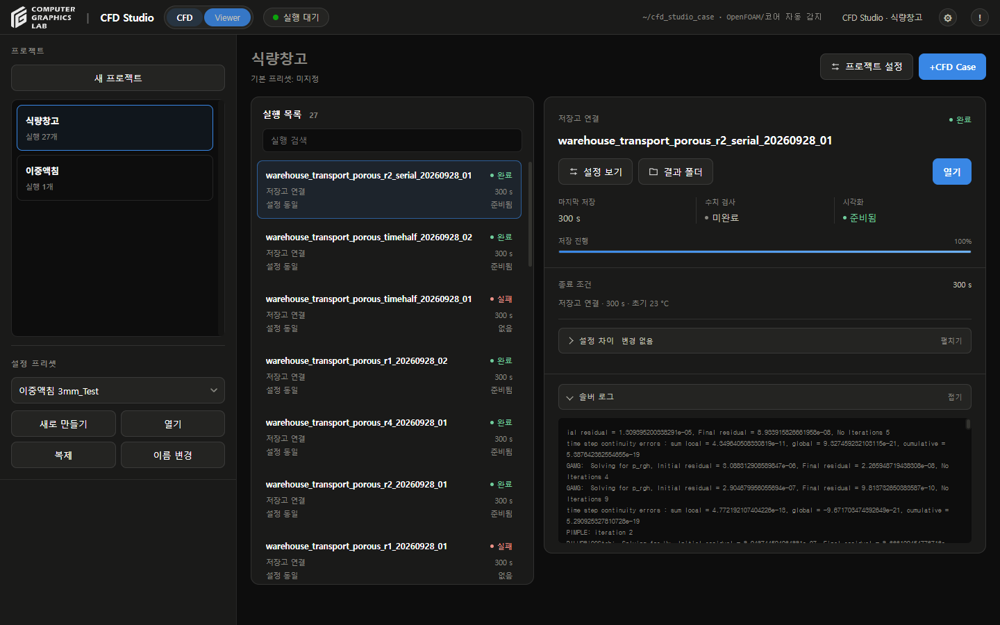
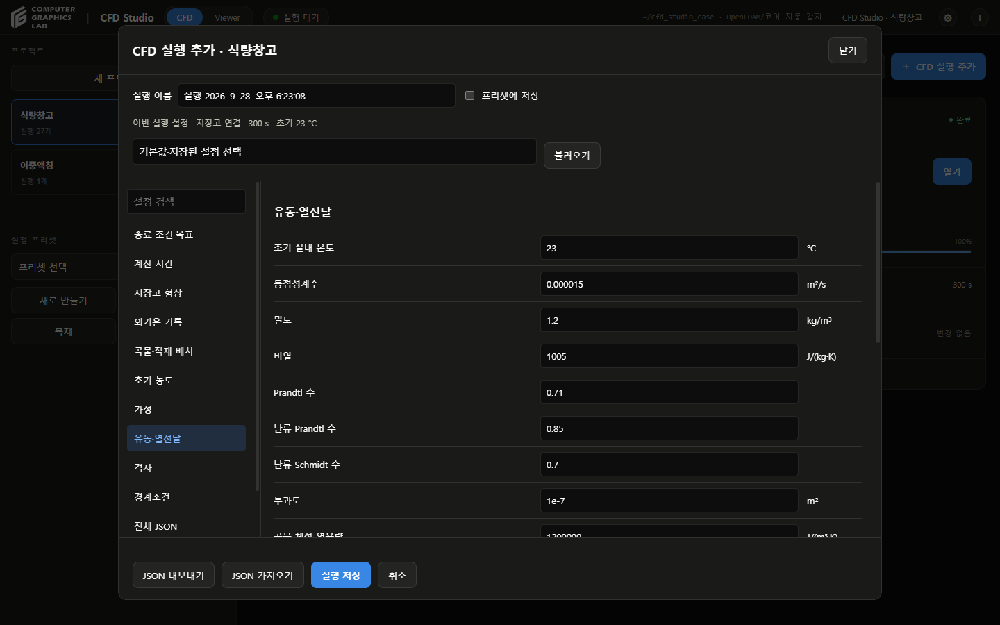

# 사용법

- 진행 순서: 프로젝트 → CFD 실행 추가 → 대기열 → 결과
- 모델·단위·검증 상태: [설명서](CFD-STUDIO-MANUAL.md)

## 프로젝트

- `cfd_studio/실행.bat` 실행
- **새 프로젝트** 선택
- 이름·설명·기본 설정 프리셋 입력 → **저장**
- **프로젝트 설정**: 이름·설명·기본 프리셋 변경
- 기본 프리셋 변경: 이후 추가할 실행에만 적용
- 왼쪽 프로젝트 목록: 전용 스크롤 영역
- **+CFD Case**: 프로젝트 화면 우측 상단
- 실행 목록: 실행 선택
- 오른쪽 실행 카드: 상태·저장 진행·설정·결과 확인
- **솔버 로그 / 설정 차이**: 오른쪽 화살표로 펼침·접힘
- 펼친 내용: 제목과 이어지는 둥근 패널

## 설정 프리셋

- CFD 화면 왼쪽 **프리셋 리스트**에서 선택
- 이중액침 기존 실행 설정: **이중액침 3mm_Test** 프리셋
- Viewer: 프리셋 관리 숨김
- **새 프로젝트** 버튼 자리: Viewer에서는 프로젝트 **시각화 준비율** 표시
- 준비율: 시각화가 준비된 Case 수 / 전체 Case 수
- 게이지 클릭: 실행 목록으로 이동
- **새로 만들기 / 복제**: 별도 이름으로 저장
- **열기**: 원본 설정 조회
- **이름 변경**: 사용자 프리셋 이름 변경
- 기본 제공 프리셋: 복제 후 이름 변경
- 기존 프리셋 덮어쓰기: 지원하지 않음

## 실행 설정

- **+CFD Case** 선택
- 실행 이름·개별 설정·종료 조건·목표값 입력
- **설정 검색 / 전체 JSON**: 입력 확인·편집
- **출처**: 설정 목록 맨 마지막에서 조회·편집
- **JSON 가져오기 / 내보내기**: 설정 파일 이동
- **프리셋에 저장**: 기본 해제
- 해제: 해당 실행에만 저장
- 체크: 새 프리셋 이름을 입력하고 별도 저장
- **실행 저장**: 실행 목록에 추가, 계산은 아직 시작하지 않음
- 저장 실패: 입력 유지, 기존 프리셋·실행 설정 보존

## 종료 조건

| 선택 | 기준 |
|---|---|
| 특정 물리시간 | 지정한 물리시간까지 계산 |
| 저장 프레임 수 | 선택한 출력 항목이 모두 저장된 시점의 개수 |
| 수렴 기준 | 현재 비활성, 연속 유지 구간 확인 기능 미연결 |

- 프레임 수: **0초 초기 프레임 포함** 여부 확인
- 정상 해석: 물리시간 선택 불가, 반복 횟수와 구분
- 솔버 시간간격: 계산 단계의 크기
- 결과 저장 간격: 결과 프레임 출력 주기
- 액침냉각의 복구 데이터 저장 간격: 재시작용 파일 주기, 결과 프레임 간격과 별도
- 재생 속도: Viewer에서만 변경

## 대기열

- 비어 있는 대기열: 화면에서 숨김
- 실행 선택 → **대기열에 추가**
- **↑ / ↓**: 아직 시작하지 않은 실행의 순서 변경
- **설정 편집**: 시작 전 실행의 입력 변경
- **제외**: 대기열에서만 제외, 실행 초안 보존
- **대기열 시작**: 한 번에 하나씩 순차 계산
- **다음 실행부터 일시정지**: 현재 실행은 유지
- **실행 중단**: 선택한 현재 실행만 중단
- 실패: 원인 확인 → **재시도 / 건너뛰기** → **대기열 시작**
- 재시도: 새 시도 폴더 사용, 앞선 실패 결과 보존
- 완료된 실행: 자동으로 다시 계산하지 않음
- 앱 재시작: 기록·설정·결과·대기열 복원, 다음 실행은 일시정지

## 설정 조회

- 실행 목록에서 실행 선택 → **설정 보기**
- Viewer에서는 상단 **CFD** → 실행 카드의 **설정 보기** 사용
- 실행 전 원본 입력: 조회·내보내기 가능
- 기존 실행 입력: 수정하지 않음
- **이 설정으로 새 실행**: 입력을 가져와 새 계산 준비
- 창 닫기: 보고 있던 결과로 복귀

## 결과 보기

- 실행 선택 → **열기** 또는 상단 **Viewer**
- **생성 / 업데이트**: 누락된 변환 구간 확인, 준비되면 **열기**
- **결과 폴더**: 선택한 실행의 원본 위치 열기
- 공통 화면: 기존 이중액침 Viewer의 3D 캔버스·재생 막대·레이어·Export 사용
- 모델별 차이: 형상·물리량·그래프 항목
- 실행 전환: 상단 **CFD** → 실행 선택 → **열기**
- 왼쪽 프로젝트 선택: 해당 프로젝트의 이전 선택 실행으로 전환
- 상단 **CFD**: 로그와 실행 목록으로 복귀
- 저장고 결과: 실행별 재생 위치·물리량·시점 유지
- 유지 범위: 현재 브라우저 탭, 새로고침 전까지

## 재생

- 아래 시간 막대: 저장 프레임 선택
- 키보드 **← / →**: 이전·다음 저장 프레임
- **재생 / 일시정지**: 연속 재생 제어
- 재생 배속: 물리시간 기준, 1×는 물리시간 1초를 화면 1초로 재생
- 실제 계산 시간: 시간 막대 옆 숫자 확인
- 드래그: 회전
- 휠: 확대·축소
- 더블클릭: 기본 시점 복원
- 휠 입력: 한 번에 최대 약 3% 변화, 모델 크기에 따른 범위 적용
- 저장고 애니메이션: 저장 프레임 사이 농도·온도·유속을 선형 보간
- 유속 이동 마커: 흐름 방향 표시

## 물리량

| 선택 | 표시 내용 |
|---|---|
| 농도장 | ClO₂ 농도, mg/m³ |
| 온도장 | 셀 온도, °C |
| 속도장 · 흐름 마커 | 속력과 흐름 방향, m/s |

- 오른쪽 **결과 데이터**: 표시할 물리량 선택
- **설계 레이어 → 중앙 통로 단면**: 내부 흐름 확인
- 농도장·온도장: 한 번에 하나 선택, 속도장과 함께 표시 가능
- 정규화 시험 농도: C/C_ref, 실제 농도와 구분
- 농도·온도: 셀 표본의 부드러운 체적 표현
- 화살표: 흐름 방향과 상대 크기
- 색 범위: 보간하는 두 저장 프레임의 범위, 범례 숫자 확인
- 왼쪽 그래프: 읽어온 저장 프레임의 최솟값·최댓값

## 위치 조회

- 오른쪽 **위치·시간 조회** 펼치기
- X·Y·Z·시간·최대 거리 입력 → **조회**
- 예제: X=39 m, Y=12.5 m, Z=3 m, 시간=270 s, 최대 거리=3 m
- 조회값 아래: 셀 번호·셀 중심까지 거리·원본 파일 확인
- 저장 시점 사이: 선형 보간
- 최대 거리: 가장 가까운 셀 중심까지 허용 거리

## 저장

- 왼쪽 **Export** 선택
- **영상 내보내기**: 첫 프레임부터 현재 배속으로 녹화
- 영상 형식: 브라우저에서 지원하는 MP4 또는 WebM
- 녹화 종료: 왼쪽 **녹화 중 — 클릭하면 저장** 선택
- 녹화 중 실행 전환: 전환 직전까지 기록한 영상 저장
- **현재 화면 PNG**: 현재 3D 화면과 시간 표시 저장
- **PNG 사진 / CSV 데이터**: 선택한 그래프 저장
- **프레임 데이터 → CSV 저장**: 선택한 저장 프레임의 표본 데이터
- 프레임 CSV 항목: 시간·셀 번호·좌표·농도·온도·유속 성분
- 프레임 CSV 범위: 저장 프레임 표본 전체, 단면 선택과 무관
- 화면이 보간 시점일 때 CSV: 그 시점 직전의 저장 프레임, 파일명·시간 열에 실제 저장 시점 기록
- **원본 파일**: 저장 시점·보간 구간·계산 원본 경로 확인
- **모델·검증**: 모델·가정·검증 상태 확인

## 이중액침

- 왼쪽 **이중액침** 프로젝트 선택
- **3mm_Test** 선택 → **열기**
- 기존 Viewer의 기포·유속·온도·상분율·재생·데이터 관리 기능 사용
- **설정 보기**: 해당 실행의 원본 입력 확인
- 보존 구간: 0~52.49초, 5,250프레임
- 원본 위치: `D:\CFD Studio\Project\3mm_Test`
- 원본 복사·이동 없이 연결

## 문제 해결

| 상황 | 확인 항목 |
|---|---|
| 결과 미표시 | 원본 존재 여부, 실행·출력 검사 결과 |
| 종료시간 이후 미표시 | 해당 실행의 계산 범위 |
| 조회 오류 | 좌표·시간·허용 거리 |
| 원본 불일치 | 원본·배열 보존 후 검사 기록 확인 |
| 이전 화면 표시 | 브라우저 새로고침 |

## 참고

- 촬영일: 2026-09-28
- 예제: `warehouse_transport_porous_r4_20260928_01`
- 예제 규모: 119,040셀·0~300초·6프레임
- 화면 자료: 보존된 실제 CFD 출력
- 대기열 검사: 별도 검토 저장소에서 1,860셀 CFD 3개 순차 실행
- 수치·물리 정확도 검증과 별도: [대기열 검토](execution-queue-review-20260928.md)
- 대용량 원본: GitHub 배포 제외
- [설명서](CFD-STUDIO-MANUAL.md)
- [계산 기록](warehouse-porous-grid-review-20260928.md)

- [Viewer 검토](shared-viewer-review-20260928.md)
