# 사용법

- 진행 순서: 프로젝트 → +CFD Case → 대기열 → 결과
- 모델·단위·검증 상태: [설명서](CFD-STUDIO-MANUAL.md)

## 설치

- 필수: Windows 10/11 x64·WebGL2 브라우저·WSL2 Ubuntu
- Windows Python: `cfd_studio/Setup/Python312`에 포함. 별도 설치 불필요
- 최초 사용: Ubuntu 설치·사용자 초기화 → `cfd_studio/설치.bat` → `cfd_studio/실행.bat`
- 설치 BAT: OpenCFD OpenFOAM v2312·Linux Python/NumPy·보조 도구·새 기본 계산 폴더 준비
- 이미 설치된 PC: `실행.bat` 사용. 설치 BAT를 업데이트용으로 반복 실행하지 않음
- 전용 솔버·GPU 환경: 별도 준비 필요
- [필수 프로그램·설치 파일·설치 순서](../cfd_studio/README.md)

## 프로젝트

- `cfd_studio/실행.bat` 실행
- 내부 코드·화면 파일: `cfd_studio/internal`에 보관
- **새 프로젝트** 선택
- 이름·프로젝트 폴더·설명 입력 → **CFD FORM** 선택 → 해당 FORM의 **프리셋** 선택 → **저장**
- **프로젝트 관리**: 이름·설명·저장 폴더·기본 프리셋 변경
- 기본 프리셋 변경: 이후 추가할 실행에만 적용
- 왼쪽 프로젝트 목록: 전용 스크롤 영역
- **+CFD Case**: 프로젝트 화면 우측 상단
- 실행 목록: 실행 선택
- 오른쪽 실행 카드: 상태·저장 진행·설정·결과 확인
- **솔버 로그 / Config 차이**: 오른쪽 화살표로 펼침·접힘
- 펼친 내용: 제목과 이어지는 둥근 패널

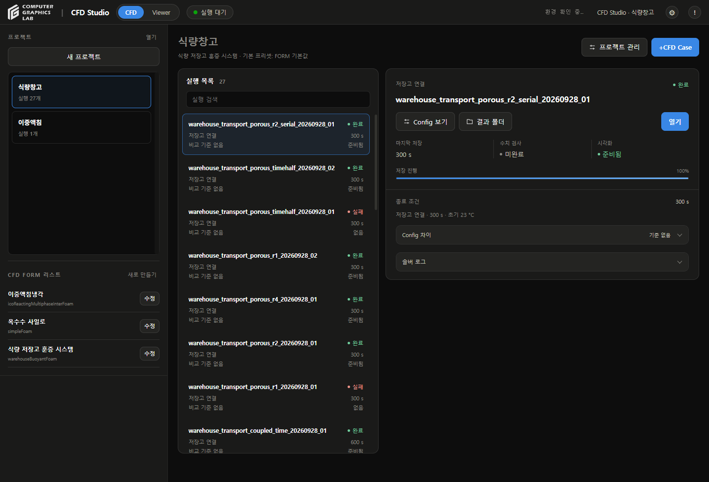

## 저장 폴더

- **새 프로젝트 → 프로젝트 폴더 → 찾기** 또는 경로 직접 입력
- 예: `D:\CFD Projects\저장고 비교`
- 지정한 폴더를 그대로 사용. 드라이브 루트나 별도 공통 폴더로 변경하지 않음
- 새 프로젝트: 비어 있는 폴더 선택
- **프로젝트 관리**: 저장 폴더 변경 가능
- 위치 변경: 복사 → 파일 검증 → 새 경로 적용. 이전 폴더 보존
- 계산·결과 저장 중에는 위치 변경 불가
- 왼쪽 프로젝트 목록에서 사용할 프로젝트 선택
- 새 Case의 설정·원본·결과·캐시: 프로젝트 폴더 안에 저장
- 기존 결과: 원래 경로 연결 유지. 위치 변경 시 프로젝트 폴더로 함께 복사
- 소프트웨어 설정: CPU·GPU 등 계산 자원만 설정
- 백업: 프로젝트 폴더 전체 복사. 기존 외부 연결 결과는 해당 원본도 보존

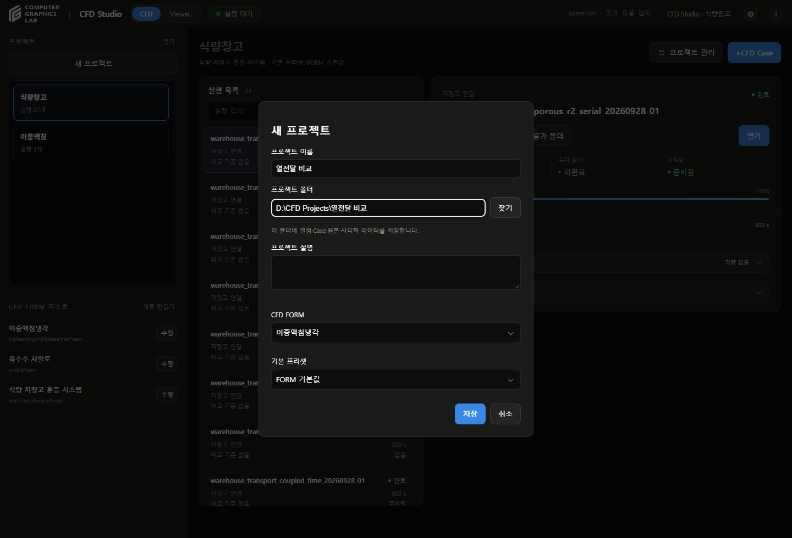

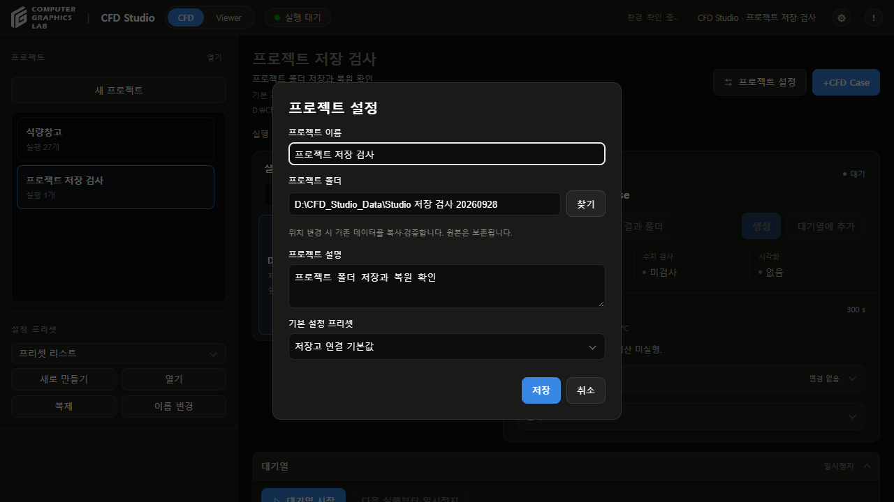

## CFD FORM

- 왼쪽 **CFD FORM 리스트**: 이중액침냉각 / 옥수수 사일로 / 식량 저장고 훈증 시스템
- **새로 만들기**: FORM 이름 → 솔버 선택 → **양식 구성**
- 유체 → 해석·유동 모델 → 영역·격자·종료 조건 → **양식 생성**
- **Config 편집**: 자동 구성된 항목에 사용자가 수치·경계조건 입력
- **Download JSON / Import JSON**: 파일 저장·수정·불러오기
- **Apply → FORM 초안 저장**: 선택 조건·입력값·자료형·단위 보존
- **양식 다시 구성**: 마지막 단계에서 교체 확인. 취소하면 기존 입력 유지
- 기존 실행 양식은 **Config Template**에서 직접 선택
- [사용법과 화면](form-wizard-20260929.md)
- 각 FORM 오른쪽 **수정**: 이름·설명·입력 양식·기본값 수정
- 기존 FORM의 해석 대상·솔버: 고정. 다른 대상·솔버는 새 FORM으로 생성
- 프로젝트: 생성 시 선택한 FORM 유지
- 기존 Case: FORM 수정 후에도 저장된 Config·비교 기준 유지

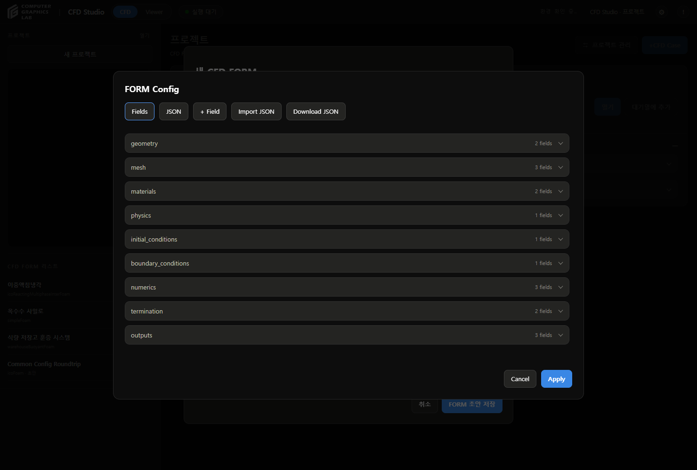

## 프리셋

- FORM에 속한 Config 값 묶음
- **FORM 수정 → 결과 그래프**: 해당 해석의 출력 항목·단위 확인
- **FORM 수정 → 새 프리셋**: 해당 FORM의 프리셋 생성
- 프로젝트 생성: 선택한 FORM의 프리셋만 표시
- **FORM 기본값**: 해당 FORM에 저장된 기본 Config 사용
- Case 편집: **프리셋 불러오기**에서 해당 FORM의 값 적용
- 기존 프리셋 덮어쓰기 없음

## Config

- **+CFD Case**: Case 이름·Config·종료 조건·목표 입력
- 파트: 형상·격자 / 물성·경계조건 / 솔버·계산 / 관측·비교
- 파트 오른쪽 화살표: 펼침·접힘
- **Config 검색 / 전체 JSON**: 입력 확인·편집
- **출처**: 마지막 참고 자료에서 조회·편집
- **JSON 가져오기 / 내보내기**: Config 파일 이동
- **프리셋에 저장**: 기본 해제
- 해제: 해당 Case에만 저장
- 체크: 새 이름으로 해당 FORM의 프리셋 저장
- **실행 저장**: 초안 생성. 계산은 대기열에서 시작
- **Config 보기**: 시작한 Case의 입력 조회
- **이 Config로 새 Case**: 원본 보존, 새 초안 생성

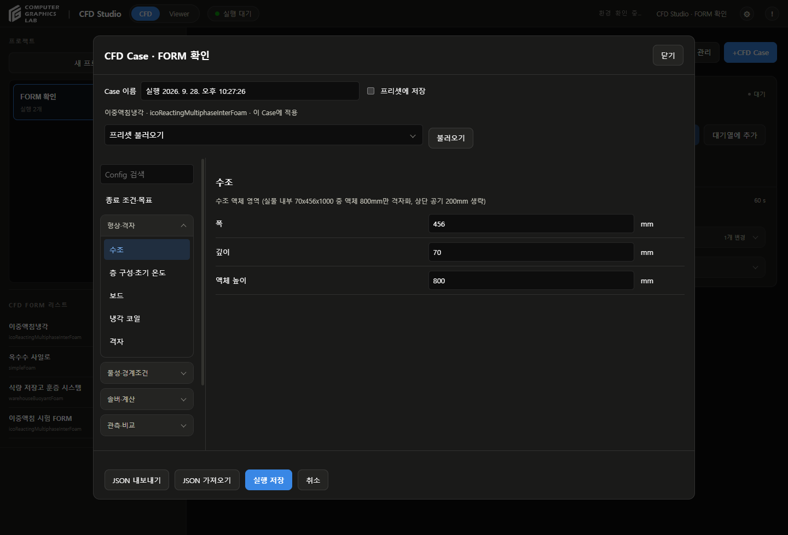

## 종료 조건

| 선택 | 기준 |
|---|---|
| 특정 물리시간 | 지정한 물리시간까지 계산 |
| 저장 프레임 수 | 선택한 출력 항목이 모두 저장된 시점의 개수 |
| 수렴 기준 | 현재 비활성, 연속 유지 구간 확인 기능 미연결 |

- 프레임 수: **0초 초기 프레임 포함** 여부 확인
- 정상 해석: 물리시간 선택 불가, 반복 횟수와 구분
- 솔버 시간간격: 계산 단계의 크기
- 결과 저장 간격: 결과 프레임 출력 주기
- 액침냉각의 복구 데이터 저장 간격: 재시작용 파일 주기, 결과 프레임 간격과 별도
- 재생 속도: Viewer에서만 변경

## 대기열

- 비어 있는 대기열: 화면에서 숨김
- 실행 선택 → **대기열에 추가**
- **↑ / ↓**: 아직 시작하지 않은 실행의 순서 변경
- **설정 편집**: 시작 전 실행의 입력 변경
- **제외**: 대기열에서만 제외, 실행 초안 보존
- **대기열 시작**: 한 번에 하나씩 순차 계산
- **다음 실행부터 일시정지**: 현재 실행은 유지
- **실행 중단**: 선택한 현재 실행만 중단
- 실패: 원인 확인 → **재시도 / 건너뛰기** → **대기열 시작**
- 재시도: 새 시도 폴더 사용, 앞선 실패 결과 보존
- 완료된 실행: 자동으로 다시 계산하지 않음
- 앱 재시작: 기록·설정·결과·대기열 복원, 다음 실행은 일시정지

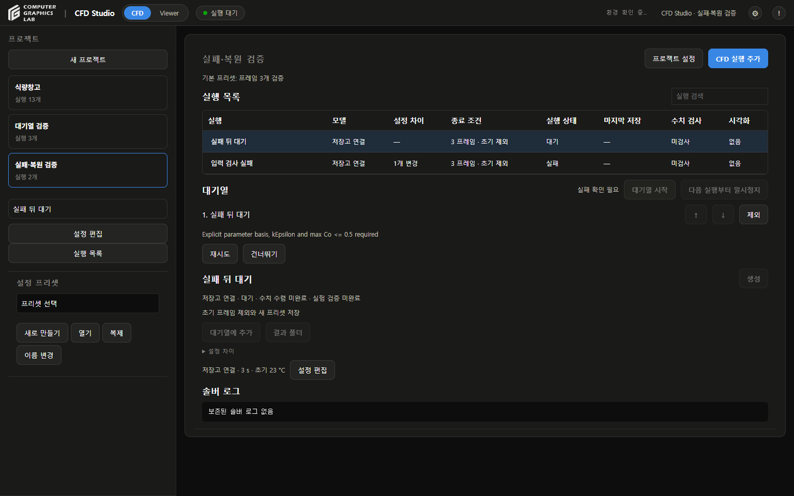

## 설정 조회

- 실행 목록에서 실행 선택 → **Config 보기**
- Viewer에서는 상단 **CFD** → 실행 카드의 **Config 보기** 사용
- 실행 전 원본 입력: 조회·내보내기 가능
- 기존 실행 입력: 수정하지 않음
- **이 설정으로 새 실행**: 입력을 가져와 새 계산 준비
- 창 닫기: 보고 있던 결과로 복귀

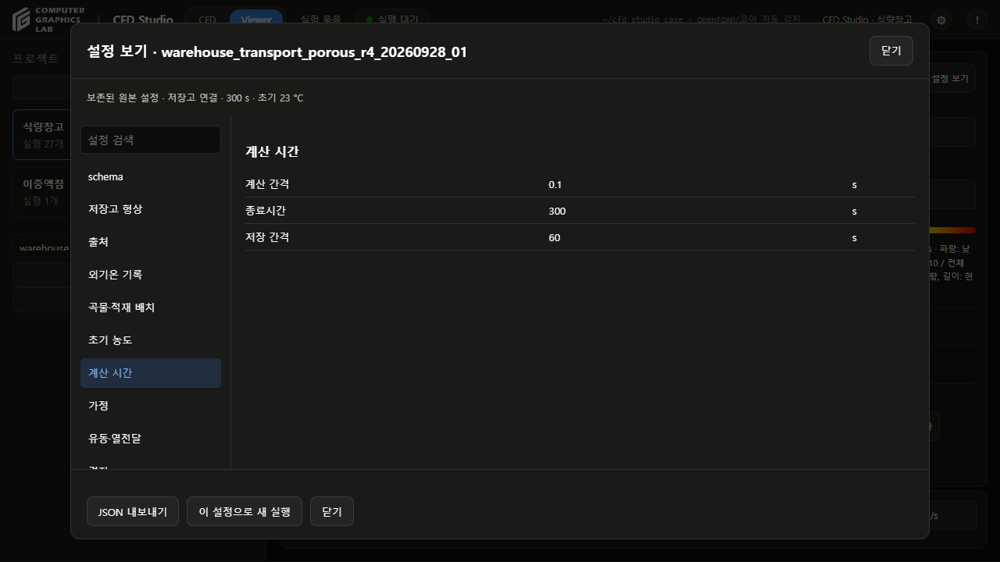

## 결과 보기

- 실행 선택 → **열기** 또는 상단 **Viewer**
- **생성 / 업데이트**: 누락된 변환 구간 확인, 준비되면 **열기**
- **결과 폴더**: 선택한 실행의 원본 위치 열기
- 공통 화면: 프로젝트·Case 목록·다시 읽기·모드 전환·재생 막대·Export 위치 동일
- 결과별 표시: Config와 저장된 데이터에 맞춰 물리량·단위·형상·레이어 구성
- 자동 동기화 항목 제거. 결과 준비 상태는 공통 Case 게이지에서 확인
- 모델별 차이: 형상·물리량·그래프 항목
- 실행 전환: 상단 **CFD** → 실행 선택 → **열기**
- 왼쪽 프로젝트 선택: 해당 프로젝트의 이전 선택 실행으로 전환
- 상단 **CFD**: 로그와 실행 목록으로 복귀
- 저장고 결과: 실행별 재생 위치·물리량·시점 유지
- 유지 범위: 현재 브라우저 탭, 새로고침 전까지

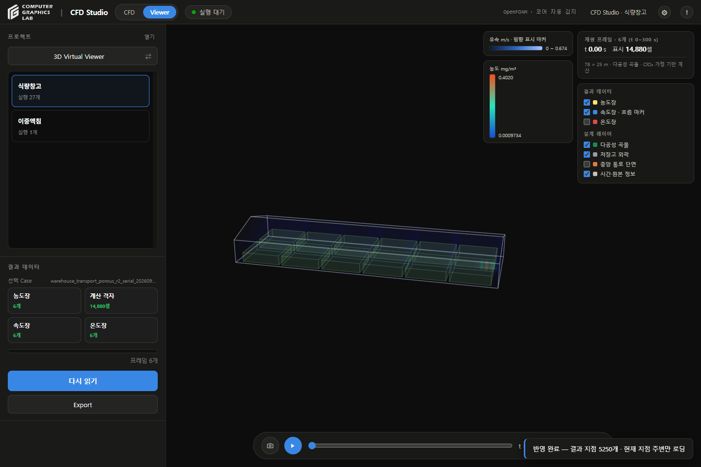

## Data Sheet Viewer

- 왼쪽 **3D Virtual Viewer** 클릭 → **Data Sheet Viewer**
- 왼쪽 **CFD Case**: 실행 하나를 선택
- 제목 오른쪽 **원형 화살표 아이콘(다시 읽기)**: 전체 Case 준비 상태 확인, 선택한 결과 갱신
- Case 목록: 프로젝트마다 같은 높이·항목 폭·스크롤 영역 유지
- 결과가 없는 프로젝트: Viewer 유지, 빈 결과 안내 표시
- Case 게이지: 프로젝트 선택 시 자동 표시, Viewer에서 주기적으로 갱신
- 준비된 결과는 100%, 변환 중인 결과는 실제 성공 프레임 비율로 표시
- 선택한 Case: 파란 테두리로 표시
- 확인 중·업데이트 필요·결과 없음·실패는 별도 표시. 게이지는 CFD 계산 완료율이나 물리 검증 상태가 아님
- Case 이름 버튼: 3D에 표시할 실행 선택
- 상단 **결과 항목**: 온도·유속·농도 등 저장된 물리량 선택
- 그래프 클릭·드래그: 가장 가까운 저장 X에 점선 표시, 각 Case의 정확한 Y 확인
- 그래프에 초점을 두고 **← / → / Home / End**: 저장 시점 이동
- 다른 Case에 동일한 X가 없으면 **—** 표시
- **CSV 저장**: 현재 항목의 읽은 값·단위 저장
- Case별 200개 이하: 자동으로 전체 읽기
- 큰 결과: 처음 16개 표시 → **전체 구간 읽기**
- **읽기 중지** 후 다시 읽으면 남은 구간부터 진행
- 완료 후 **다시 읽기**: 새 저장값 확인
- 정상 해석: 시간 대신 솔버 반복 횟수 표시
- 재생·하단 표·모델 검증 탭 없음
- 다시 **Data Sheet Viewer** 클릭 → 3D 복귀

## 3D 재생

- 아래 시간 막대: 저장 프레임 선택
- 키보드 **← / →**: 이전·다음 저장 프레임
- **재생 / 일시정지**: 연속 재생 제어
- 재생 배속: 물리시간 기준, 1×는 물리시간 1초를 화면 1초로 재생
- 실제 계산 시간: 시간 막대 옆 숫자 확인
- 드래그: 회전
- 휠: 확대·축소
- 더블클릭: 기본 시점 복원
- 휠 입력: 한 번에 최대 약 3% 변화, 모델 크기에 따른 범위 적용
- 저장고 애니메이션: 저장 프레임 사이 농도·온도·유속을 선형 보간
- 유속 이동 마커: 흐름 방향 표시

## 물리량

| 선택 | 표시 내용 |
|---|---|
| 농도장 | ClO₂ 농도, mg/m³ |
| 온도장 | 셀 온도, °C |
| 속도장 · 흐름 마커 | 속력과 흐름 방향, m/s |

- 오른쪽 **결과 데이터**: 표시할 물리량 선택
- 저장고 **속도장 → 표시 밀도**: 표준·세밀·매우 세밀, 기본값 세밀
- **중앙 통로 단면**: 내부 셀의 흐름 확인
- 유속 범례: 실제 표시 벡터 개수 확인
- [저장고 시각화](warehouse-density-review-20260929.md)
- 상단 **표시**: 읽은 셀 수 / 전체 저장 셀 수
- **설계 레이어 → 중앙 통로 단면**: 내부 흐름 확인
- 농도장·온도장: 한 번에 하나 선택, 속도장과 함께 표시 가능
- 정규화 시험 농도: C/C_ref, 실제 농도와 구분
- 농도·온도: 셀 표본의 부드러운 체적 표현
- 화살표: 흐름 방향과 상대 크기
- 색 범위: 보간하는 두 저장 프레임의 범위, 범례 숫자 확인
- **Data Sheet Viewer**: 선택한 Case의 물리량별 그래프 조회

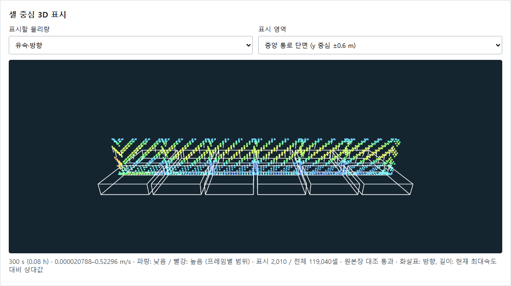

## 위치 조회

- 조회할 저장고 Case 이름 선택
- **Data Sheet Viewer** → 아래 **위치·시간 조회** 펼치기
- X·Y·Z·시간·검색 반경 입력 → **조회**
- 예제: X=39 m, Y=12.5 m, Z=3 m, 시간=270 s, 최대 거리=3 m
- 조회값 아래: 셀 번호·셀 중심까지 거리 확인
- 저장 시점 사이: 선형 보간
- 최대 거리: 가장 가까운 셀 중심까지 허용 거리

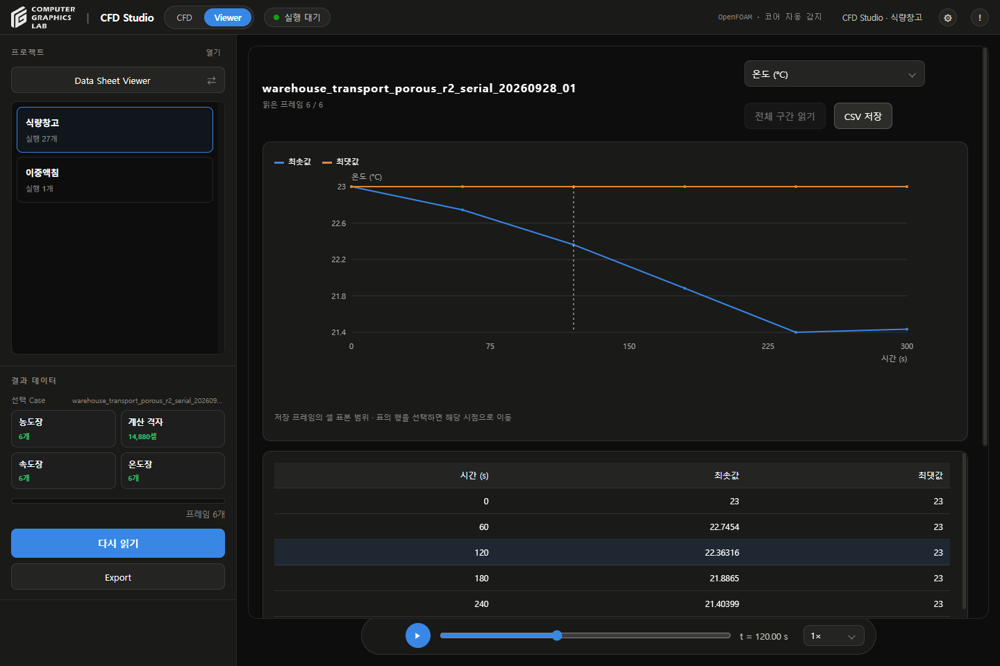

## 저장

- 3D Viewer 재생 바 오른쪽 **Export** 선택
- **영상 내보내기**: 첫 프레임부터 현재 배속으로 녹화
- 영상 형식: 브라우저에서 지원하는 MP4 또는 WebM
- 녹화 종료: 재생 바 오른쪽 **녹화 종료** 선택
- 녹화 중 실행 전환: 전환 직전까지 기록한 영상 저장
- **현재 화면 PNG**: 현재 3D 화면과 시간 표시 저장
- **PNG 사진 / CSV 데이터**: 선택한 그래프 저장
- **프레임 데이터 → CSV 저장**: 선택한 저장 프레임의 표본 데이터
- 프레임 CSV 항목: 시간·셀 번호·좌표·농도·온도·유속 성분
- 프레임 CSV 범위: 저장 프레임 표본 전체, 단면 선택과 무관
- 화면이 보간 시점일 때 CSV: 그 시점 직전의 저장 프레임, 파일명·시간 열에 실제 저장 시점 기록
- 원본 위치 확인: **CFD → 결과 폴더**
- 모델·가정·검증 기록: 해당 Case의 Config와 원본 결과 파일에 보존

## 이중액침

- 왼쪽 **이중액침** 프로젝트 선택
- **3mm_Test** 선택 → **열기**
- 기존 Viewer의 기포·유속·온도·상분율·재생·데이터 관리 기능 사용
- **Config 보기**: 해당 실행의 원본 입력 확인
- 보존 구간: 0~52.49초, 5,250프레임
- 원본 위치: `D:\CFD Studio\Project\3mm_Test`
- 원본 복사·이동 없이 연결

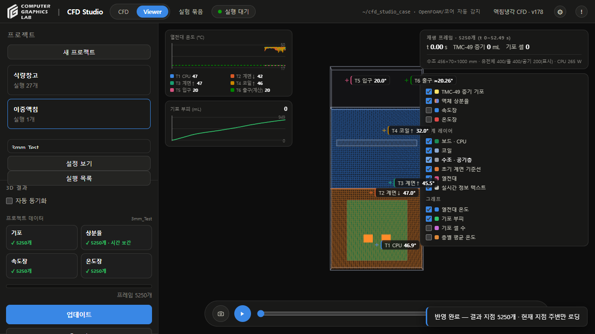

## 솔버 선택

- **CFD FORM 리스트 → + → 솔버**
- 범용 솔버 10개·기존 전용 구성 2개 제공
- 솔버 선택 시 해석 기능·주요 결과·연결 양식 표시
- **설치 확인**: 실행 파일 확인. Studio 연결 상태는 별도 표시
- 연결된 양식: **Config 편집 → FORM 저장**
- 사용자 정의: **양식 구성 → Config 편집 → FORM 초안 저장**. 실행 연결 후 프로젝트에 적용 가능
- [솔버별 설명과 화면](solver-catalog-20260929.md)

## 문제 해결

| 상황 | 확인 항목 |
|---|---|
| 결과 미표시 | 원본 존재 여부, 실행·출력 검사 결과 |
| 종료시간 이후 미표시 | 해당 실행의 계산 범위 |
| 조회 오류 | 좌표·시간·허용 거리 |
| 원본 불일치 | 원본·배열 보존 후 검사 기록 확인 |
| 이전 화면 표시 | 브라우저 새로고침 |

## 참고

- 촬영일: 2026-09-28
- 예제: `warehouse_transport_porous_r4_20260928_01`
- 예제 규모: 119,040셀·0~300초·6프레임
- 화면 자료: 보존된 실제 CFD 출력
- 대기열 검사: 별도 검토 저장소에서 1,860셀 CFD 3개 순차 실행
- 수치·물리 정확도 검증과 별도: [대기열 검토](execution-queue-review-20260928.md)
- 대용량 원본: GitHub 배포 제외
- [설명서](CFD-STUDIO-MANUAL.md)
- [계산 기록](warehouse-porous-grid-review-20260928.md)

- [Viewer 검토](shared-viewer-review-20260928.md)

## 솔버별 필수 입력

- 솔버 선택 시 주요 용도·필수 Config·선택 Config·계산 범위 확인
- 자동 생성 양식의 **Required** 항목 입력 후 **입력 검사**
- 누락 경로 확인·초안 저장 가능. 물리 정확도·실행 연결 검증은 별도
- [솔버별 입력 정의](solver-input-definitions-20260929.md)
