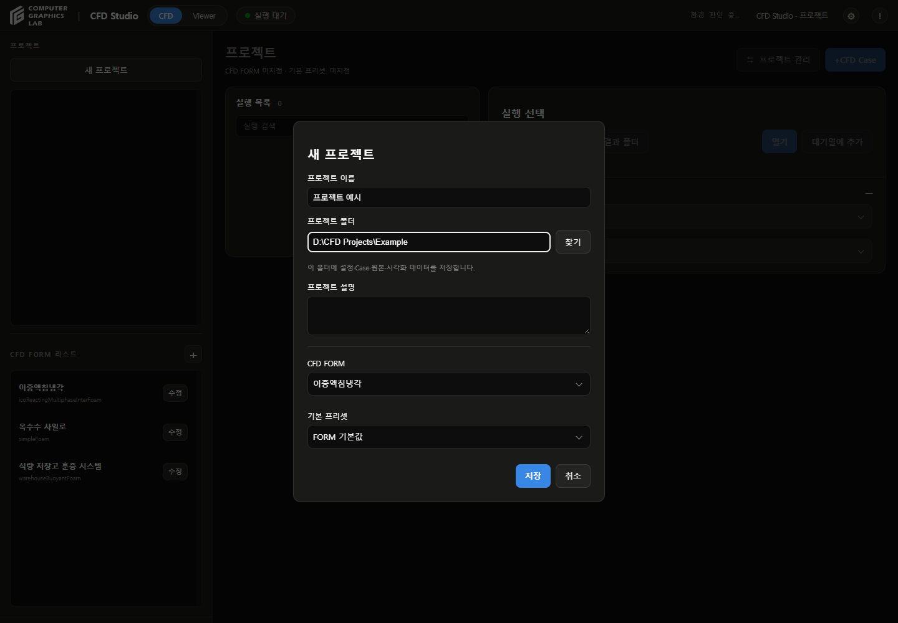

# 사용법

- **CFD**: 프로젝트·CFD FORM·Config 관리, 계산 실행, 결과 준비
- **Viewer**: Case 선택, 데이터 시각화율 확인, 3D·그래프 조회, 내보내기
- 프로젝트: 여러 Case를 묶어 보관하는 공간
- CFD Case: 입력값과 결과를 독립적으로 보관하는 계산 단위

## 설치 및 프로그램 실행

- 최초 설치: [설치 안내](../cfd_studio/README.md)에 따라 `설치.bat` 실행
- 설치 완료 후 실행: `cfd_studio/실행.bat` 더블클릭
- 열린 브라우저 상단 **CFD** 탭 선택

## CFD

- **화면 진입**: 상단 **CFD** 탭 클릭
- **기본 순서**: 새 프로젝트 → +CFD Case → 실행 저장 → 대기열에 추가 → 대기열 시작 → 생성 / 업데이트 → 열기

### 기존 프로젝트 등록

- **위치**: CFD 화면 왼쪽 상단 **프로젝트 찾기** 버튼
- **찾기**로 CFD Studio 프로젝트 폴더 선택 또는 전체 경로 입력 → **추가**
- `project.cfdproj`·필수 폴더·실행 목록·대기열 검증 후 프로젝트 목록에 등록
- 이미 등록된 폴더: 기존 프로젝트 선택. 중복 항목 생성 없음
- 동일 프로젝트가 다른 유효 경로에 등록된 경우: 등록 거부. **프로젝트 관리**에서 위치 변경
- 검증 실패: 대화상자에 오류 표시. 등록 목록과 기존 데이터 유지
- 가져온 대기열: 일시정지 상태. 실행하려면 **대기열 시작** 선택
- 프로젝트를 등록해도 CFD 계산은 자동으로 시작하지 않음

### 프로젝트 생성

- **위치**: 왼쪽 **프로젝트** 제목 아래 두 버튼 중 오른쪽 **새 프로젝트** 버튼
- 이름 입력 → **프로젝트 폴더** 옆 **찾기** 클릭 → 비어 있는 폴더 선택
- **CFD FORM**: 사용할 해석 양식 선택
- **기본 프리셋**: 시작할 입력값 묶음 선택. **FORM 기본값** 선택 가능
- 창 하단 **저장** 클릭 → 왼쪽 목록에 프로젝트 표시
- 기존 프로젝트 사용: 왼쪽 목록에서 프로젝트 이름 클릭

- 사진: 새 프로젝트 입력 예시. 저장 전 화면. 왼쪽 버튼 구성은 현재 버전과 다를 수 있음

### 프로젝트 정보 및 저장 폴더 변경

- **위치**: CFD 화면에서 프로젝트 선택 → 오른쪽 상단 **프로젝트 관리**
- 이름·설명·기본 프리셋 변경 가능
- **프로젝트 폴더** 옆 **찾기** 또는 경로 직접 입력 → **저장**
- C·D 등 드라이브의 폴더 선택 가능
- 이동 처리: 복사·검증 → 연결 전환. 이전 원본 보존
- 계산·결과 저장 중에는 위치 변경 불가
- 백업: 프로젝트 폴더 전체 보관. 이전 형식의 외부 연결 결과는 해당 원본도 보관

### CFD FORM 생성 및 편집

- 기존 FORM 사용 시 목록에서 해당 FORM 선택
- **위치**: 상단 **CFD** 탭 → 왼쪽 하단 **CFD FORM 리스트** 제목 오른쪽의 둥근 정사각형 **+**
- **CFD FORM 이름** 입력 → **솔버** 선택
- **설치 확인** 클릭 → 바로 아래에서 **설치 확인됨 / 실행 파일 없음 / 확인 실패** 확인
- **설치 확인**은 설치 여부 조회. 자동 설치 기능 미제공

| 작업 | 버튼·입력 항목 | 동작 |
|---|---|---|
| 해석 조건별 양식 생성 | 양식 구성 | 유체·해석·영역·격자·종료 조건 선택 후 **양식 생성** |
| 기존 연결 양식 사용 | Config Template 선택 상자 | 선택한 솔버와 연결된 양식 선택 |
| 입력값 편집 | Config 편집 | 항목별 Key·Type·Unit·Value 편집 |
| 편집 내용 반영 | Apply | FORM 창으로 돌아감 |
| FORM 저장 | FORM 저장 / FORM 초안 저장 | 왼쪽 FORM 목록에 추가 |

- **FORM 초안 저장**: 양식 보관. 실제 계산 연결 전에는 프로젝트·Case에 사용할 수 없음
- 파일로 편집: Config 편집창의 **Download JSON / Import JSON**
- 항목 추가: Config 편집창의 **+ Field**
- 기존 FORM 변경: 목록의 FORM 이름 오른쪽 **수정** 버튼
- [양식 구성 화면](form-wizard-20260929.md) · [솔버별 입력 항목](solver-input-definitions-20260929.md)

### CFD Case 생성 및 Config 입력

- **위치**: 프로젝트 화면 오른쪽 상단 파란 **+CFD Case** 버튼
- **Case 이름**에 구분하기 쉬운 이름 입력
- 열린 창 왼쪽에서 Config 항목 선택 → 오른쪽에서 값 입력
- **종료 조건·목표**에서 종료 방식 선택

| 선택 항목 | 입력할 값 |
|---|---|
| 특정 물리시간 | **목표 물리시간 (s)** 입력 |
| 저장 프레임 수 | **목표 저장 프레임 수** 입력, **0초 초기 프레임 포함** 여부 확인 |
| 수렴 기준 | 현재 선택 불가 |

- 창 하단 파란 **실행 저장** 클릭 → 실행 목록에 Case 추가
- **실행 저장은 입력 보관 단계**. 계산은 **대기열 구성 및 CFD 실행**에서 시작
- 조건을 달리한 계산 추가: **+CFD Case**를 다시 클릭

### 프리셋 저장 및 불러오기

- **위치**: Case의 Config 편집창 상단 **프리셋에 저장** 체크박스
- 이 Case에만 적용: 체크 해제 상태로 **실행 저장**
- 새 프리셋 저장: 체크 → 나타난 이름 칸에 새 프리셋 이름 입력 → **실행 저장**
- 기존 프리셋 불러오기: 편집창 상단 **프리셋 불러오기** 선택 상자에서 항목 선택 → **불러오기**
- 프로젝트 기본값 변경: 프로젝트 오른쪽 상단 **프로젝트 관리 → 기본 프리셋**
- 변경한 기본값은 이후 추가하는 Case에 적용. 기존 Case의 입력은 유지

### 대기열 구성 및 CFD 실행

- **위치**: 가운데 **실행 목록**에서 Case 이름 클릭
- 오른쪽 상세 영역의 **대기열에 추가** 클릭
- 화면 하단에 나타난 **대기열** 영역에서 파란 **대기열 시작** 클릭
- 선택한 Case 상태가 **계산 중**으로 바뀌는지 확인
- 오른쪽 **솔버 로그** 제목 끝의 아래 화살표 클릭 → 진행 내용 확인

| 버튼 | 위치 | 동작 |
|---|---|---|
| ↑ / ↓ | 대기열의 각 Case 행 | 아직 시작하지 않은 Case 순서 변경 |
| 제외 | 대기열의 각 Case 행 | 대기열에서 제거, Case 자체는 보존 |
| 다음 실행부터 일시정지 | 대기열 제목 아래 | 현재 Case를 계속 계산하고 다음 Case부터 정지 |
| 실행 중단 | 실행 중 Case의 오른쪽 상세 영역 | 선택한 현재 계산 중단 |
| 재시도 / 건너뛰기 | 실패 시 대기열 영역 | 실패한 Case를 다시 시도하거나 다음 Case로 진행 준비 |

- 여러 Case: 각 Case를 **대기열에 추가**한 뒤 **대기열 시작** 클릭
- 실패 처리 후: 원인 확인 → **재시도 / 건너뛰기** → **대기열 시작**
- 앱 재시작 후: 대기열 확인 → 필요할 때 **대기열 시작**

### 실행 Config 조회 및 비교

- **위치**: CFD 화면의 실행 목록에서 Case 선택 → 오른쪽 상세 영역
- 계산 전: **Config 편집** 클릭 → 값 수정 → **실행 저장**
- 시작한 Case: **Config 보기** 클릭 → 실행 당시 입력 조회
- 동일 입력으로 새 Case 생성: **Config 보기 → 이 Config로 새 Case**
- 입력 항목 찾기: Config 창 왼쪽 **Config 검색**에 항목명 입력
- 입력값 비교: 오른쪽 상세 영역의 **Config 차이** 제목 끝 화살표 클릭
- 비교 기준: 해당 Case 생성 시 저장한 기준 Config

### 결과 생성 및 Viewer 열기

- **위치**: 실행 목록에서 Case 선택 → 오른쪽 파란 결과 버튼
- 같은 위치의 버튼 이름이 결과 상태에 따라 변경됨

| 버튼 이름 | 기능 |
|---|---|
| 생성 | 저장된 계산 결과를 시각화용으로 준비 |
| 업데이트 | 기존 결과에 새 데이터를 반영 |
| 열기 | 준비된 결과를 Viewer에서 표시 |

- **생성 / 업데이트** 완료 후 **열기** 클릭
- 회색 결과 버튼: 변환하거나 열 결과가 있는지 **실행 상태·솔버 로그** 확인
- 원본 확인: 같은 상세 영역의 **결과 폴더** 클릭

## Viewer

- **화면 진입**: 상단 **Viewer** 탭 또는 CFD 화면에서 Case의 **열기** 버튼 클릭
- **기본 순서**: 프로젝트 선택 → CFD Case 선택 → 시각화율 확인 → 3D 또는 그래프 조회 → 내보내기

### 프로젝트 및 CFD Case 선택

- **진입**: 화면 상단 **Viewer** 탭. CFD 화면에서는 Case의 **열기** 버튼으로 진입
- **위치**: 왼쪽 프로젝트 목록 → 아래 **CFD Case** 목록
- 프로젝트 이름 클릭 → 조회할 Case 이름 클릭
- 선택한 Case: 파란 테두리로 표시. 3D·그래프 모두 선택한 Case의 결과 표시
- 다른 Case 비교: 같은 목록에서 다른 Case 선택. 한 번에 한 Case 표시
- 계산 화면 복귀: 화면 상단 **CFD** 탭 클릭

- 사진: 이중액침 결과 예시. 왼쪽 하단에 **CFD Case** 목록 표시. 모드 선택은 현재 **Data Sheet / 3D Virtual** 버튼 사용

### 데이터 시각화율 확인 및 업데이트

- **위치**: 왼쪽 **CFD Case** 목록의 각 항목 안 게이지
- 프로젝트 선택 시 표시되는 게이지로 현재 시각화 준비 상태 확인
- 갱신: **CFD Case** 제목 오른쪽 둥근 사각형의 **원형 화살표** 클릭. 포인터를 올리면 **다시 읽기** 표시
- 프로젝트 내 Case들의 준비 상태 확인 및 선택한 Case의 결과 다시 읽기
- **100%**: 시각화 준비 완료. CFD 계산 진행률·수렴·실험 검증과 별도
- 새로운 원본의 변환이 필요한 경우: **CFD** 탭 → Case 선택 → **생성 / 업데이트** → 준비 완료 후 **열기**

### 3D Virtual Viewer 조작

- **위치**: Viewer 중앙 3D 화면과 아래 재생 바
- 왼쪽 상단 **3D Virtual** 버튼 클릭 → 3D 화면 표시
- 선택한 모드는 파란 테두리·배경으로 표시. 활성 버튼을 다시 눌러도 모드 유지

| 조작 | 위치 | 동작 |
|---|---|---|
| ▶ / 일시정지 | 화면 하단 재생 바의 파란 버튼 | 저장 결과 재생·정지 |
| 시간 막대 | 재생 버튼 오른쪽 | 조회할 시점 선택 |
| 1× | 재생 바 오른쪽 선택 상자 | 재생 배속 변경 |
| 결과 데이터 체크박스 | 화면 오른쪽 | 온도·유속 등 표시할 물리량 선택 |
| 설계 레이어 체크박스 | 화면 오른쪽 | 형상·단면 표시 선택 |
| 드래그 / 휠 / 더블클릭 | 3D 화면 | 회전 / 확대·축소 / 기본 시점 복원 |

- 시간 표시: **0.00s (전체 프레임 수)**
- 표시 가능한 물리량은 선택한 Case의 저장 데이터에 따라 달라짐
- 저장고 속도 벡터 표시 밀도 변경: 오른쪽 **속도장 → 표시 밀도**에서 **세밀 / 매우 세밀** 선택

### Data Sheet Viewer 전환 및 수치 조회

- **위치**: Viewer 왼쪽 상단 두 버튼 중 **Data Sheet**
- **Data Sheet** 클릭 → 그래프 화면 표시. 선택한 버튼에 파란 테두리·배경 표시
- 그래프 위 **결과 항목**에서 확인할 물리량 선택
- 그래프의 원하는 위치 클릭 → 세로 점선·정확한 X와 Y 확인
- 연속해서 확인: 그래프 위에서 드래그하거나 그래프에 초점을 둔 뒤 **← / →** 누르기
- 전체 저장 구간을 조회하려면: 그래프 위 **전체 구간 읽기** 클릭
- 수치 저장: 그래프 화면 오른쪽 상단 **CSV 저장** 클릭
- 3D 화면 전환: 왼쪽 상단 **3D Virtual** 버튼 클릭
- 저장고 위치 조회: 그래프 아래 **위치·시간 조회** 펼치기 → 좌표·시간·허용 거리 입력 → **조회**
- Data Sheet Viewer에는 재생 버튼 없음. 그래프에서 저장 시점을 직접 선택

### 영상·이미지·CSV 내보내기

- **위치**: 3D Viewer 아래 재생 바 오른쪽 끝 **Export** 버튼
- 영상: **영상 내보내기** 클릭. 녹화 종료 시 재생 바의 **녹화 종료** 클릭
- 현재 3D 화면: **현재 화면 PNG** 클릭
- 그래프: 내보낼 항목 선택 → **PNG 사진 / CSV 데이터** 클릭
- 그래프의 수치만 저장: **Data Sheet Viewer** 오른쪽 상단 **CSV 저장** 클릭

## 설명서

- [모델·단위·계산 범위·검증 상태](CFD-STUDIO-MANUAL.md)
- [필수 프로그램과 설치 순서](../cfd_studio/README.md)
