# 사용법

- CFD Studio V1.0

- **CFD**: 프로젝트·CFD Template·Config 관리, 계산 실행, 결과 준비
- **Viewer**: Case 선택, 데이터 시각화율 확인, 3D·그래프 조회, 내보내기
- 프로젝트: 여러 Case를 묶어 보관하는 공간
- CFD Case: 입력값과 결과를 독립적으로 보관하는 계산 단위

## Config 속성 추가

1. Config 왼쪽에서 형상 요소 선택
2. **물질 상태**에서 고체·액체·기체 선택
3. **물성 및 초기 조건 → + 속성 → 속성 종류**에서 분류별 후보 선택
4. 속성 추가 후 숫자·XYZ·표 입력칸에 값 입력

- 물질 상태 미지정 시에도 공통 속성 제공
- 표시되는 후보는 상태·솔버·물리 조건에 따라 달라짐
- 없는 항목은 **직접 정의** 또는 [JSON 양식](CONFIG-JSON.md)으로 확장
- **JSON 내보내기**: 값과 입력 양식을 함께 저장 · 다시 가져와 동일한 양식으로 편집
- 오류 발생 시 표시된 코드·항목·해결 방법 확인 · [오류 코드](ERROR-CODES.md)

## 설치 및 프로그램 실행

- **지원 운영체제: Windows 10/11 x64**
- **macOS(Mac) 미지원** · 현재 배포판은 Windows 실행 환경과 WSL2를 사용

- 최초 설치: [설치 안내](../cfd_studio/README.md)에 따라 `설치.bat` 실행
- 설치 완료 후 실행: `cfd_studio/실행.bat` 더블클릭
- 열린 브라우저 상단 **CFD** 탭 선택

## 언어변환

- 화면 오른쪽 상단 **환경 설정** 버튼 클릭
- 창 위쪽 **언어변환** 클릭 → **한국어 / English / 日本語** 선택
- 선택한 언어는 즉시 적용되며 파란 테두리로 표시
- CFD·Viewer·환경 설정의 버튼·안내·상태를 선택한 언어로 표시
- Config 비교 기준·코어 자동 감지·GPU 준비 상태·입력 오류·그래프 안내도 함께 변경
- 프로젝트명·Template명·Case명과 입력값·비교값·원본 로그는 원문 유지
- 새 Case의 자동 이름은 선택한 언어의 날짜 형식 사용 · 기존 이름과 입력값은 유지
- 별도 저장 버튼을 누르지 않아도 현재 브라우저에 보관
- 같은 브라우저·접속 주소에서는 새로고침·Studio 재시작 후에도 유지
- 다른 브라우저·주소·포트 또는 브라우저 데이터 삭제 후에는 다시 선택
- 계산 중에도 언어 변경 가능 · CPU·MPI·GPU 설정은 계산 중 변경 불가
- 프로젝트명·Template명·Case명·사용자 입력·JSON 키·솔버 원문 로그는 원문 유지
- 영문 화면: **Settings → Language** · 일본어 화면: **環境設定 → 言語切替**

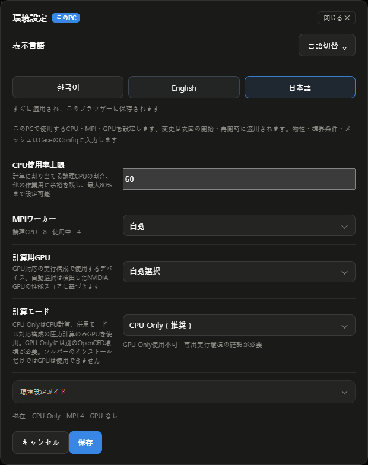

## LLM 에이전트

- **환경 설정 → LLM 에이전트 → 에이전트 안내**
- **안내 프롬프트 복사** 후 브라우저 조작 도구가 있는 에이전트에 전달
- 사용자가 보고 있는 Studio 탭에 연결하면 버튼 선택·Config 입력·Viewer 전환이 같은 화면에 표시
- **Alt + Shift + A**: 안내 열기·접기
- **명령 일시정지**: 이후 명령 차단 · 진행 중인 계산은 유지
- 형상·Config는 전용 JSON 명령으로 일괄 입력 · 반영된 3D와 입력값을 화면에서 확인
- 에이전트가 설정의 의미·변경사항을 설명한 뒤 사용자 확인을 받아 최종 저장 · 대기열 추가·계산 시작은 별도 확인
- 명령 전달과 저장·계산 완료는 별도 확인
- 최상단 가운데 **에이전트 조작 중** 표시 · 오른쪽 **에이전트 조작 중단**으로 명령 차단 및 일시정지 신호 전달
- **에이전트 조작 재개**로 대기 중인 에이전트에 재개 신호 전달 · 진행 중인 CFD 계산과 별개
- AI 에이전트 사용법: [한국어](CFD-STUDIO-AGENT-GUIDE.md) · [English](CFD-STUDIO-AGENT-GUIDE.en.md) · [日本語](CFD-STUDIO-AGENT-GUIDE.ja.md)

## CFD

- **화면 진입**: 상단 **CFD** 탭 클릭
- **기본 순서**: 새 프로젝트 → + CFD Case → 실행 저장 → 대기열에 추가 → 대기열 시작 → 생성 / 업데이트 → 열기


### 기존 프로젝트 등록

- **위치**: CFD 화면 왼쪽 상단 **프로젝트 찾기** 버튼
- **찾기**로 CFD Studio 프로젝트 폴더 선택 또는 전체 경로 입력 → **추가**
- `project.cfdproj`·필수 폴더·실행 목록·대기열 검증 후 프로젝트 목록에 등록
- 이미 등록된 폴더: 기존 프로젝트 선택. 중복 항목 생성 없음
- 동일 프로젝트가 다른 유효 경로에 등록된 경우: 등록 거부. **프로젝트 관리**에서 위치 변경
- 검증 실패: 대화상자에 오류 표시. 등록 목록과 기존 데이터 유지
- 가져온 대기열: 일시정지 상태. 실행하려면 **대기열 시작** 선택
- 프로젝트를 등록해도 CFD 계산은 자동으로 시작하지 않음

### 프로젝트 생성

- **위치**: 왼쪽 **프로젝트** 제목 아래 두 버튼 중 오른쪽 **새 프로젝트** 버튼
- 이름 입력 → **프로젝트 폴더** 옆 **찾기** 클릭 → 비어 있는 폴더 선택
- **CFD Template**: 사용할 해석 양식 선택
- **기본 프리셋 → 직접 입력 → Config 입력**: 빈 양식에 값 입력 → **저장**
- 저장된 값 사용: 해당 Template의 프리셋 선택 → 필요하면 **Config 입력**에서 수정
- 입력값 재사용: **프리셋에 저장** 체크 → 새 프리셋 이름 입력
- 창 하단 **저장** 클릭 → 왼쪽 목록에 프로젝트 표시
- 기존 프로젝트 사용: 왼쪽 목록에서 프로젝트 이름 클릭

- 선택할 Template이 없으면 선택란 오른쪽 **+** 클릭
- 프로젝트 창이 왼쪽으로 이동하고 오른쪽에 Template 생성 화면 표시
- 설문 작성 → 솔버 선택 → 양식 생성 → 이름 입력 → **Template 저장**
- 저장한 Template 자동 선택 · 프로젝트 이름·폴더·설명 유지
- 생성 취소 시 기존 Template·프리셋 선택 유지
- 좁은 화면에서는 Template 생성 화면을 중앙에 표시

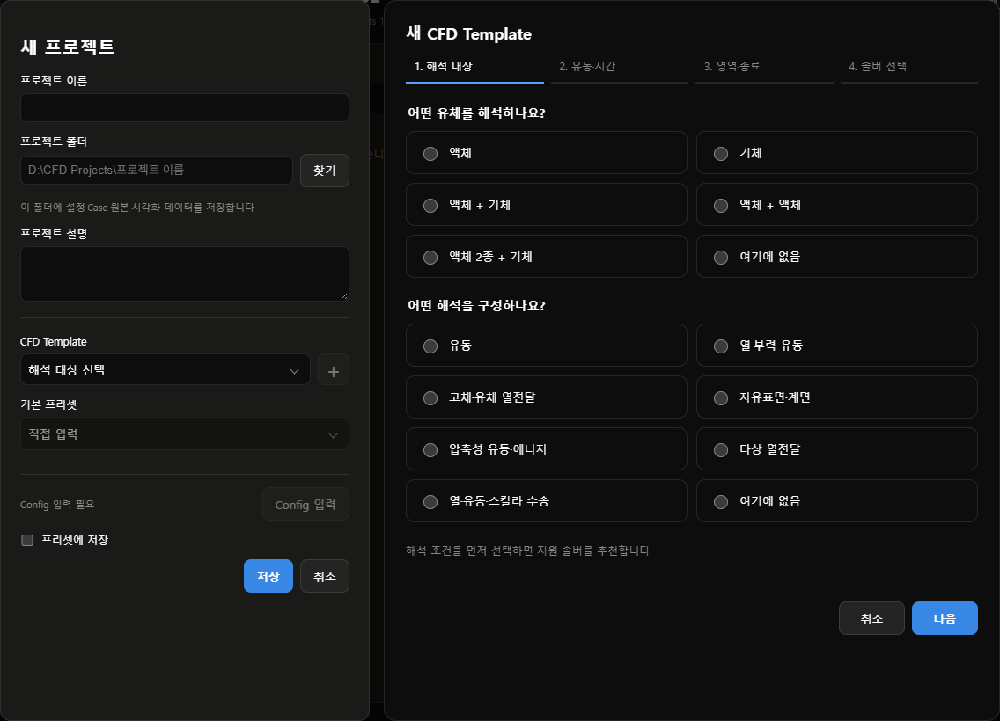
- **실행 연결 필요**로 표시된 Template은 프로젝트·입력값 저장 가능, CFD Case 실행은 별도 실행기 연결 필요

### 프로젝트 정보 및 저장 폴더 변경

- **위치**: CFD 화면에서 프로젝트 선택 → 오른쪽 상단 **프로젝트 관리**
- 이름·설명·기본 프리셋 변경 가능
- **프로젝트 폴더**에서 현재 경로 확인 · 변경 시 경로 직접 입력 → **저장**
- C·D 등 드라이브의 폴더 선택 가능
- 이동 처리: 복사·검증 → 연결 전환. 이전 원본 보존
- 계산·결과 저장 중에는 위치 변경 불가
- 백업: 프로젝트 폴더 전체 보관. 이전 형식의 외부 연결 결과는 해당 원본도 보관

### 하드웨어 사용률

- CFD 화면의 실행 목록·상세 정보 블록 위에 **CPU / 드라이브 / GPU**를 초록색 게이지 카드로 표시
- 컴퓨터 전체 사용량 기준 · C·D 등 로컬 고정 드라이브의 저장 용량 비율을 각각 표시
- GPU는 **GPU 0 / GPU 1** 등 장치별로 표시 · Windows에서 가장 바쁜 GPU 엔진의 사용률 기준
- 하드웨어는 CFD 상태 조회와 독립적으로 약 1초마다 갱신 · 측정 실패·오래된 값은 **—** 표시
- GPU 카드에 마우스를 올리면 장치 이름·활성 엔진·측정 기준 확인
- GPU 게이지 아래에 **VRAM 사용 용량 / 전체 용량** 표시 · GiB 기준, 1 GiB = 1,024 MiB
- 드라이브 게이지 아래에 **사용 용량 / 전체 용량** 표시 · GB 기준, 1 GB = 10억 바이트
- 없는 드라이브·GPU는 카드와 빈자리 모두 표시하지 않음
- 카드는 일정한 폭으로 왼쪽 정렬 · 창이 좁으면 다음 줄에 표시

### CFD Template

- Config 양식은 입력창 형태로 미리보기 제공 · `ex)` 예시는 저장값이 아님
- **경계조건 종류**: 속도·압력 등 경계값의 지정 방식 · 별도 다운로드 대상이 아님
- **JSON** 버튼으로 원문 확인 · **양식으로 돌아가기**로 복귀

- 왼쪽 **CFD Template 리스트 → +** 클릭
- **해석 대상**: 액체·기체·다상과 필요한 해석 선택 → **다음**
- **유동·시간**: 층류·난류, 정상·비정상 해석 선택 → **다음**
- **영역·종료**: 내부·외부 영역, 격자 준비 방식, 종료 조건 선택 → **솔버 추천**
- 추천 목록에서 기능·출력·제한 확인 → 솔버 하나 선택 → **양식 생성**
- **여기에 없음**: 해당 조건을 지원하는 등록 솔버·양식이 없음을 표시 · 지원하지 않는 항목 안내 후 추천·생성 중지 · 선택 수정 또는 취소 가능
- 맞는 솔버가 없으면 **선택한 조건**과 후보별 변경 필요 항목 확인
- 변경값이 해석 목적에 맞으면 **이 조건으로 다시 추천** → 솔버 선택
- 버튼을 누르기 전에는 기존 응답 유지 · 조건을 유지하려면 **이전** 또는 **취소**
- 액체+기체 등의 **유동**·**열·부력 유동**도 지원되는 다상 솔버에 연결
- **양식 확인** 화면에서 이름·설명 입력
- **양식 편집**에서 항목명·입력 형식·단위 확인 → **저장 → Template 저장**
- 조건 변경: **설문 수정** → 재선택 → **양식 생성** · 취소하면 기존 양식 유지
- 실제 물성·치수·초기값은 프로젝트 생성 시 입력
- 추천은 등록된 양식 지원 조건 기준 · 설치와 실행기 연결 여부는 별도
- 기존 Template의 솔버는 고정 · 다른 솔버가 필요하면 새 Template 생성
- 솔버 설명의 원작자·원본 소스 링크, **설치 확인**으로 추가 정보 확인
- 오른쪽 **JSON 가져오기 / JSON 내보내기**로 Template 정의 파일 편집

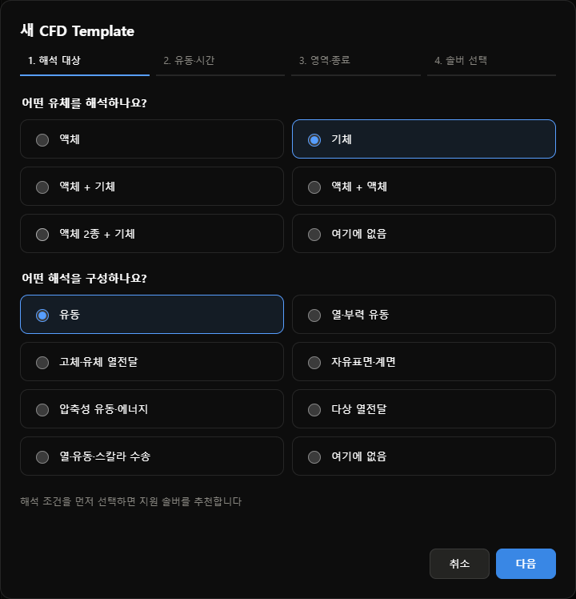

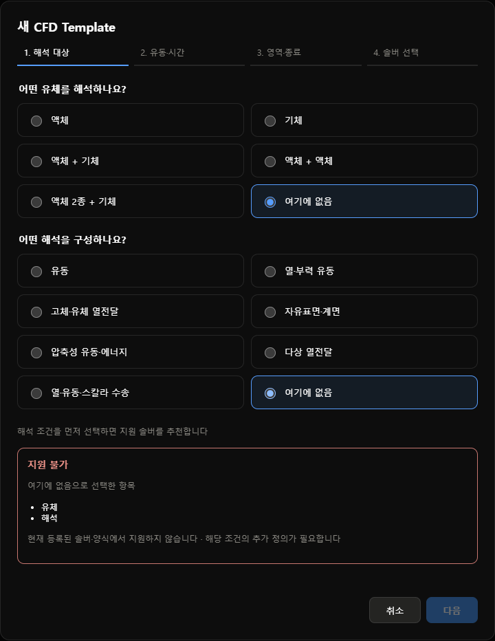

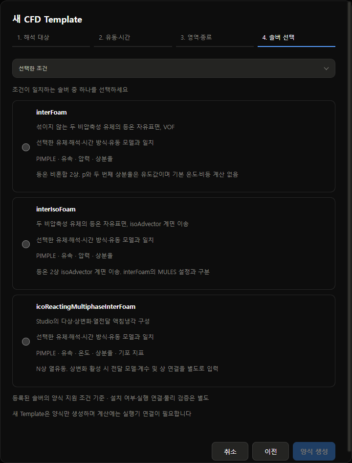

### Config 입력

- 왼쪽 목록에서 형상 요소 또는 Config 분류 선택 · 오른쪽 3D 형상은 계속 표시
- 왼쪽 분류에서 **재료 물성·초기 조건·경계조건·계산 방법** 등 선택
- 기본 화면: 필수 항목과 선택한 해석 조건에 필요한 항목부터 표시
- 항목명 오른쪽에 값 입력 · 단위는 입력칸 옆에 표시
- 속도 등의 **X·Y·Z**: 같은 줄에서 입력
- **전체 항목**: 선택 항목과 자동 설정값 확인 · 숨긴 값도 그대로 보존
- **입력 검사**: 누락 항목 확인 · 결과의 항목명을 누르면 해당 입력으로 이동
- **항목 추가**: 표시 이름·입력할 내용·단위 지정 → **추가**
- 입력 형식: **숫자 / 정수 / 문자 / 사용 여부 / 목록 / 항목 묶음** · 선택 시 예시 표시
- **구조 편집**: JSON 키·입력 형식·단위 수정 · 프로젝트 값 입력 화면에는 표시하지 않음
- 오른쪽 **JSON**: 전체 정의 또는 입력값 편집
- **저장**: 상위 화면에 반영 · 상위 화면에서 프로젝트 또는 Template 저장
- 자동 설정: 설문에서 선택한 솔버·계산 방식·고정 단위 유지
- 선택 항목: 기존 프리셋 값 유지 · 미입력 물성·경계조건·시간간격은 임의로 채우지 않음
- 화면 예시의 수치는 조작 설명용이며 솔버 기본값이 아님

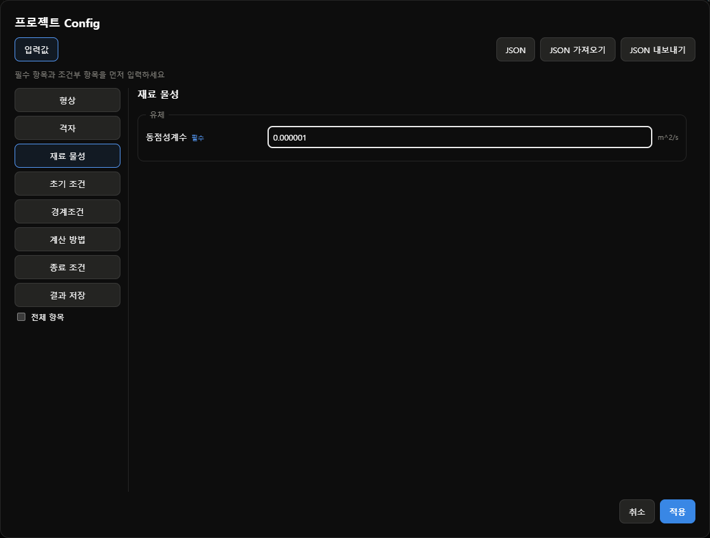

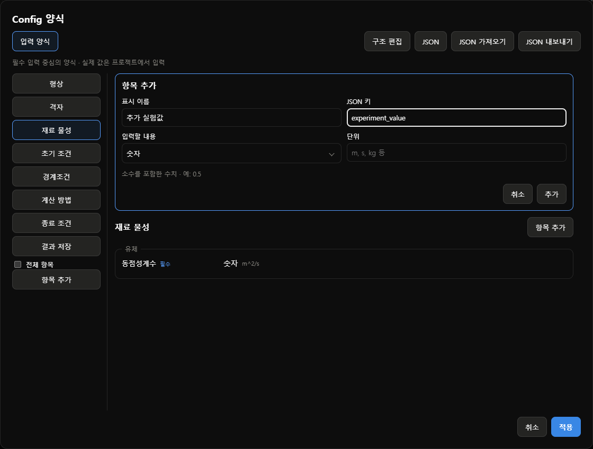

### 형상과 요소 속성

- Template 구성: **솔버 + Config 양식 + 초기 형상**
- **양식 편집**: 초기 형상 입력 → **저장 → Template 저장**
- **새 프로젝트 → Config 입력**: 초기 형상 사본과 개별 입력값 편집
- 오른쪽 **네임태그** 또는 왼쪽 **형상 및 계산 영역** 목록에서 파츠 선택
- **영역 역할**: 원하는 역할 이름 직접 입력
- 선택한 파츠에서 **물질 상태 → 고체 / 액체 / 기체** 선택
- **변환**: 위치 X·Y·Z와 Scale 입력 · 실제 좌표·치수와 3D 형상에 반영
- **물성 및 초기 조건**: 상태와 솔버에 맞는 기본 입력 제공 · 기존 물성표가 있으면 그대로 사용
- **상변화**: 해당 상태의 모델이 정의된 솔버에서 선택 · 상간 전달 모델·계수·상 연결은 별도 입력
- 빨간색 **필수**만 표시 · 조건부·선택·자동 설정 배지는 표시하지 않음
- 온도표 등 목록: 항목별 입력칸에 값 입력 · 오른쪽 **+**로 추가, 각 행 **−**로 삭제 · 40개 초과 시 페이지 이동
- **+ 속성**: 물질 상태·솔버·상변화 선택으로 필터링된 속성 종류 선택 또는 직접 정의 → 이름·키·입력 형식·단위 지정 → **속성 추가**
- Template에는 속성 양식 저장 · 프로젝트·Case에서 실제 값 입력 · 추가 속성 오른쪽 **−**로 제거
- 사용자 추가 속성의 이름 **더블클릭** → 이름 입력 → **Enter** 또는 다른 곳 클릭으로 반영 · **Esc**로 취소
- 기본 항목에는 이름 변경·정의 수정 기능 없음 · 사용자 추가 속성의 중복 JSON 키는 저장 불가
- 기본 항목 이름·자료형·단위는 Template 정의 유지 · 입력값은 해당 입력칸에서 직접 변경
- 편집을 적용한 뒤 Config의 **저장** 선택 · 다시 열기와 JSON 가져오기에서도 표시 이름 유지
- 실행 기록의 Config는 읽기 전용 · 변경하려면 **이 Config로 새 Case** 선택


- 사용자 속성의 계산 적용에는 솔버 입력 연결 필요 · 역할 이름만으로 계산 모델이 자동 변경되지 않음
- 기존 액체층은 각 재료 이름으로 선택 · **영역 높이** 변경 시 공통 경계와 상대층 높이 함께 변경
- 네임태그는 3D 화면 좌우에 배치 · 연결선으로 해당 오브젝트 표시 · 회전·확대 시 함께 갱신
- 선택한 요소의 이름·영역 역할·치수·좌표를 왼쪽에서 수정 · 3D 형상 자동 갱신
- **+ 요소**: 직육면체 추가 → **기하 형상**에서 직육면체·구·원기둥 선택 → 치수 입력
- **요소 삭제**: 편집 중인 사본에서 해당 요소 제거 · **취소**하면 원본 유지
- 선택한 요소 제목 오른쪽 **JSON**: 형상 종류·단위·좌표·치수를 직접 입력
- JSON 창 오른쪽 상단 **기본 형상 예시 → 직육면체 / 구 / 원기둥**: 입력 구조 생성 · 빈 치수는 직접 입력
- **JSON 저장**: 형상 검사 후 미리보기 갱신 · Config 또는 Template의 **저장**으로 확정
- 일반 형상에는 `liquid_height_mm` 불필요 · `name`은 표시 이름이며 형상 종류를 결정하지 않음
- 기존 전용 형상은 현재 치수를 명시적인 형상 JSON으로 변환해 표시 · 원본은 저장 전까지 유지
- 기존 직육면체 실행기에 구·원기둥을 지정하면 실행용 Config 저장 차단 · 일반 Template의 형상 정의와 실제 실행 지원 범위는 별도

- 기존에 연결된 물성·초기조건·열원은 해당 요소의 입력란에서 편집 · 수동 연결 선택 UI 없음
- 전압·전기전도도·접촉 열저항·공극률 등은 **+ 속성**에서 추가 · 직접 정의도 가능
- 상위 형상에 종속된 좌표는 조회 전용 · 액체층은 **영역 높이**, 수조는 치수 입력으로 변경
- 구의 Scale은 모든 축, 원기둥의 반지름 Scale은 두 축이 함께 변경
- 형상 이외의 설정은 왼쪽 **재료 물성·물리 모델·초기 조건·경계조건·계산 방법·결과 저장** 등에서 편집
- 프로젝트에서 수정해도 원본 Template·다른 프로젝트·기존 Case 스냅샷은 유지
- **저장** 후 상위 프로젝트 창에서 **저장**
- 아래 화면은 기능 설명용 예시이며 실제 계산 결과가 아님

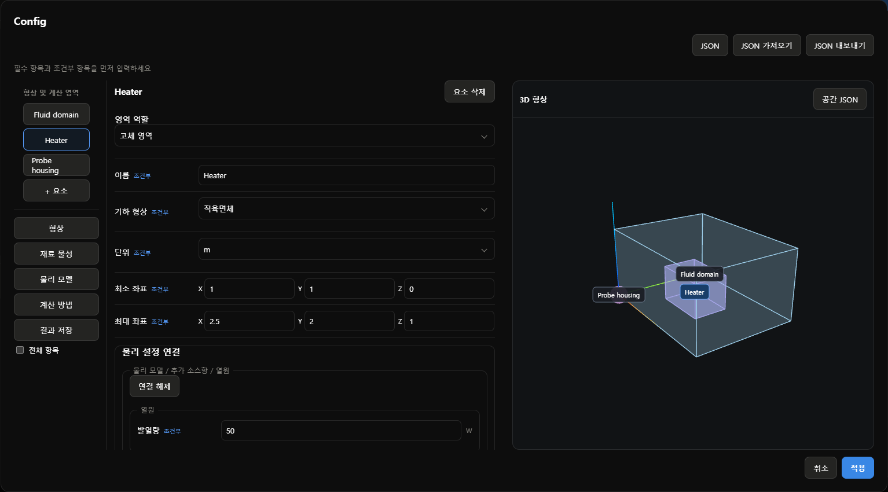

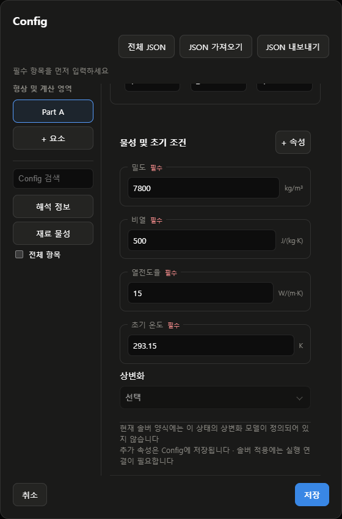

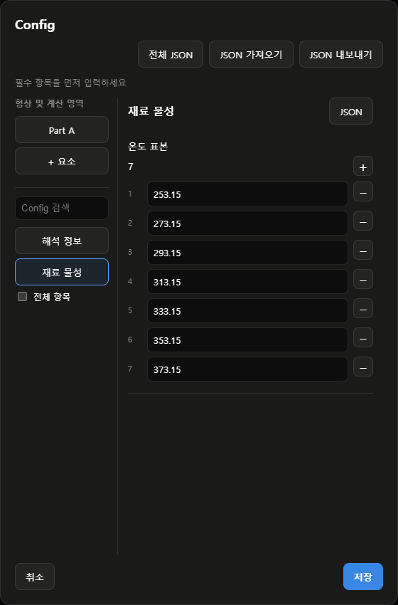

### 이름과 공간 채움

- 형상 선택 → 맨 위 **이름** 입력 → 아래 **영역 역할·물질 상태** 입력
- 고체에 빈 공간이 필요한 경우 **내부 공간 정의** → 좌표·치수 입력
- 액체·기체 선택 → **공간 채움**에서 **기준 공간** 선택
- **채움 방향**, **단위**, **채움 시작·끝** 입력 → **채움 적용**
- 시작·끝은 선택한 축의 내부 공간 최솟값을 0으로 한 거리
- 적용하면 형상과 JSON 자동 갱신 · **저장**으로 완료
- 직육면체 공간은 X·Y·Z 방향 선택 · 원기둥은 중심축 방향으로 채움
- 내부 공간 밖 범위·다른 유체와의 겹침은 수정 후 적용
- 기존 이중액침은 연속된 두 유체층으로 구성 · 층 경계 변경 시 인접층과 실행 입력 함께 갱신

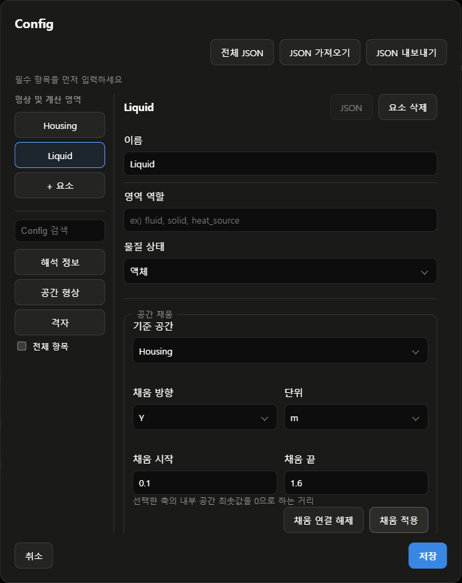

### 기본 격자와 국부 격자

- 왼쪽 **격자** → **기본 격자**에서 전체 계산의 간격 입력
- **국부 격자 → + 영역** 또는 목록 위 **+** 클릭
- 영역 이름·단위·최소 좌표·최대 좌표·국부 격자 크기 입력
- 국부 간격은 기본 간격보다 작은 양수로 지정 · 계산 영역 안의 직육면체 영역 사용
- 이중액침·정렬된 적재물 저장고 격자 생성기에 연결
- 연결면을 맞추기 위해 선택 범위와 겹치는 주변 축 방향 구간도 세분화
- 저장고의 **전체 세분화 배율**은 기본 간격과 국부 간격 모두에 적용
- 설정 저장은 기존 결과의 격자를 바꾸지 않음 · 새 Case 계산에서 반영
- 일반 솔버 Template은 정의 저장 지원 · 실제 적용에는 해당 격자 생성기 연결 필요

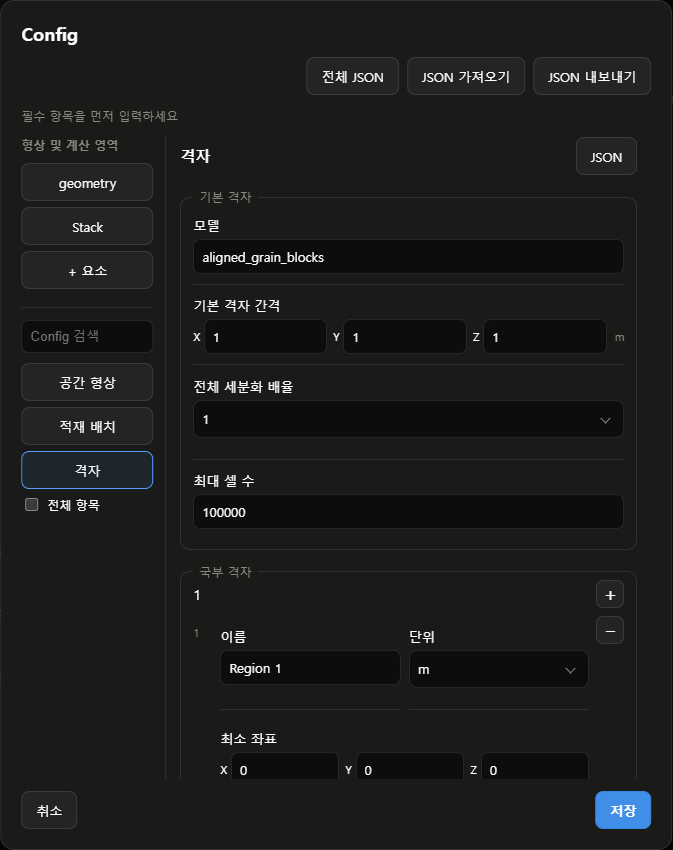

### 컴포넌트 물성 입력

- **형상 및 계산 영역**에서 액체 요소 또는 3D 네임태그 선택
- 해당 요소의 **증기 물성**, **상변화**에서 값 입력 · 기존 이중액침 양식은 유전액 영역에 표시
- 종료 조건·격자·결과 저장·측정 위치·실험 조건은 공통 분류에서 입력
- **온도별 물성**: 왼쪽 열에 절대온도(K), 오른쪽 열에 물성값 입력
- 표 위 **+**: 온도와 물성값의 행을 함께 추가 · 행 오른쪽 **−**: 해당 행 삭제
- **측정 위치**의 **+**: 빈 X·Y·Z 입력칸을 가진 측정 지점 추가
- 각 지점의 **X·Y·Z** 입력 · 오른쪽 **−**로 해당 지점 삭제
- 빈 항목 묶음: **항목 추가** → 이름·입력 형식·단위 지정 → 값 입력
- 솔버 양식에 모델 후보가 있으면 **모델** 드롭다운에서 선택

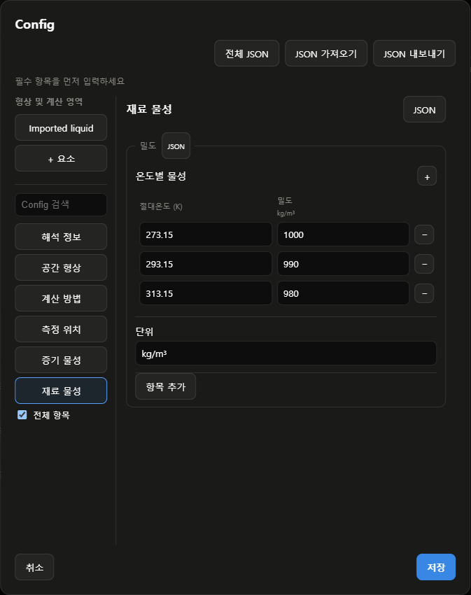

- 화면의 수치는 입력 형식 설명용 예시

### 외부 JSON 가져오기

- Config 상단 **JSON 가져오기** → `.json` 파일 선택
- 지원 입력: Config 객체, Studio 필드 정의, `config`와 `config_schema` 또는 `input_schema`를 포함한 파일
- 물성표는 행 입력, 좌표는 X·Y·Z, 중첩 객체는 항목 묶음으로 표시
- 선언된 자료형과 선택지 유지 · 자료형이 없는 `null`은 **입력 형식 선택** 후 입력
- 가져오기는 현재 초안을 교체 · **저장** 전에는 원본 프로젝트·프리셋에 반영되지 않음
- 읽기 실패 시 기존 초안 유지 · 사용자 이름·JSON 키·입력값은 번역하지 않음
- 어느 형상에 속하는지 정의되지 않은 물성은 공통 항목에 유지 · 임의 배정하지 않음

### JSON 편집

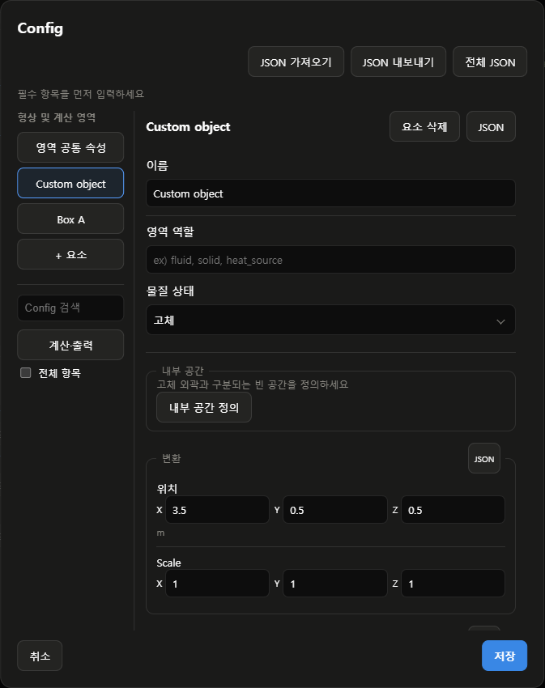

- 화면 예시: 사용자 정의 형상과 분류별 JSON 버튼

- Template·프로젝트·Case Config에 동일한 편집 화면 사용
- 왼쪽 독립 블록: Config 항목과 요소 속성
- 오른쪽 큰 독립 블록: 3D 형상과 네임태그 · Template·프로젝트·Case에 동일하게 적용
- 분류나 네임태그를 선택해도 왼쪽 목록의 스크롤 위치 유지
- 3D 형상 제목 옆 **JSON**: 전체 공간 정의 표시 · 형상·격자·경계 및 계면·관측 위치로 구분
- **JSON**은 큰 분류와 선택한 요소에 제공 · 개별 숫자·좌표·배열·속성에는 버튼 없음
- **공간 형상**: 종류·좌표·치수 / **변환**: 위치·Scale·단위 / **물리 속성**: 해당 분류의 물성
- **물성 및 초기 조건**: 사용자 추가 속성 묶음 / 요소 제목 옆 **JSON**: 선택한 요소 전체
- 적재 블록을 포함한 영역의 위치·크기는 **형상 및 계산 영역**에서 편집
- **영역 공통 속성**: 같은 목록에 속한 영역이 공유하는 입력값
- **+ 요소**: 선택한 요소의 목록에 추가 · 새 일반 영역은 공간 정의 목록에서 관리
- 공간 채움으로 결정되는 형상 JSON은 조회 전용 · 변경은 **공간 채움**에서 입력
- **전체 JSON**: 전체 Config 표시 · Template 양식에서는 필드 정의 표시
- JSON을 열면 기존 입력창과 3D 영역의 폭을 유지하며 왼쪽으로 이동 · 오른쪽에 독립된 큰 JSON 블록 표시
- **JSON 저장**: 문법·자료형 확인 후 현재 초안에 반영 · 3D 형상 자동 갱신
- JSON 수정 중에는 왼쪽 입력을 잠금 · **취소**하면 JSON 수정분 폐기
- Case는 **실행 저장**으로 최종 저장 · Template·프로젝트는 Config의 **저장** 후 상위 창에서도 **저장**
- 시작한 Case는 입력창·JSON 모두 조회 전용 · **이 Config로 새 Case**로 사본 수정
- 외부 CAD·가져온 격자의 렌더링은 별도 지원 필요

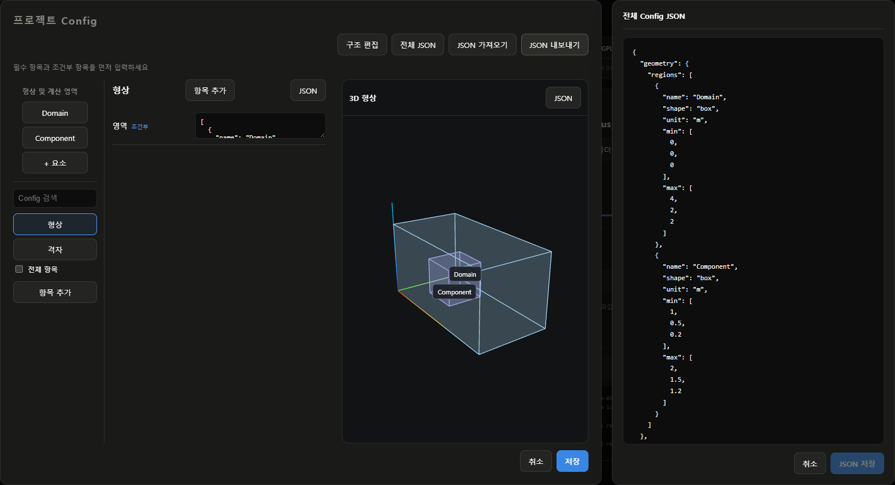

### 형상 및 격자 파일 저장

- 직접 정의한 형상은 파일 경로 입력 불필요
- Template 저장: Studio 설치 폴더의 `_runtime/executions/Templates/<Template ID>` 내부에 정의 파일 자동 생성
- 프로젝트 저장: 프로젝트 폴더의 `Assets/Definitions` 내부에 자동 생성
- Case 저장: 프로젝트의 `Cases/<Case ID>/Assets/Definitions` 내부에 자동 생성
- 항목별 JSON·전체 Config·형상·격자 설정을 같은 버전에 보관 · 이전 버전 유지
- 생성되는 격자 설정 JSON은 계산용 격자 파일이 아님 · 실제 격자는 연결된 실행기의 격자 생성 단계에서 생성
- **기존 격자**를 가져오는 경우 실제 원본 필요 · 빈 격자 파일을 자동 생성하지 않음

### 프로젝트 Config

- **새 프로젝트 → CFD Template** 선택
- 빈 양식 사용: **기본 프리셋 → 직접 입력 → Config 입력**
- 저장된 값 사용: 해당 Template의 프리셋 선택 → 필요 시 **Config 입력**에서 수정
- Config 창에서 값 입력 → **저장** → 프로젝트 창에서 **저장**
- **프리셋에 저장** 체크 → 새 프리셋 이름 입력 시 해당 Template에 별도 저장
- 체크박스 기본값은 해제 · 기존 프리셋은 덮어쓰지 않음
- 프로젝트 Config는 이후 새 Case의 시작값 · Case별 수정과 실행 스냅샷은 독립
- 기존 Template의 입력값은 **기존 입력값** 프리셋으로 유지

### CFD Case 생성 및 Config 입력

- **위치**: 프로젝트 화면 오른쪽 상단 파란 **+ CFD Case** 버튼
- **Case 이름**에 구분하기 쉬운 이름 입력
- 열린 창 왼쪽에서 Config 항목 선택·값 입력 → 가운데 3D 형상 확인
- 숫자 입력란은 문자 입력·붙여넣기를 차단. 정수 입력란은 소수 입력도 차단
- 빈 필수값·미완성 숫자·범위 밖 값·잘못된 JSON은 저장·조회 불가. 입력란 안내에 따라 수정
- **종료 조건·목표**에서 종료 방식 선택
- Case의 종료값은 이 화면에서만 입력 · 계산·출력의 중복 종료시간·종료 방식은 표시하지 않음
- 계산·출력에는 계산 시간간격·저장 간격·출력 항목 유지 · 저장 시 종료값을 솔버 입력에 반영

| 선택 항목 | 입력할 값 |
|---|---|
| 특정 물리시간 | **목표 물리시간 (s)** 입력 |
| 저장 프레임 수 | **목표 저장 프레임 수** 입력, **0초 초기 프레임 포함** 여부 확인 |
| 수렴 기준 | 현재 선택 불가 |

- 창 하단 파란 **실행 저장** 클릭 → 실행 목록에 Case 추가
- **실행 저장은 입력 보관 단계**. 계산은 **대기열 구성 및 CFD 실행**에서 시작
- 조건을 달리한 계산 추가: **+ CFD Case**를 다시 클릭

### 프리셋 저장 및 불러오기

- **위치**: Case의 Config 편집창 상단 **프리셋에 저장** 체크박스
- 이 Case에만 적용: 체크 해제 상태로 **실행 저장**
- 새 프리셋 저장: 체크 → 나타난 이름 칸에 새 프리셋 이름 입력 → **실행 저장**
- 기존 프리셋 불러오기: 편집창 상단 **프리셋 불러오기** 선택 상자에서 항목 선택 → **불러오기**
- 프로젝트 기본값 변경: 프로젝트 오른쪽 상단 **프로젝트 관리 → 기본 프리셋**
- 변경한 기본값은 이후 추가하는 Case에 적용. 기존 Case의 입력은 유지

### 대기열 구성 및 CFD 실행

- **위치**: 가운데 **실행 목록**에서 Case 이름 클릭
- 오른쪽 상세 영역의 **대기열에 추가** 클릭
- 화면 하단에 나타난 **대기열** 영역에서 파란 **대기열 시작** 클릭
- 선택한 Case 상태가 **계산 중**으로 바뀌는지 확인
- 오른쪽 **솔버 로그**에서 진행 내용 확인 · 항상 표시

| 버튼 | 위치 | 동작 |
|---|---|---|
| ↑ / ↓ | 대기열의 각 Case 행 | 아직 시작하지 않은 Case 순서 변경 |
| 제외 | 대기열의 각 Case 행 | 대기열에서 제거, Case 자체는 보존 |
| 다음 실행부터 일시정지 | 대기열 제목 아래 | 현재 Case를 계속 계산하고 다음 Case부터 정지 |
| 실행 중단 | 실행 중 Case의 오른쪽 상세 영역 | 선택한 현재 계산 중단 |
| 다시하기 | 실패·중단 Case의 상세 영역 | 기존 기록을 보존하고 새 실행 기록으로 처음부터 계산 |
| 이어하기 | 중단 Case의 상세 영역 | 완전한 재시작 저장 지점 확인 후 재개 |
| 실패 사유 및 복구 / 건너뛰기 | 실패 시 대기열 영역 | 원인과 오류 기록 확인 또는 다음 Case로 진행 준비 |

- 여러 Case: 각 Case를 **대기열에 추가**한 뒤 **대기열 시작** 클릭
- 실패 처리 후: 원인 확인 → **다시하기 / 이어하기 / 건너뛰기** → **대기열 시작**
- Config 검증 실패: **Config 보기 → 이 Config로 새 Case**에서 입력 수정
- 재시작 데이터가 없거나 실행기가 재개를 지원하지 않으면 **이어하기** 비활성화 및 사유 표시
- 저장고 실행기: 현재 저장 지점 재개 미지원. **다시하기**로 새 실행 기록에서 계산
- 재개 가능 여부: 양수 저장 시점, 필수 원본장, 실행 ID 및 실행 방식 확인. 실제 재개 전 원본 별도 보존
- 앱 재시작 후: 대기열 확인 → 필요할 때 **대기열 시작**

### 실행 Config 조회 및 비교

- **위치**: CFD 화면의 실행 목록에서 Case 선택 → 오른쪽 상세 영역
- 계산 전: **Config 편집** 클릭 → 값 수정 → **실행 저장**
- 시작한 Case: **Config 보기** 클릭 → 실행 당시 입력 조회
- 동일 입력으로 새 Case 생성: **Config 보기 → 이 Config로 새 Case**
- 입력 항목 찾기: Config 창 왼쪽 **Config 검색**에 항목명 입력
- 입력값 비교: 오른쪽 상세 영역의 **Config 차이**에서 확인 · 항상 표시
- **Config 차이**와 **솔버 로그**는 Case 선택 시 접힘 없이 표시
- 비교 기준: 해당 Case 생성 시 저장한 기준 Config
- 긴 차이 목록·로그는 각 영역 안에서 스크롤

### 결과 생성 및 Viewer 열기

- **위치**: 실행 목록에서 Case 선택 → 오른쪽 파란 결과 버튼
- 같은 위치의 버튼 이름이 결과 상태에 따라 변경됨

| 버튼 이름 | 기능 |
|---|---|
| 생성 | 저장된 계산 결과를 시각화용으로 준비 |
| 업데이트 | 기존 결과에 새 데이터를 반영 |
| 열기 | 준비된 결과를 Viewer에서 표시 |

- **생성 / 업데이트** 완료 후 **열기** 클릭
- 회색 결과 버튼: 변환하거나 열 결과가 있는지 **실행 상태·솔버 로그** 확인
- 원본 확인: 같은 상세 영역의 **결과 폴더** 클릭

### 전체 CSV 내보내기

- **위치**: CFD → 실행 목록에서 Case 선택 → 오른쪽 상세 영역의 **전체 CSV**
- **전체 CSV** 클릭 → 생성 완료 후 ZIP 다운로드
- `time_series.csv`: 모든 저장 시점의 결과 항목·통계값·단위
- `fields/`: 저장된 공간 데이터 전체. 시점·셀 인덱스·좌표·물리량 포함. 기포 파일은 저장된 셀 인덱스와 값 포함
- `manifest.json`: Case·적용 Config·파일별 행 수·저장 단위 안내
- 그래프 선택 항목·화면 표시 밀도·읽어온 구간과 무관하게 내보내기
- 공간 CSV는 저장된 배열 기준. 시각화 격자로 저장한 Case는 해당 격자를 내보내며, 저장되지 않은 원본 셀을 복원하지 않음
- 손상된 파일이나 생성 중 변경된 결과가 있으면 오류 표시. 일부 데이터만 포함한 파일을 완료로 제공하지 않음

## Viewer

- **화면 진입**: 상단 **Viewer** 탭 또는 CFD 화면에서 Case의 **열기** 버튼 클릭
- **기본 순서**: 프로젝트 선택 → CFD Case 선택 → 시각화율 확인 → 3D 또는 그래프 조회 → 내보내기

- 왼쪽 **3D Virtual** · 오른쪽 **Data Sheet**
- 클릭 시 선택 테두리가 해당 버튼으로 이동


### 프로젝트 및 CFD Case 선택

- **진입**: 화면 상단 **Viewer** 탭. CFD 화면에서는 Case의 **열기** 버튼으로 진입
- **위치**: 왼쪽 프로젝트 목록 → 아래 **CFD Case** 목록
- 프로젝트 이름 클릭 → 조회할 Case 이름 클릭
- 선택한 Case: 파란 테두리로 표시. 3D·그래프 모두 선택한 Case의 결과 표시
- 다른 Case 비교: 같은 목록에서 다른 Case 선택. 한 번에 한 Case 표시
- 계산 화면 복귀: 화면 상단 **CFD** 탭 클릭

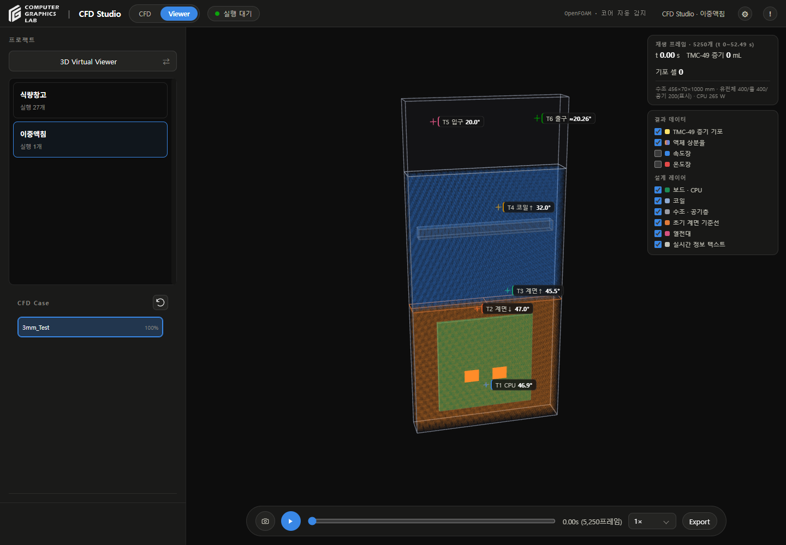

- 사진: 이중액침 결과 예시. 왼쪽 하단에 **CFD Case** 목록 표시. 모드 선택은 현재 **3D Virtual / Data Sheet** 버튼 사용

### 데이터 시각화율 확인 및 업데이트

- **위치**: 왼쪽 **CFD Case** 목록의 각 항목 안 게이지
- 프로젝트 선택 시 표시되는 게이지로 현재 시각화 준비 상태 확인
- 갱신: **CFD Case** 제목 오른쪽 둥근 사각형의 **원형 화살표** 클릭. 포인터를 올리면 **다시 읽기** 표시
- 프로젝트 내 Case들의 준비 상태 확인 및 선택한 Case의 결과 다시 읽기
- **100%**: 시각화 준비 완료. CFD 계산 진행률·수렴·실험 검증과 별도
- 새로운 원본의 변환이 필요한 경우: **CFD** 탭 → Case 선택 → **생성 / 업데이트** → 준비 완료 후 **열기**

### 3D Virtual Viewer 조작

- **위치**: Viewer 중앙 3D 화면과 아래 재생 바
- 왼쪽 상단 **3D Virtual** 버튼 클릭 → 3D 화면 표시
- 선택한 모드는 파란 테두리·배경으로 표시. 활성 버튼을 다시 눌러도 모드 유지

| 조작 | 위치 | 동작 |
|---|---|---|
| ▶ / 일시정지 | 화면 하단 재생 바의 파란 버튼 | 저장 결과 재생·정지 |
| 시간 막대 | 재생 버튼 오른쪽 | 재생 시간에 따라 연속 이동 · 드래그로 조회 시점 선택 |
| 1× | 재생 바 오른쪽 선택 상자 | 재생 배속 변경 |
| 결과 데이터 체크박스 | 화면 오른쪽 | 온도·유속 등 표시할 물리량 선택 |
| 설계 레이어 체크박스 | 화면 오른쪽 | 형상·단면 표시 선택 |
| 드래그 / 휠 / 더블클릭 | 3D 화면 | 회전 / 확대·축소 / 기본 시점 복원 |

- 시간 표시: **0.00s (전체 프레임 수)**
- 표시 가능한 물리량은 선택한 Case의 저장 데이터에 따라 달라짐
- 속도 벡터 표시 밀도 변경: 오른쪽 결과 패널 맨 위 **표시 밀도**에서 **표준 / 세밀 / 매우 세밀** 선택. 이중액침·저장고에 공통 적용

- 저장 간격이 길어도 재생바는 시간에 따라 이동 · 일시정지 후 같은 시점에서 재개
- [결과 데이터별 표시 방식](VIEWER-DATA.md)

### Data Sheet Viewer 전환 및 수치 조회

- **위치**: Viewer 왼쪽 상단 두 버튼 중 **Data Sheet**
- **Data Sheet** 클릭 → 그래프 화면 표시. 선택한 버튼에 파란 테두리·배경 표시

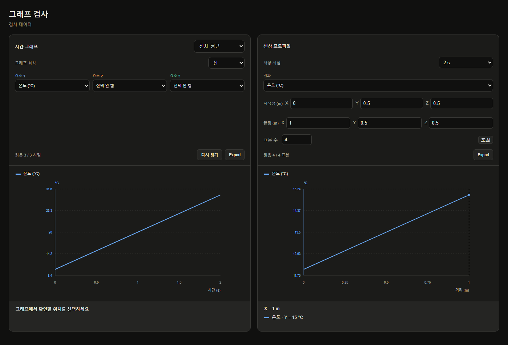

- 화면 예시: 기능 설명용 데이터

#### 시간 그래프

- 왼쪽 **시간 그래프** 제목 오른쪽에서 **전체 평균 / 특정 좌표** 선택
- **전체 평균**: 저장된 전체 유효 셀의 산술 평균을 시간별로 표시
- **특정 좌표**: **X·Y·Z** 좌표(m) 입력 → **조회** → 최근접 저장 셀의 시간별 값 표시
- 입력란의 **최소값 ~ 최대값** 확인, 영역 밖 좌표는 조회 불가
- **그래프 형식**: **선 / 막대 / 산점도** 선택
- **요소 1 / 2 / 3**: 최대 3개 물리량 선택, **선택 안 함**으로 추가 요소 해제
- 서로 다른 단위는 별도 Y축, 같은 단위는 같은 눈금 사용
- 정상 해석은 시간 대신 반복 횟수 표시

#### 선상 프로파일

- 오른쪽 **선상 프로파일**에서 **결과**와 **저장 시점** 선택
- **시작점 / 끝점**에 X·Y·Z 좌표(m) 입력
- **표본 수** 지정 → **조회**
- X축: 시작점부터의 거리(m), Y축: 선택한 물리량
- 기본 64개, 2~256개 지점에서 최근접 저장 셀 조회
- 표본 수 증가는 계산 격자의 해상도를 높이지 않음
- **Export → CSV 데이터**: 거리·값·저장 시점·입력 좌표·실제 셀 중심·셀까지 거리 저장
- **Export → PNG 이미지**: 표시 중인 그래프 저장

#### 그래프 조작

- 두 그래프의 항목·X·Y 조회 위치·PNG·CSV 내보내기는 독립적으로 조작
- 나란히 배치된 두 배경 패널의 높이와 그래프·상세값 시작 위치는 동일
- 화면 폭이 좁으면 두 그래프를 세로로 배치
- 그래프의 원하는 위치 클릭 → 세로 점선·정확한 X와 Y 확인
- 연속 조회: 그래프를 마우스 왼쪽 버튼으로 드래그하거나 그래프에 초점을 둔 뒤 **← / →** 누르기
- 일반 화면 문구는 텍스트 선택 방지. Config 입력값·조회값과 Viewer 하단 상세 수치는 선택·복사 가능
- 배경 패널은 열 전체 폭 사용. 내부 그래프만 가로 폭 80%로 표시하고 하단 상세값과 여백 확보
- 전체 저장 구간을 조회하려면 시간 그래프 위 **전체 구간 읽기** 클릭
- 읽는 중에는 **읽기 중지**, 모두 읽은 뒤에는 **다시 읽기**로 버튼명 변경
- 그래프 위 버튼은 해당 그래프 데이터를 읽고, 왼쪽 **CFD Case** 제목의 원형 화살표는 Case 결과 연결과 준비 상태를 갱신
- 그래프 저장: 각 그래프 상단 **Export** → **PNG 이미지 / CSV 데이터**
- 3D 화면 전환: 왼쪽 상단 **3D Virtual** 버튼 클릭
- 좌표 변경 시 이전 그래프를 비움. 새 좌표 입력 후 **조회** 클릭
- 프로젝트·CFD Case 이름: Data Sheet와 3D Virtual 화면 왼쪽 상단에 표시
- Data Sheet Viewer에는 재생 버튼 없음. 그래프에서 저장 시점을 직접 선택

### 영상·이미지·CSV 내보내기

| 모드 | Export 위치 | 저장 형식 |
|---|---|---|
| 3D Virtual | 하단 재생 바 오른쪽 끝 | 영상, 현재 3D 화면 PNG |
| Data Sheet | 각 그래프 상단 | 해당 그래프 PNG, CSV |

- **3D Virtual → Export → 영상 내보내기**: 선택한 형식으로 재생·녹화. 조기 종료는 재생 바의 **녹화 종료**
- **3D Virtual → Export → 현재 화면 PNG**: 현재 카메라·레이어·시점의 이미지 저장
- **Data Sheet → 시간 그래프 또는 선상 프로파일의 Export → PNG 이미지**: 현재 그래프의 제목·단위·축·곡선·선택한 X·Y 위치 저장
- **Data Sheet → 해당 그래프의 Export → CSV 데이터**: 해당 그래프에 읽어온 구간의 수치 저장
- Export 창을 연 시점의 그래프와 데이터를 기준으로 저장
- 시간 그래프의 전체 저장 구간이 필요한 경우 **전체 구간 읽기** 완료 후 Export


## 관련 문서

- [설명서](CFD-STUDIO-MANUAL.md)
- [CFD Template](template-inputs.md)
- [필수 프로그램과 설치 순서](../cfd_studio/README.md)


### 기본 형상 JSON

- 직육면체: `shape`, `unit`, `min`, `max`
- 구: `shape`, `unit`, `center`, `radius`
- 원기둥: `shape`, `unit`, `center`, `radius`, `height`, `axis`
- 좌표 배열 순서: X·Y·Z · 단위: m·cm·mm
- 아래 예시는 기존 456 × 800 × 70 mm 영역의 명시적 정의 · Y가 높이 방향

```json
{
  "name": "tank",
  "shape": "box",
  "unit": "mm",
  "min": [0, 0, 0],
  "max": [456, 800, 70]
}
```

- 이름·치수는 해석 대상에 맞게 변경 · 액체 영역이라는 의미는 이 형상 JSON에 포함되지 않음
- 물질 상태와 물성은 **물질 상태**, **물성 및 초기 조건**에서 별도 지정
- 기본 형상 미리보기는 계산 격자 생성 결과가 아님

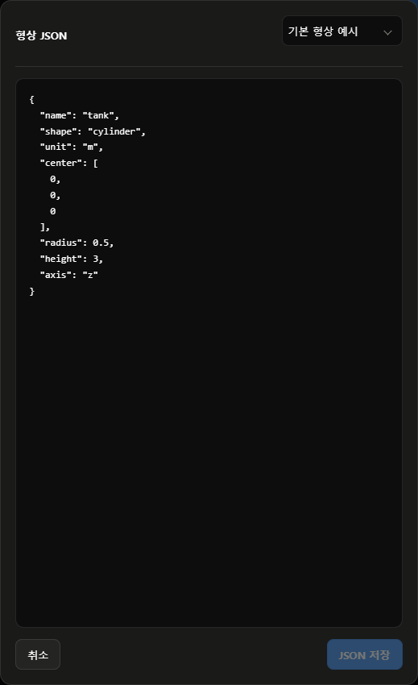
