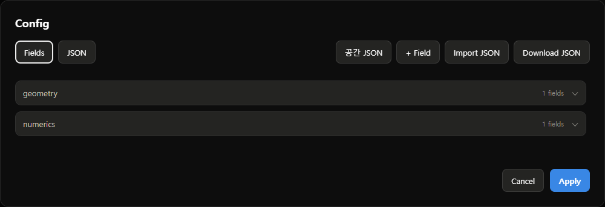
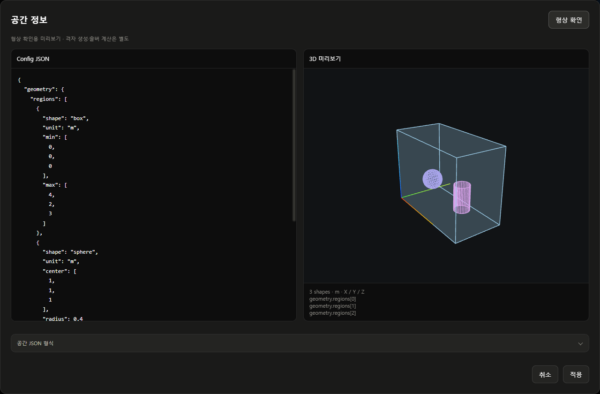

# 사용법

- **CFD**: 프로젝트·CFD Template·Config 관리, 계산 실행, 결과 준비
- **Viewer**: Case 선택, 데이터 시각화율 확인, 3D·그래프 조회, 내보내기
- 프로젝트: 여러 Case를 묶어 보관하는 공간
- CFD Case: 입력값과 결과를 독립적으로 보관하는 계산 단위

## 설치 및 프로그램 실행

- **지원 운영체제: Windows 10/11 x64**
- **macOS(Mac) 미지원** · 현재 배포판은 Windows 실행 환경과 WSL2를 사용

- 최초 설치: [설치 안내](../cfd_studio/README.md)에 따라 `설치.bat` 실행
- 설치 완료 후 실행: `cfd_studio/실행.bat` 더블클릭
- 열린 브라우저 상단 **CFD** 탭 선택

## 언어변환

- 화면 오른쪽 상단 **환경 설정** 버튼 클릭
- 창 위쪽 **언어변환** 클릭 → **한국어 / English / 日本語** 선택
- 선택한 언어는 즉시 적용되며 파란 테두리로 표시
- 별도 저장 버튼을 누르지 않아도 현재 브라우저에 보관
- 같은 브라우저·접속 주소에서는 새로고침·Studio 재시작 후에도 유지
- 다른 브라우저·주소·포트 또는 브라우저 데이터 삭제 후에는 다시 선택
- 계산 중에도 언어 변경 가능 · CPU·MPI·GPU 설정은 계산 중 변경 불가
- 프로젝트명·Template명·Case명·사용자 입력·JSON 키·솔버 원문 로그는 원문 유지
- 영문 화면: **Settings → Language** · 일본어 화면: **環境設定 → 言語切替**

## CFD

- **화면 진입**: 상단 **CFD** 탭 클릭
- **기본 순서**: 새 프로젝트 → +CFD Case → 실행 저장 → 대기열에 추가 → 대기열 시작 → 생성 / 업데이트 → 열기

### 기존 프로젝트 등록

- **위치**: CFD 화면 왼쪽 상단 **프로젝트 찾기** 버튼
- **찾기**로 CFD Studio 프로젝트 폴더 선택 또는 전체 경로 입력 → **추가**
- `project.cfdproj`·필수 폴더·실행 목록·대기열 검증 후 프로젝트 목록에 등록
- 이미 등록된 폴더: 기존 프로젝트 선택. 중복 항목 생성 없음
- 동일 프로젝트가 다른 유효 경로에 등록된 경우: 등록 거부. **프로젝트 관리**에서 위치 변경
- 검증 실패: 대화상자에 오류 표시. 등록 목록과 기존 데이터 유지
- 가져온 대기열: 일시정지 상태. 실행하려면 **대기열 시작** 선택
- 프로젝트를 등록해도 CFD 계산은 자동으로 시작하지 않음

### 프로젝트 생성

- **위치**: 왼쪽 **프로젝트** 제목 아래 두 버튼 중 오른쪽 **새 프로젝트** 버튼
- 이름 입력 → **프로젝트 폴더** 옆 **찾기** 클릭 → 비어 있는 폴더 선택
- **CFD Template**: 사용할 해석 양식 선택
- **기본 프리셋 → 직접 입력 → Config 입력**: 빈 양식에 값 입력 → **Apply**
- 저장된 값 사용: 해당 Template의 프리셋 선택 → 필요하면 **Config 입력**에서 수정
- 입력값 재사용: **프리셋에 저장** 체크 → 새 프리셋 이름 입력
- 창 하단 **저장** 클릭 → 왼쪽 목록에 프로젝트 표시
- 기존 프로젝트 사용: 왼쪽 목록에서 프로젝트 이름 클릭

- 선택할 Template이 없으면 선택란 오른쪽 **+** 클릭
- 프로젝트 창이 왼쪽으로 이동하고 오른쪽에 Template 생성 화면 표시
- 설문 작성 → 솔버 선택 → 양식 생성 → 이름 입력 → **Template 저장**
- 저장한 Template 자동 선택 · 프로젝트 이름·폴더·설명 유지
- 생성 취소 시 기존 Template·프리셋 선택 유지
- 좁은 화면에서는 Template 생성 화면을 중앙에 표시

- **실행 연결 필요**로 표시된 Template은 프로젝트·입력값 저장 가능, CFD Case 실행은 별도 실행기 연결 필요

### 프로젝트 정보 및 저장 폴더 변경

- **위치**: CFD 화면에서 프로젝트 선택 → 오른쪽 상단 **프로젝트 관리**
- 이름·설명·기본 프리셋 변경 가능
- **프로젝트 폴더** 옆 **찾기** 또는 경로 직접 입력 → **저장**
- C·D 등 드라이브의 폴더 선택 가능
- 이동 처리: 복사·검증 → 연결 전환. 이전 원본 보존
- 계산·결과 저장 중에는 위치 변경 불가
- 백업: 프로젝트 폴더 전체 보관. 이전 형식의 외부 연결 결과는 해당 원본도 보관

### CFD Template

- 왼쪽 **CFD Template 리스트 → +** 클릭
- **해석 대상**: 액체·기체·다상과 필요한 해석 선택 → **다음**
- **유동·시간**: 층류·난류, 정상·비정상 해석 선택 → **다음**
- **영역·종료**: 내부·외부 영역, 격자 준비 방식, 종료 조건 선택 → **솔버 추천**
- 추천 목록에서 기능·출력·제한 확인 → 솔버 하나 선택 → **양식 생성**
- **여기에 없음**: 해당 조건을 지원하는 등록 솔버·양식이 없음을 표시 · 지원하지 않는 항목 안내 후 추천·생성 중지 · 선택 수정 또는 취소 가능
- 맞는 솔버가 없으면 **이전**으로 돌아가 조건 확인
- **양식 확인** 화면에서 이름·설명 입력
- **양식 편집**에서 Key·Type·Unit 확인 → **Apply → Template 저장**
- 조건 변경: **설문 수정** → 재선택 → **양식 생성** · 취소하면 기존 양식 유지
- 실제 물성·치수·초기값은 프로젝트 생성 시 입력
- 추천은 등록된 양식 지원 조건 기준 · 설치와 실행기 연결 여부는 별도
- 기존 Template의 솔버는 고정 · 다른 솔버가 필요하면 새 Template 생성
- 솔버 설명의 원작자·원본 소스 링크, **설치 확인**으로 추가 정보 확인
- **Download JSON / Import JSON**으로 Template 정의 파일 편집

### 공간 정보

- **양식 편집** 또는 **Config 편집** → **공간 JSON**
- 왼쪽 큰 입력창: 공간 정보 JSON 편집 · Tab으로 들여쓰기
- 오른쪽 위 **형상 확인**: 오른쪽에 3D 미리보기 표시
- 드래그: 회전 · 휠: 확대·축소 · 더블클릭: 시점 초기화
- 입력 변경 후 **형상 확인**으로 갱신
- **적용**: 편집 중인 Config에 반영 → 상위 편집 화면에서 저장
- **취소**: 공간 편집 내용 폐기 · 기존 Config 유지
- Template: 필드 정의를 JSON으로 편집 · 미리보기용 입력 치수는 저장하지 않음
- 실행을 시작한 Case의 Config: 조회만 가능
- **Fields / JSON**: 왼쪽 표시 방식 선택 · **+ Field / Import JSON / Download JSON**: 오른쪽 작업 버튼
- 지원 형식과 제한: [설명서](CFD-STUDIO-MANUAL.md#공간-정보)

### 프로젝트 Config

- **새 프로젝트 → CFD Template** 선택
- 빈 양식 사용: **기본 프리셋 → 직접 입력 → Config 입력**
- 저장된 값 사용: 해당 Template의 프리셋 선택 → 필요 시 **Config 입력**에서 수정
- Config 창에서 값 입력 → **Apply** → 프로젝트 창에서 **저장**
- **프리셋에 저장** 체크 → 새 프리셋 이름 입력 시 해당 Template에 별도 저장
- 체크박스 기본값은 해제 · 기존 프리셋은 덮어쓰지 않음
- 프로젝트 Config는 이후 새 Case의 시작값 · Case별 수정과 실행 스냅샷은 독립
- 기존 Template의 입력값은 **기존 입력값** 프리셋으로 유지

### CFD Case 생성 및 Config 입력

- **위치**: 프로젝트 화면 오른쪽 상단 파란 **+CFD Case** 버튼
- **Case 이름**에 구분하기 쉬운 이름 입력
- 열린 창 왼쪽에서 Config 항목 선택 → 오른쪽에서 값 입력
- 숫자 입력란은 문자 입력·붙여넣기를 차단. 정수 입력란은 소수 입력도 차단
- 빈 필수값·미완성 숫자·범위 밖 값·잘못된 JSON은 저장·조회 불가. 입력란 안내에 따라 수정
- **종료 조건·목표**에서 종료 방식 선택

| 선택 항목 | 입력할 값 |
|---|---|
| 특정 물리시간 | **목표 물리시간 (s)** 입력 |
| 저장 프레임 수 | **목표 저장 프레임 수** 입력, **0초 초기 프레임 포함** 여부 확인 |
| 수렴 기준 | 현재 선택 불가 |

- 창 하단 파란 **실행 저장** 클릭 → 실행 목록에 Case 추가
- **실행 저장은 입력 보관 단계**. 계산은 **대기열 구성 및 CFD 실행**에서 시작
- 조건을 달리한 계산 추가: **+CFD Case**를 다시 클릭

### 프리셋 저장 및 불러오기

- **위치**: Case의 Config 편집창 상단 **프리셋에 저장** 체크박스
- 이 Case에만 적용: 체크 해제 상태로 **실행 저장**
- 새 프리셋 저장: 체크 → 나타난 이름 칸에 새 프리셋 이름 입력 → **실행 저장**
- 기존 프리셋 불러오기: 편집창 상단 **프리셋 불러오기** 선택 상자에서 항목 선택 → **불러오기**
- 프로젝트 기본값 변경: 프로젝트 오른쪽 상단 **프로젝트 관리 → 기본 프리셋**
- 변경한 기본값은 이후 추가하는 Case에 적용. 기존 Case의 입력은 유지

### 대기열 구성 및 CFD 실행

- **위치**: 가운데 **실행 목록**에서 Case 이름 클릭
- 오른쪽 상세 영역의 **대기열에 추가** 클릭
- 화면 하단에 나타난 **대기열** 영역에서 파란 **대기열 시작** 클릭
- 선택한 Case 상태가 **계산 중**으로 바뀌는지 확인
- 오른쪽 **솔버 로그**에서 진행 내용 확인 · 항상 표시

| 버튼 | 위치 | 동작 |
|---|---|---|
| ↑ / ↓ | 대기열의 각 Case 행 | 아직 시작하지 않은 Case 순서 변경 |
| 제외 | 대기열의 각 Case 행 | 대기열에서 제거, Case 자체는 보존 |
| 다음 실행부터 일시정지 | 대기열 제목 아래 | 현재 Case를 계속 계산하고 다음 Case부터 정지 |
| 실행 중단 | 실행 중 Case의 오른쪽 상세 영역 | 선택한 현재 계산 중단 |
| 다시하기 | 실패·중단 Case의 상세 영역 | 기존 기록을 보존하고 새 실행 기록으로 처음부터 계산 |
| 이어하기 | 중단 Case의 상세 영역 | 완전한 재시작 저장 지점 확인 후 재개 |
| 실패 사유 및 복구 / 건너뛰기 | 실패 시 대기열 영역 | 원인과 오류 기록 확인 또는 다음 Case로 진행 준비 |

- 여러 Case: 각 Case를 **대기열에 추가**한 뒤 **대기열 시작** 클릭
- 실패 처리 후: 원인 확인 → **다시하기 / 이어하기 / 건너뛰기** → **대기열 시작**
- Config 검증 실패: **Config 보기 → 이 Config로 새 Case**에서 입력 수정
- 재시작 데이터가 없거나 실행기가 재개를 지원하지 않으면 **이어하기** 비활성화 및 사유 표시
- 저장고 실행기: 현재 저장 지점 재개 미지원. **다시하기**로 새 실행 기록에서 계산
- 재개 가능 여부: 양수 저장 시점, 필수 원본장, 실행 ID 및 실행 방식 확인. 실제 재개 전 원본 별도 보존
- 앱 재시작 후: 대기열 확인 → 필요할 때 **대기열 시작**

### 실행 Config 조회 및 비교

- **위치**: CFD 화면의 실행 목록에서 Case 선택 → 오른쪽 상세 영역
- 계산 전: **Config 편집** 클릭 → 값 수정 → **실행 저장**
- 시작한 Case: **Config 보기** 클릭 → 실행 당시 입력 조회
- 동일 입력으로 새 Case 생성: **Config 보기 → 이 Config로 새 Case**
- 입력 항목 찾기: Config 창 왼쪽 **Config 검색**에 항목명 입력
- 입력값 비교: 오른쪽 상세 영역의 **Config 차이**에서 확인 · 항상 표시
- **Config 차이**와 **솔버 로그**는 Case 선택 시 접힘 없이 표시
- 비교 기준: 해당 Case 생성 시 저장한 기준 Config
- 긴 차이 목록·로그는 각 영역 안에서 스크롤

### 결과 생성 및 Viewer 열기

- **위치**: 실행 목록에서 Case 선택 → 오른쪽 파란 결과 버튼
- 같은 위치의 버튼 이름이 결과 상태에 따라 변경됨

| 버튼 이름 | 기능 |
|---|---|
| 생성 | 저장된 계산 결과를 시각화용으로 준비 |
| 업데이트 | 기존 결과에 새 데이터를 반영 |
| 열기 | 준비된 결과를 Viewer에서 표시 |

- **생성 / 업데이트** 완료 후 **열기** 클릭
- 회색 결과 버튼: 변환하거나 열 결과가 있는지 **실행 상태·솔버 로그** 확인
- 원본 확인: 같은 상세 영역의 **결과 폴더** 클릭

### 전체 CSV 내보내기

- **위치**: CFD → 실행 목록에서 Case 선택 → 오른쪽 상세 영역의 **전체 CSV**
- **전체 CSV** 클릭 → 생성 완료 후 ZIP 다운로드
- `time_series.csv`: 모든 저장 시점의 결과 항목·통계값·단위
- `fields/`: 저장된 공간 데이터 전체. 시점·셀 인덱스·좌표·물리량 포함. 기포 파일은 저장된 셀 인덱스와 값 포함
- `manifest.json`: Case·적용 Config·파일별 행 수·저장 단위 안내
- 그래프 선택 항목·화면 표시 밀도·읽어온 구간과 무관하게 내보내기
- 공간 CSV는 저장된 배열 기준. 시각화 격자로 저장한 Case는 해당 격자를 내보내며, 저장되지 않은 원본 셀을 복원하지 않음
- 손상된 파일이나 생성 중 변경된 결과가 있으면 오류 표시. 일부 데이터만 포함한 파일을 완료로 제공하지 않음

## Viewer

- **화면 진입**: 상단 **Viewer** 탭 또는 CFD 화면에서 Case의 **열기** 버튼 클릭
- **기본 순서**: 프로젝트 선택 → CFD Case 선택 → 시각화율 확인 → 3D 또는 그래프 조회 → 내보내기

- 왼쪽 **3D Virtual** · 오른쪽 **Data Sheet**
- 클릭 시 선택 테두리가 해당 버튼으로 이동

### 프로젝트 및 CFD Case 선택

- **진입**: 화면 상단 **Viewer** 탭. CFD 화면에서는 Case의 **열기** 버튼으로 진입
- **위치**: 왼쪽 프로젝트 목록 → 아래 **CFD Case** 목록
- 프로젝트 이름 클릭 → 조회할 Case 이름 클릭
- 선택한 Case: 파란 테두리로 표시. 3D·그래프 모두 선택한 Case의 결과 표시
- 다른 Case 비교: 같은 목록에서 다른 Case 선택. 한 번에 한 Case 표시
- 계산 화면 복귀: 화면 상단 **CFD** 탭 클릭

- 사진: 이중액침 결과 예시. 왼쪽 하단에 **CFD Case** 목록 표시. 모드 선택은 현재 **3D Virtual / Data Sheet** 버튼 사용

### 데이터 시각화율 확인 및 업데이트

- **위치**: 왼쪽 **CFD Case** 목록의 각 항목 안 게이지
- 프로젝트 선택 시 표시되는 게이지로 현재 시각화 준비 상태 확인
- 갱신: **CFD Case** 제목 오른쪽 둥근 사각형의 **원형 화살표** 클릭. 포인터를 올리면 **다시 읽기** 표시
- 프로젝트 내 Case들의 준비 상태 확인 및 선택한 Case의 결과 다시 읽기
- **100%**: 시각화 준비 완료. CFD 계산 진행률·수렴·실험 검증과 별도
- 새로운 원본의 변환이 필요한 경우: **CFD** 탭 → Case 선택 → **생성 / 업데이트** → 준비 완료 후 **열기**

### 3D Virtual Viewer 조작

- **위치**: Viewer 중앙 3D 화면과 아래 재생 바
- 왼쪽 상단 **3D Virtual** 버튼 클릭 → 3D 화면 표시
- 선택한 모드는 파란 테두리·배경으로 표시. 활성 버튼을 다시 눌러도 모드 유지

| 조작 | 위치 | 동작 |
|---|---|---|
| ▶ / 일시정지 | 화면 하단 재생 바의 파란 버튼 | 저장 결과 재생·정지 |
| 시간 막대 | 재생 버튼 오른쪽 | 조회할 시점 선택 |
| 1× | 재생 바 오른쪽 선택 상자 | 재생 배속 변경 |
| 결과 데이터 체크박스 | 화면 오른쪽 | 온도·유속 등 표시할 물리량 선택 |
| 설계 레이어 체크박스 | 화면 오른쪽 | 형상·단면 표시 선택 |
| 드래그 / 휠 / 더블클릭 | 3D 화면 | 회전 / 확대·축소 / 기본 시점 복원 |

- 시간 표시: **0.00s (전체 프레임 수)**
- 표시 가능한 물리량은 선택한 Case의 저장 데이터에 따라 달라짐
- 속도 벡터 표시 밀도 변경: 오른쪽 결과 패널 맨 위 **표시 밀도**에서 **표준 / 세밀 / 매우 세밀** 선택. 이중액침·저장고에 공통 적용

### Data Sheet Viewer 전환 및 수치 조회

- **위치**: Viewer 왼쪽 상단 두 버튼 중 **Data Sheet**
- **Data Sheet** 클릭 → 그래프 화면 표시. 선택한 버튼에 파란 테두리·배경 표시

#### 전체 평균

- 왼쪽 그래프 위 **그래프 형식**에서 **선 / 막대 / 산점도** 선택
- 그 아래 **요소 1 / 2 / 3**에서 최대 3개 물리량 선택
- **요소 2 / 3 → 선택 안 함**: 해당 물리량 표시 해제
- 형식을 바꿔도 선택한 물리량·조회 시점·CSV 수치 유지
- 막대는 0 기준으로 표시
- 서로 다른 단위는 색상과 Y축을 구분. 같은 단위는 같은 눈금 사용

#### 좌표 조회

- 오른쪽 **좌표 조회**의 **결과**에서 물리량 선택
- 좌표 입력란의 **최소값 ~ 최대값** 확인 → **X·Y·Z** 좌표(m) 입력 → **조회**
- 범위 밖 좌표는 입력 확정·조회 불가. 저장고의 Z 상한은 Y 위치에 따라 변경
- 좌표 그래프: 가장 가까운 저장 셀의 시간별 값 표시

#### 그래프 조작

- 두 그래프의 항목·X·Y 조회 위치·읽기·PNG·CSV 내보내기는 독립적으로 조작
- 나란히 배치된 두 배경 패널의 높이와 그래프·상세값 시작 위치는 동일
- 화면 폭이 좁으면 두 그래프를 세로로 배치
- 그래프의 원하는 위치 클릭 → 세로 점선·정확한 X와 Y 확인
- 연속 조회: 그래프를 마우스 왼쪽 버튼으로 드래그하거나 그래프에 초점을 둔 뒤 **← / →** 누르기
- 일반 화면 문구는 텍스트 선택 방지. Config 입력값·조회값과 Viewer 하단 상세 수치는 선택·복사 가능
- 배경 패널은 열 전체 폭 사용. 내부 그래프만 가로 폭 80%로 표시하고 하단 상세값과 여백 확보
- 전체 저장 구간을 조회하려면 그래프 위 **전체 구간 읽기** 클릭
- 읽는 중에는 **읽기 중지**, 모두 읽은 뒤에는 **다시 읽기**로 버튼명 변경
- 그래프 위 버튼은 해당 그래프 데이터를 읽고, 왼쪽 **CFD Case** 제목의 원형 화살표는 Case 결과 연결과 준비 상태를 갱신
- 그래프 저장: 각 그래프 상단 **Export** → **PNG 이미지 / CSV 데이터**
- 3D 화면 전환: 왼쪽 상단 **3D Virtual** 버튼 클릭
- 좌표 변경 시 이전 그래프를 비움. 새 좌표 입력 후 **조회** 클릭
- 프로젝트·CFD Case 이름: Data Sheet와 3D Virtual 화면 왼쪽 상단에 표시
- Data Sheet Viewer에는 재생 버튼 없음. 그래프에서 저장 시점을 직접 선택

### 영상·이미지·CSV 내보내기

| 모드 | Export 위치 | 저장 형식 |
|---|---|---|
| 3D Virtual | 하단 재생 바 오른쪽 끝 | 영상, 현재 3D 화면 PNG |
| Data Sheet | 각 그래프 상단 | 해당 그래프 PNG, CSV |

- **3D Virtual → Export → 영상 내보내기**: 선택한 형식으로 재생·녹화. 조기 종료는 재생 바의 **녹화 종료**
- **3D Virtual → Export → 현재 화면 PNG**: 현재 카메라·레이어·시점의 이미지 저장
- **Data Sheet → 전체 평균 또는 좌표 조회의 Export → PNG 이미지**: 현재 그래프의 제목·단위·축·곡선·선택한 X·Y 위치 저장
- **Data Sheet → 해당 그래프의 Export → CSV 데이터**: 해당 그래프에 읽어온 구간의 수치 저장
- Export 창을 연 시점의 그래프와 데이터를 기준으로 저장
- 전체 저장 구간이 필요한 경우 해당 그래프의 **전체 구간 읽기** 완료 후 Export

## 관련 문서

- [설명서](CFD-STUDIO-MANUAL.md)
- [CFD Template](template-inputs.md)
- [필수 프로그램과 설치 순서](../cfd_studio/README.md)
