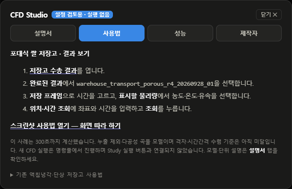

# 사용법 — 저장고 CFD 결과 보기

**따라 할 일:** 실행 → 결과 선택 → 농도·온도·유속 보기 → 위치 조회.
모델과 숫자의 의미는 [설명서](CFD-STUDIO-MANUAL.md)를 보세요.

## 1. 프로그램과 결과 화면 열기

1. `cfd_studio/실행.bat`을 엽니다. 처음 설치하는 PC는 [설치 안내](../cfd_studio/README.md)를 먼저 따릅니다.
2. 메인 화면 오른쪽 위 **`!` → 사용법 → 저장고 수송 결과**를 누릅니다.
3. **완료된 결과**에서 아래 사례를 고릅니다.

`warehouse_transport_porous_r4_20260928_01`

이 예제는 **119,040셀 · 0–300초 · 6프레임**입니다. GitHub에는 전체 계산 원본이 포함되지 않아, 새 PC에서는 이 결과가 목록에 없을 수 있습니다. [새 계산 실행 방법](warehouse-porous-grid-review-20260928.md#재현)을 참고하세요. 현재 저장고 연결 CFD는 명령줄에서 실행하며, Study의 실행 버튼으로 시작하지 않습니다.

*그림 1. `사용법`은 화면 조작, `설명서`는 모델·단위·검증 상태를 안내합니다. 읽기 전용 검토 화면에서 촬영했습니다.*

## 2. 계산 선택과 시간 확인

**저장 프레임** 막대를 움직여 시간을 고릅니다. 오른쪽 끝이 **300초**입니다.
아래 정보에서 **다공성 곡물**, **누출 제외**, **격자 수렴 기준 미달** 표시를 확인합니다.

*그림 2. `완료된 결과`에서 사례를 고르고 `저장 프레임`으로 시간을 바꿉니다. 계산 완료와 정확도 검증 완료는 별개입니다.*

## 3. 농도·온도·유속 보기

**표시할 물리량**에서 원하는 값을 선택합니다.

| 선택 | 표시 내용 |
|---|---|
| 농도 | ClO₂ 농도, mg/m³ |
| 온도 | 계산된 실내 온도, °C |
| 유속·방향 | 속력과 화살표 방향, m/s |

**표시 영역 → 중앙 통로 단면**을 고르면 내부 흐름을 보기 쉽습니다.
마우스 **드래그는 회전**, **휠은 확대·축소**입니다.

*그림 3. `유속·방향`과 `중앙 통로 단면`을 선택한 실제 화면입니다. 점은 셀 표본, 화살표는 흐름 방향입니다. 아래 범례에서 시간·단위·값 범위를 읽습니다. 색 범위는 프레임마다 바뀝니다.*

## 4. 특정 위치의 값 조회

**위치·시간 조회**에 아래 예시를 입력하고 **조회**를 누릅니다.

| x | y | z | 시간 | 최대 거리 |
|---:|---:|---:|---:|---:|
| 39 m | 12.5 m | 3 m | 270 s | 3 m |

*그림 4. 조회값 아래에 선택한 셀까지의 거리와 원본 C/T/U 파일이 표시됩니다. 270초 값은 저장된 240초·300초 사이를 선형 보간한 값입니다.*

**최대 거리**는 조회 좌표와 가장 가까운 셀 중심 사이에 허용할 거리입니다. 이 예제의 좌표는 저장고 한쪽 끝을 x=0, 폭 방향을 y, 바닥 높이를 z=0으로 사용합니다.

## 막히면 여기부터 확인

| 상황 | 확인할 것 |
|---|---|
| 결과가 목록에 없음 | 해당 PC에 계산 원본이 있는지, 실행·출력 검사를 통과했는지 확인 |
| 300초 이후가 안 나옴 | 이 사례의 계산 범위는 300초까지임 |
| 조회 오류 | 좌표·시간이 범위 안인지, 셀까지의 거리가 너무 먼지 확인 |
| 원본 불일치 오류 | 원본 파일과 배열을 함께 보존하고 해당 계산의 검사 기록 확인 |
| 예전 안내가 보임 | 계산이 끝난 뒤 Studio를 다시 열어 최신 도움말 확인 |

[설명서 — 모델·단위·검증 상태](CFD-STUDIO-MANUAL.md) · [실행 기록과 재현 명령](warehouse-porous-grid-review-20260928.md)

촬영: 2026-09-28. 결과 화면은 보존된 실제 CFD 출력으로 촬영했으며, 수치나 검증 표시를 바꾸지 않았습니다.
