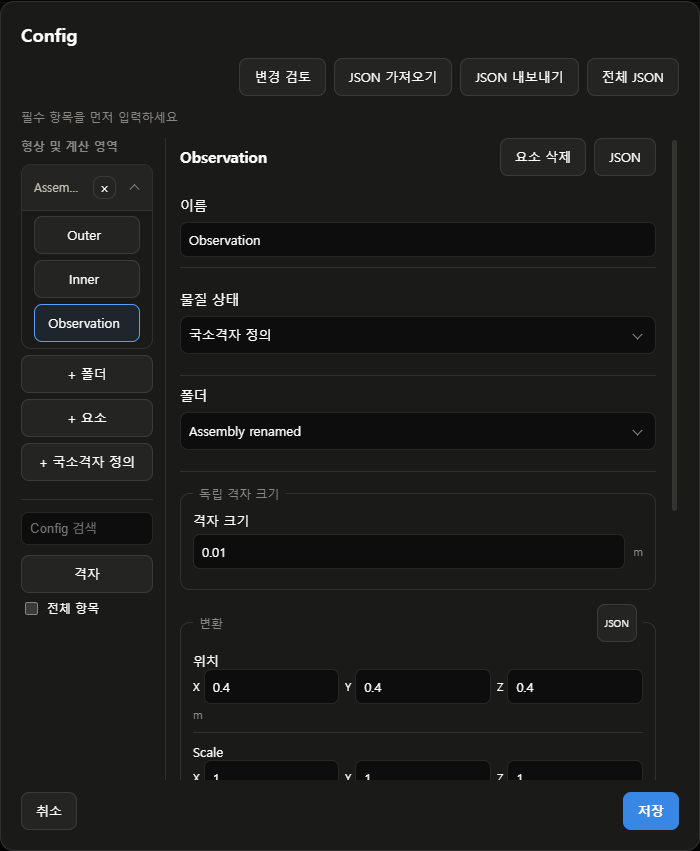

# 형상별 격자

## 사용

- Config → 격자 → 국부 격자 → 형상 선택 → 형상에서 추가 → 격자 크기 입력
- 좌표 범위는 + 영역 또는 목록의 +로 별도 입력
- 기본 간격보다 작은 양수와 단위 지정 · 완전히 포함된 영역은 안쪽 설정 우선
- 동일 범위에 다른 간격 또는 다른 간격의 부분 겹침은 충돌 오류 · 한 점·면으로 접하는 경우는 겹침 아님
- 형상 참조는 현재 치수를 사용 · 구와 원기둥은 외접 직육면체 사용
- UI에서 참조 중인 형상 삭제는 차단 · 앞쪽 배열 요소 삭제 시 참조 인덱스 갱신
- JSON 배열 재정렬 시 target_path도 갱신 · 원본 결과는 새 Case 실행 전까지 유지

## 지원

| 생성기 | 반영 방식 | 제한 |
| --- | --- | --- |
| 이중액침 | 형상 경계 및 각 축 분할·셀 수 반영 | 연결면 유지를 위해 주변 축 구간도 세분화 |
| 정렬된 적재물 저장고 | 기존 블록의 축별 셀 수 증가 | 적재·지붕 경계 유지 · 전체 세분화 배율 추가 적용 |
| 사일로 등가 모델 | 지정 높이에서 블록 분할 · 세분화 간격 반영 | 수평 단면 전체에 적용 · 상세 원문 덕트 구현과 별도 |
| 일반 솔버 Template | 형상 참조·범위·간격 입력 및 저장 | 실행 어댑터에 격자 생성기 연결 필요 |

- 사일로 좌표: 중심 X=0·Y=0, 바닥 Z=0, 원통 축 Z
- 사일로 기준 간격: 원통 체적 / target_cells의 세제곱근 · 격자 길이의 보증값이 아닌 입력 비교 기준
- 사일로 격자 기록: 실제 생성 예정 셀 수·높이 분할·셀 수·해결된 영역 범위·전파 방식
- 세분화 후 셀 수는 target_cells보다 증가 · 최대 2천만 셀, mesh.maximum_cells로 더 낮은 한도 지정 가능
- 실제 생성된 곡면 격자의 품질은 checkMesh로 별도 검사
- 팔분할 적응 격자·임의 CAD 표면 세분화·모든 솔버 자동 연결은 미구현

## JSON

기존 Template에서 출력한 Config의 mesh 또는 porous_mesh에 다음 항목 추가

```json
{
  "refinement_regions": [
    {
      "name": "Inspection region",
      "target_path": ["geometry", "regions", 0],
      "cell_size": {"value": 0.025, "unit": "m"}
    }
  ]
}
```

- 예시의 경로·수치는 실제 Config와 목적에 맞게 변경
- target_path 사용 시 shape·unit·min·max를 같은 영역에 중복 입력하지 않음
- 잘못된 참조·형상·입력·영역·생성 한도는 MESH-R001~MESH-R009로 구분
- [오류 안내](ERROR-CODES.md) · [기계 판독 오류 목록](config-error-codes.json)

## 검증

- 독립 시험용 원통 형상 · 논문 재현 또는 사용자 Case 아님
- OpenFOAM v2312 blockMesh 및 checkMesh 실제 실행
- 기본 4,032셀, 세분화 28,728셀 · 양쪽 Mesh OK
- 최대 비직교각: 기본 24.7616°, 세분화 34.8738°
- 최대 종횡비: 기본 3.63056, 세분화 9.28516
- 유동 솔버 미실행 · 격자 수렴·물리 검증 결과가 아님
- 단위 검사는 tests/test_local_refinement.py, tests/test_spatial_editor.js
- 화면 검사는 tests/browser_geometry_refinement.js · 실제 프로젝트 저장·계산 없음

## 독립 격자 크기

- 형상 선택 → **독립 격자 크기 → 사용** → 간격·단위 입력
- Config 형상 객체의 `mesh_control.cell_size`에 저장
- 해제 시 해당 형상의 독립 간격만 제거 · 형상·물성 유지
- 기존 `refinement_regions`와 함께 처리 · 같은 범위·같은 간격은 중복 제거
- 포함 관계는 현재 생성기가 사용하는 축 정렬 외접 상자로 판단
- 안쪽 간격은 바깥쪽 이하로 입력 · 안쪽을 더 거칠게 지정하면 **MESH-R007** 표시
- 현재 연결 격자는 인접 축 방향도 세분화 · 입력 간격은 정확한 모든 셀 변 길이 보증값이 아님
- 별도 물리 영역의 격자가 서로 분리되는 기능은 아님

## 국소격자 정의

- 형상 목록의 **+ 국소격자 정의** → 이름·위치·크기·독립 격자 크기 입력
- 투명 범위로 표시 · 기본 직육면체, 형상 JSON으로 지원 기본 형상 편집
- 재료·벽·물성·채움·경계조건 생성 없음 · 물리 속성이 포함되면 **MESH-R008** 표시
- 유체 채움의 기준 공간으로 사용할 수 없음
- 물리 모델은 유지되지만 격자 분해능 변경으로 수치 결과는 달라질 수 있음
- 물리 형상 목록과 별도로 최상위 `mesh_regions`에 저장

```json
{
  "mesh_regions": [
    {
      "name": "Observation",
      "material_state": "mesh_refinement",
      "shape": "box",
      "unit": "m",
      "min": [0.3, 0.3, 0.3],
      "max": [0.5, 0.5, 0.5],
      "mesh_control": {"cell_size": {"value": 0.01, "unit": "m"}}
    }
  ]
}
```

- 예시 위치·간격은 실제 계산 영역과 목적에 맞게 입력
- `mesh_regions`를 물리 `regions` 또는 적재물 `loading.blocks`에 넣지 않음

## 형상 폴더

- **+ 폴더** → 이름 입력 → **추가**
- 각 형상 선택 → **폴더**에서 소속 선택 · 물리 형상과 국소격자 정의를 함께 묶을 수 있음
- 폴더 제목 클릭으로 접기·펼치기 · 제목 더블클릭으로 이름 변경
- 폴더의 **×**는 폴더만 삭제 · 포함 형상은 목록에 유지
- Config 저장 시 소속·이름·접힘 상태 보존 · 읽기 전용 Case에서 접기는 가능하나 저장값 변경 없음
- 폴더 정의: `_studio.geometry_groups`의 고유 `id`·`name`·`expanded`
- 형상 소속: `editor_group`의 폴더 ID · 표시용 묶음으로 형상 좌표·물리 영역·격자 설정을 바꾸지 않음
- 한 단계 폴더 지원 · 하위 폴더·드래그 일괄 이동은 미구현



## 중첩 격자 검증

- 독립 시험 형상에서 기본 2,368셀 → 중첩 세분화 18,688셀
- OpenFOAM v2312 `blockMesh`·`checkMesh` 양쪽 통과
- 총 체적 0.000982 m³·경계 패치 4개·연결 영역 1개 유지
- 추가한 국소격자 정의의 벽 패치·재료 영역 없음
- 유동 솔버·실제 프로젝트 계산 미실행 · 격자 수렴 검증과 별개
- 테스트: `tests/test_mesh_components.py`, `tests/browser_mesh_components.js`

- 관련 회귀 검사: Python 65개·JavaScript 65개·실제 화면 15항목 통과
