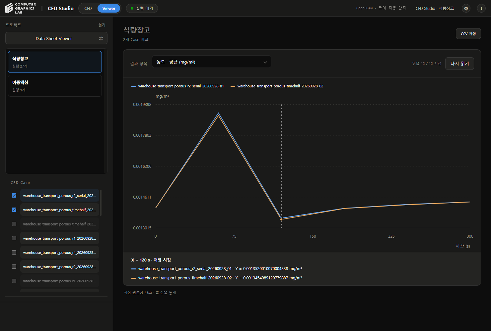
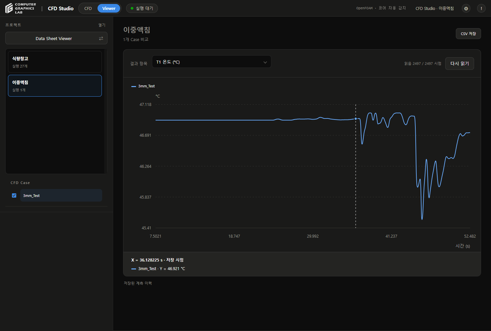
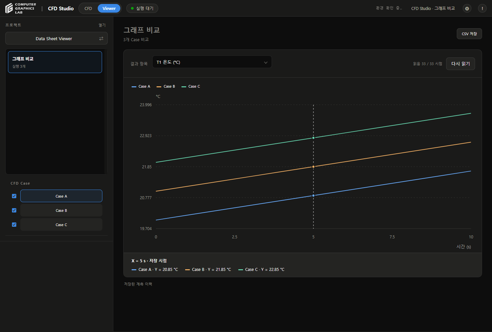

# Case 그래프 검토

## 변경

- v186
- Viewer 안에 프로젝트별 CFD Case 목록 추가
- 이름 버튼으로 3D 활성 Case 전환, 체크박스로 그래프 비교 대상 선택
- Data Sheet 상단 정리, 여러 Case의 같은 항목을 색으로 구분
- 그래프 클릭·드래그·키보드로 저장 X 선택, 점선과 정확한 X/Y 표시
- 하단 표·재생 UI·모델 검증 영역 제거
- CFD FORM의 결과 그래프 목록 추가
- 온도·유속 성분·압력·난류·상분율·농도·흡착량·저장 이력 연결
- 그래프 조회를 3D 캐시와 분리, 큰 결과는 페이지별 읽기
- Data Sheet에서 3D 재생 키와 추가 프레임 선행 읽기 차단
- Config·검증 기록·원본 결과 유지

## 검사

| 항목 | 결과 |
|---|---|
| Python 전체 | 170개 통과 |
| Windows 내장 Python 그래프 검사 | 8개 통과 |
| JavaScript 전체 Viewer·Config | 58개 통과 |
| UI 비교 예제 | Case 3개, X=5에서 Y=20.85·21.85·22.85 °C 확인 |
| 실제 저장고 | 저장 결과 2개의 농도·온도 비교, 총 12시점 읽기 |
| 3D 연속성 | Viewer 내부 이름 버튼으로 다른 저장고 Case 전환 |
| 실제 이중액침 | 5,250프레임 중 유속 16시점 조회, 열전대 이력 2,497시점 전체 읽기 |
| 재시작 | 프로젝트 2개·실행 28개의 ID 유지 |
| 브라우저 새로고침 | 프로젝트별 비교 체크 복원 |
| 응답 지연 | 온도 응답 지연 중 T2 전환, 늦은 응답이 선택 항목을 덮어쓰지 않음 |
| 화면 | 하단 표·재생 UI 숨김, 모델 검증 패널 없음, 긴 Case 목록 가로 넘침 없음 |

- 이번 작업에서 CFD 계산 실행 없음
- 실행 결과 파일 수정 없음
- 단상 압력·난류는 파일 형식 시험, 실제 단상 계산 화면은 이번 검토 대상 아님

## 해석 범위

- 그래프 값: 저장 결과에서 추출한 통계·이력
- X 커서: 가장 가까운 실제 저장 시점으로 맞춤
- 다른 Case에 동일한 X가 없으면 빈값, 임의 보간 없음
- 정상 해석의 반복 횟수와 비정상 해석의 물리시간 분리
- 정규화 농도와 실제 단위 농도 분리
- 없는 출력 항목은 생성하지 않음
- 큰 결과의 초기 부분 읽기와 전체 읽기 구분
- 기존 시각화 격자 통계는 원래 CFD 격자의 체적 가중 평균이 아님
- T5는 입력값, T6는 기존 코일 식에 따른 계산값
- 새로운 솔버나 새로운 출력 파일 형식은 별도 연결 필요
- 표시 성공은 수치·실험 검증 완료 판정이 아님

## 화면

### 저장고

### 이중액침

### UI 검사

- 화면 검사용 저장값, 실제 CFD 결과 아님

