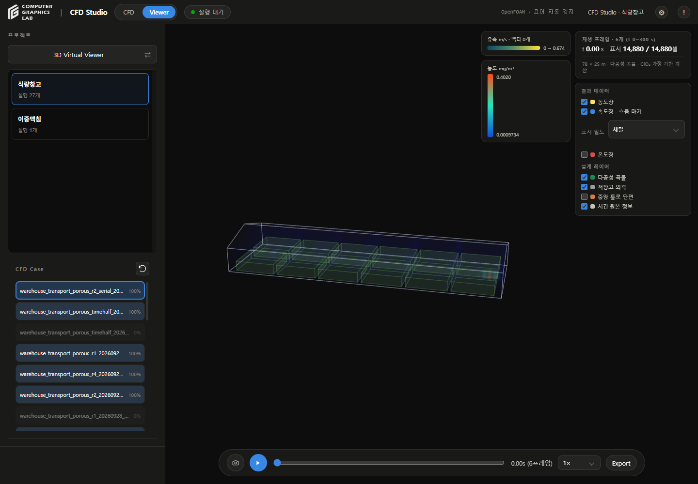
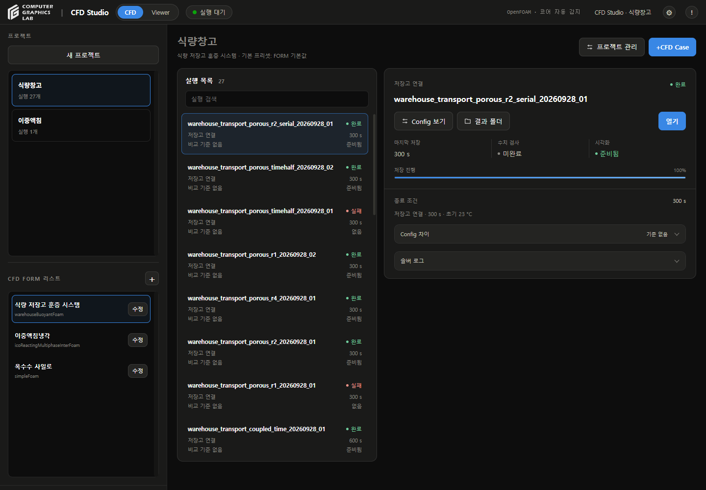

# Viewer UI 검토

- 날짜: 2026-09-29
- 버전: v202

## 변경

- CFD Case 목록 높이 310px, 스크롤 공간 고정
- 프로젝트별 Case 개수와 관계없이 항목 폭 유지
- 선택한 Case 테두리·준비율 게이지 유지
- 결과가 없는 프로젝트에서도 Viewer 유지
- CFD FORM `+` 버튼: 28×28px 둥근 정사각형, 기호 확대
- Viewer 다시 읽기: 같은 크기의 원형 화살표 아이콘, 기존 결과 갱신 기능 유지
- 자동 동기화 항목 제거
- 공통 Viewer 패널·재생 바·좁은 화면 배치 통일
- 프로젝트 전환 중 이전 시간·프레임 표시 초기화

## 확인

- 실제 저장고 27개 Case와 이중액침 1개 Case 전환
- 1440×1000 화면: Case 목록 276×310px, 항목 폭 267px
- 저장고 6프레임, 이중액침 5,250프레임 로드 확인
- 정규화 추적자 121프레임 로드 확인
- Data Sheet 전환 및 640px 좁은 화면 확인
- 빈 프로젝트: 브라우저 응답 대체로 확인, 실제 프로젝트 생성 없음
- 관련 JavaScript 테스트 49개 통과
- CFD 계산 미실행

## 재현

```sh
node --test tests/test_shared_warehouse_viewer.js tests/test_viewer_review.js tests/test_data_sheet_viewer.js
```

## 화면

### 저장고



### 이중액침


### CFD FORM



## 범위

- 공통 화면 배치와 프로젝트 전환 점검
- 모든 솔버·임의 결과 파일에 대한 호환성 검증은 포함하지 않음
- 물리 모델·격자·계산 결과 변경 없음
