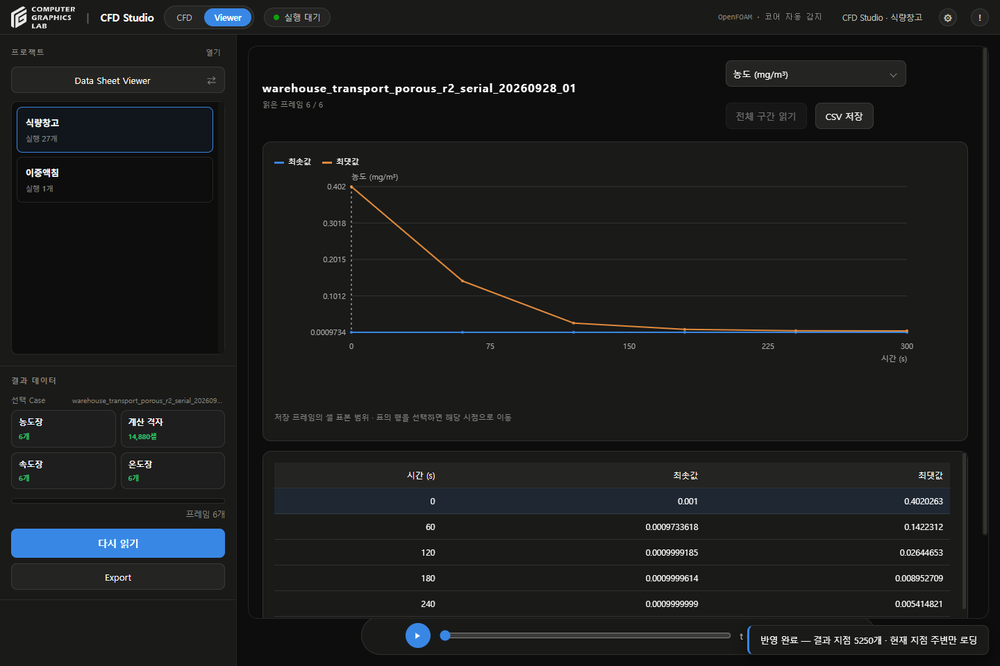
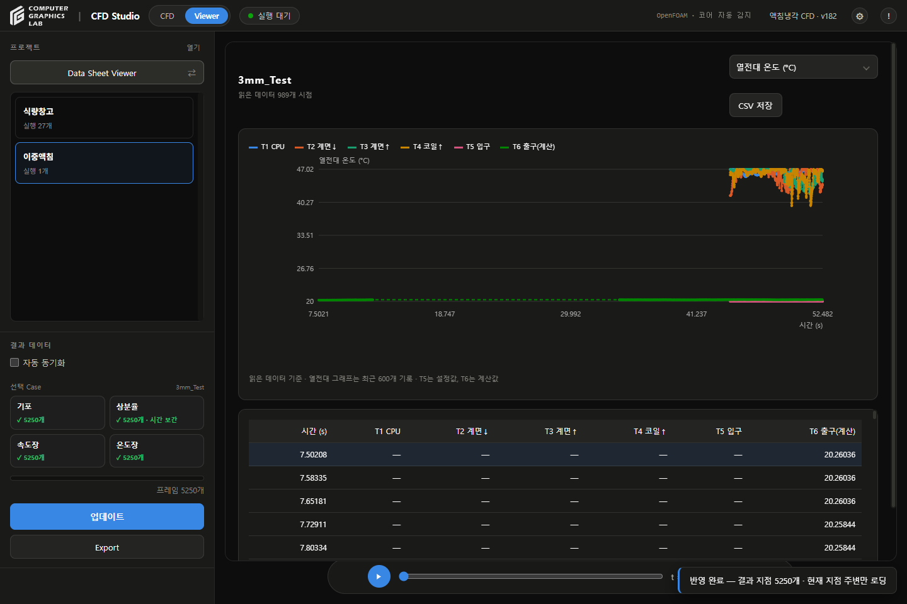

# Viewer 검토

## 변경

- 버전: v182
- 기존 시각화 준비율 버튼: **3D Virtual Viewer ↔ Data Sheet Viewer** 전환
- 버튼 위치·프로젝트 목록·하단 재생 막대 유지
- 모드 전환: 선택 Case·물리시간·카메라 유지, 재생 일시정지
- Data Sheet: 물리량 선택·시간 그래프·표·CSV
- 위치·시간 조회와 모델·검증: Data Sheet 아래 접기 영역
- 원본 파일 경로 패널 제거
- 상단 환경 경로·프로젝트 본문 경로·이전 Raw 경로 표시 제거
- 프로젝트 경로: 프로젝트 설정에서 확인
- 이중액침: 파일 읽기 완료 후 Viewer 준비 상태 갱신
- Case 전환: 이전 그래프·표·조회값 제거 후 선택 결과 표시

## 검사

| 항목 | 결과 |
|---|---|
| Python | 149개 통과 |
| JavaScript | 47개 통과 |
| 저장고 | 6개 저장 시점, 농도·온도·유속 그래프·표 확인 |
| 정규화 저장고 | 11개 저장 시점, C/C_ref 구분 확인 |
| 이중액침 | 기존 3mm_Test 열전대 그래프·표 표시 |
| 모드 전환 | Case·재생 시점·카메라 동일 확인 |
| 시간 선택 | 표의 120초 행 선택, 재생 시점 120초 확인 |
| 위치 조회 | 좌표·시간 입력 후 농도·온도·유속·셀 거리 반환 |
| 표 대조 | 저장된 프레임 통계와 표시값 비교, 반올림 오차 범위 내 일치 |
| CSV | 실제 다운로드, 6개 시간·농도 단위 확인 |
| 기존 데이터 | 프로젝트 2개·실행 연결 28개 동일 |
| CFD 실행 | 이번 작업에서 실행하지 않음 |

## 재현

```text
python -m unittest discover -s tests -p "test_*.py" -q
node --test tests/test_data_sheet_viewer.js tests/test_shared_warehouse_viewer.js tests/test_settings_editor.js tests/test_viewer_review.js
```

- Studio 실행 → 프로젝트·Case 선택 → Viewer
- 왼쪽 **3D Virtual Viewer** → **Data Sheet Viewer**
- 물리량 선택 → 그래프·표·CSV 확인
- 표 행 선택 → 하단 시간 확인
- 다시 전환 → 동일 Case·카메라 확인
- 저장고·이중액침 간 전환 → 이전 조회값·필드 제거 확인

## 범위

- 저장고: 표시용 셀 표본 통계, 원본 전체 셀 통계와 구분
- 200프레임 이하 저장고: 자동 읽기
- 200프레임 초과: **전체 구간 읽기**로 누락 구간 읽기
- 이중액침: 읽힌 프레임·열전대 기록만 표시
- 열전대: 각 이력의 최근 600개 기록, T5 설정값·T6 계산값 구분
- 정규화 추적자: 읽힌 격자 범위, 단위 C/C_ref·Q/C_ref
- 누락값: 표·CSV 빈칸, 0으로 대체하지 않음
- 수치 검사·실험 검증 상태: 기존 결과 기록 유지

## 화면






