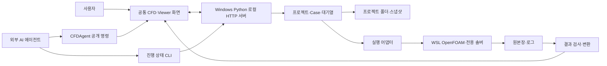

# 구조

## 시스템 경계

- 화면·Python 서버·WSL 솔버는 서로 다른 실행 환경
- 서버는 `app.py`의 `StudioHTTPServer`로 루프백 `127.0.0.1`에 바인딩
- 클라우드 서비스·다중 사용자 인증 서버로 검증된 구조가 아님
- 공통 UX는 유지하되 실행기와 결과 읽기 모듈의 차이는 명시적 계약으로 구분

## 모듈 지도

| 책임 | 주요 파일 | 변경 시 함께 확인 |
| --- | --- | --- |
| 앱 시작·HTTP·기존 Viewer | `cfd_studio/app.py`, `internal/studio_launcher.py` | 시작·중복 실행·종료·정적 자원 |
| 프로젝트·Case 화면 | `internal/execution_workspace.js` | 선택·목록·상태·CFD/Viewer 연속성 |
| 프로젝트·실행 관리 | `internal/execution_workspace.py`, `run_management.py`, `project_storage.py` | 원자 저장·revision·재시작 |
| Template·프리셋 | `internal/cfd_forms.py`, `form_schema.py`, `config_presets.py` | 복제·스냅샷·양식과 값 분리 |
| 솔버 설문·요건 | `internal/solver_catalog.py`, `solver_requirements.py`, `form_wizard.py` | 설치·양식·실행 연결 구분 |
| Config·공간 편집 | `internal/form_config_editor.js`, `spatial_editor.js`, `config_contract.js` | JSON 왕복·읽기 전용·스크롤 |
| 격자·전용 계산 | `tracer_transport`, `silo_reproduction`, `tmc49_full_tank` | 각 실행기의 지원 범위 |
| 결과·그래프 | `internal/result_series.py`, `warehouse_results.py`, `data_sheet_viewer.js` | 원본·좌표·단위·시간 축 |
| 3D 공통 표시 | `internal/viewer_presentation.js`, `warehouse_viewer.js`, `tracer_viewer.js` | 카메라·재생·마스크·메모리 |
| 에이전트 | `internal/agent_controls.js`, `agent_activity.py`, `agent_collaboration.js` | 중단·소유권·화면 수신 |
| 언어·도움말 | `internal/i18n.js`, `i18n_help.js` | 한국어·영어·일본어 |
| 장치·설치 | `internal/hardware_monitor.py`, `windows_gpu.py`, `setup_bridge.py` | 비동기 갱신·명령창·환경 차이 |
| 별도 Study | `study_platform` | 제품 Case 연결과 별도 범위 |

- 위 `internal/` 경로의 기준은 `cfd_studio/`
- 모든 자체 소스와 테스트는 [목록](INVENTORY.md)에서 탐색
- 현재 `app.py`에 초기 앱·호환 코드가 집중됨 · 완전히 분리된 계층 구조로 오인하지 않음

## 주요 경계 규칙

- Template = 솔버 + Config 양식 + 초기 공간 형상
- 프로젝트 = 실행 이력과 저장 위치 · 프리셋 = 입력값 묶음
- Case 생성은 값 복사, 실행 시작은 고정 스냅샷 · 원본 Template/프리셋에 소급 적용 금지
- 새 솔버 등록만으로 입력 생성·실행·후처리가 추가되지 않음
- 형상 미리보기와 실제 격자가 동일하다고 가정하지 않음
- Viewer 보간·벡터 표시 밀도는 계산 격자와 별개
- 설정한 기능이 미지원이면 명시적 오류 · 다른 계산 방식으로 몰래 대체하지 않음

## 확장 경로

1. 설문·솔버 기능·필수 입력 정의
2. Config 검증과 형상·물성 입력 연결
3. 격자 생성 및 품질 검사
4. 실행·중단·복구·종료 조건 연결
5. 결과 원본·메타데이터·단위 변환 연결
6. 공통 Viewer·그래프·CSV·에이전트 명령 검사
7. 지원 표·오류·3개 언어 문서 갱신

- 하나의 프로젝트 이름을 조건으로 전용 UI를 추가하는 방식은 허용하지 않음
- 기존 전용 Config 호환 처리는 남아 있음 · 범용화 완료로 표현하지 않음
