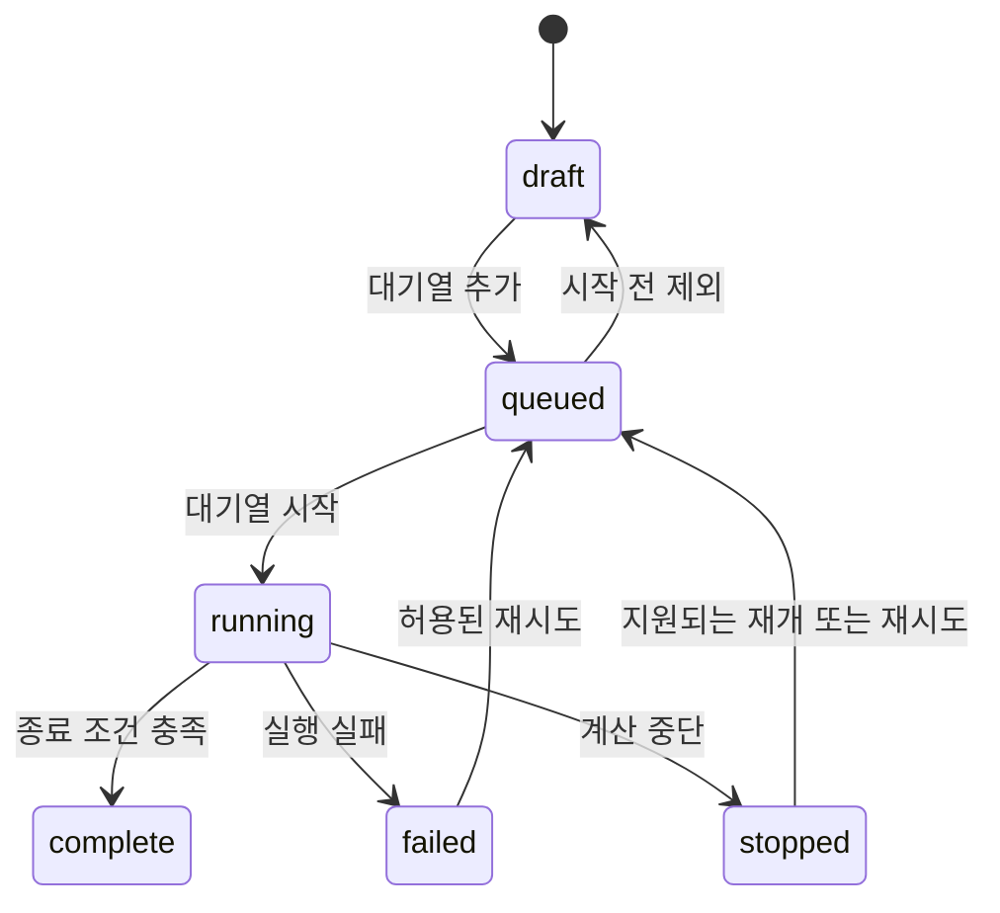

# 실행과 API

## 실행 흐름

- 실제 내부 값과 전이는 `run_management.py` 기준 · 완료 Case를 자동 재실행하지 않음
- 시작된 Case의 입력 변경은 새 Case로 분리
- 재시작 후 다음 실행은 일시정지 · 프로세스 응답·실행 기록을 확인하고 복구
- 재시도/재개 가능 여부는 오류 분류·체크포인트·실행기 지원을 함께 확인
- 실패 시 기본 대기열 정지 · 실패 원인·건너뛰기·재시도 안내
- 에이전트 조작 중단과 CFD 솔버 중단은 다른 동작

## 별도 상태

| 상태 | 예 | 판정 기준 |
| --- | --- | --- |
| 실행 | draft, queued, running, complete, failed, stopped | 작업·프로세스·완료 기록 |
| 결과 | none, preparing, update, ready | 저장·변환·읽기 준비 |
| 수치 검사 | unchecked, incomplete, passed 등 | 해당 검사 범위와 증거 |
| 실험 검증 | 미완료/검증 근거 | 독립 실측 비교 |
| 에이전트 | 진행·연결 끊김·일시정지 | 상태 전송과 탭 수신 |

- 표의 값은 모든 모델에 동일한 enum을 강제한 신규 명세가 아님 · 호출하는 API의 실제 응답 확인
- 모델별 수치 검사 범위는 결과 계약에 보존

## HTTP 경계

- `/api/executions` 라우팅: `cfd_studio/internal/execution_workspace.py`
- POST 성공: `{ok: true, result: ...}` · 처리 오류: HTTP 400, `{ok: false, msg: ...}`
- 다른 앱·Study·결과 경로는 별도 핸들러가 존재하며 응답 형식이 완전히 같지는 않음
- API는 내부 제품 연결용 · 버전 안정성이 보장된 외부 SDK/OpenAPI로 배포된 것은 아님

| 경로 | 입력 요약 | 역할 |
| --- | --- | --- |
| GET `/api/executions` | 없음 | 프로젝트·Case·대기열 스냅샷 |
| GET `/api/executions/template` | id | 입력 기본값 조회 |
| POST `/api/executions/project` | name, form_id, storage_path, initial_config 등 | 프로젝트 생성 |
| POST `/api/executions/project-open` | storage_path | 기존 프로젝트 검증·등록 |
| POST `/api/executions/case` | project_id, name, config, id/revision 등 | Case 저장·동시 편집 검사 |
| POST `/api/executions/queue` | action, ids/id | 순서·시작·중단 조정 |
| POST `/api/executions/recover` | id, action | 지원되는 복구 |
| POST `/api/executions/mesh-plan` | config | 연결 격자 셀 수·한도 사전 검사 |
| POST `/api/executions/result` | id | 결과 생성/갱신 |
| POST `/api/executions/export-csv` | id | 전체 CSV 준비 |
| POST `/api/executions/form-from-survey` | solver, answers | 설문 기반 양식 |
| POST `/api/executions/form-inspect` | solver, config | 필수 요건 확인 |

- 전체 라우트와 정확한 선택 인수는 핸들러에서 확인 · 이 표는 주요 경계 요약
- 큐 action 이름을 추정해 직접 요청하지 않음 · 공개 화면 명령/해당 핸들러 확인

## 에이전트 인터페이스

- 기준: [AI 에이전트 사용법](../CFD-STUDIO-AGENT-GUIDE.md)
- 연결: describe/observe → 현재 탭과 대상 확인
- 저비용 조회: status → 필요한 controls/configDocument/errorInfo만 요청
- 입력: 현재 Template JSON → 공개 JSON 명령 → 같은 화면 초안 → 사용자 검토
- 저장·계산 시작: 변경 검토와 지침서의 실행 절차 준수
- pause 신호는 다음 명령을 차단 · 장시간 작업 중에도 경계마다 확인
- 진행 CLI `--wait-visible` 성공은 표시 수신 확인 · 사용자의 내용 승인과 구분

## 경쟁 상태와 실패

- revision이 바뀐 Case/Template은 오래된 요청으로 덮어쓰지 않음
- 비동기 결과는 요청 당시 프로젝트·Case·입력 스냅샷과 대조
- 앱 재시작 뒤 stale agent session을 재사용하지 않음
- 저장 실패·디스크 단절·JSON 손상·실행기 heartbeat 소실·불완전 프레임을 구분
- 현재 일부 예외는 일반 메시지 경로 · 전체 오류 코드화 완료로 안내하지 않음
