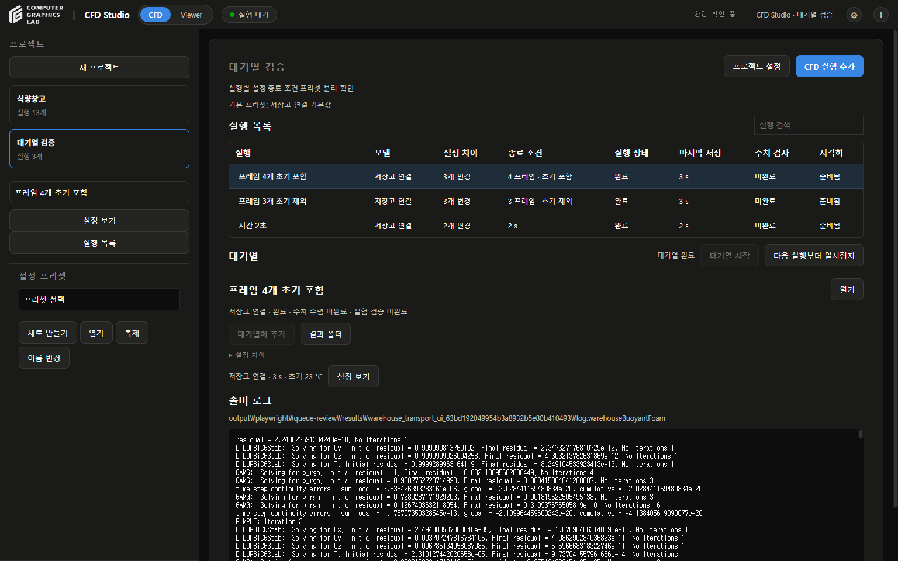
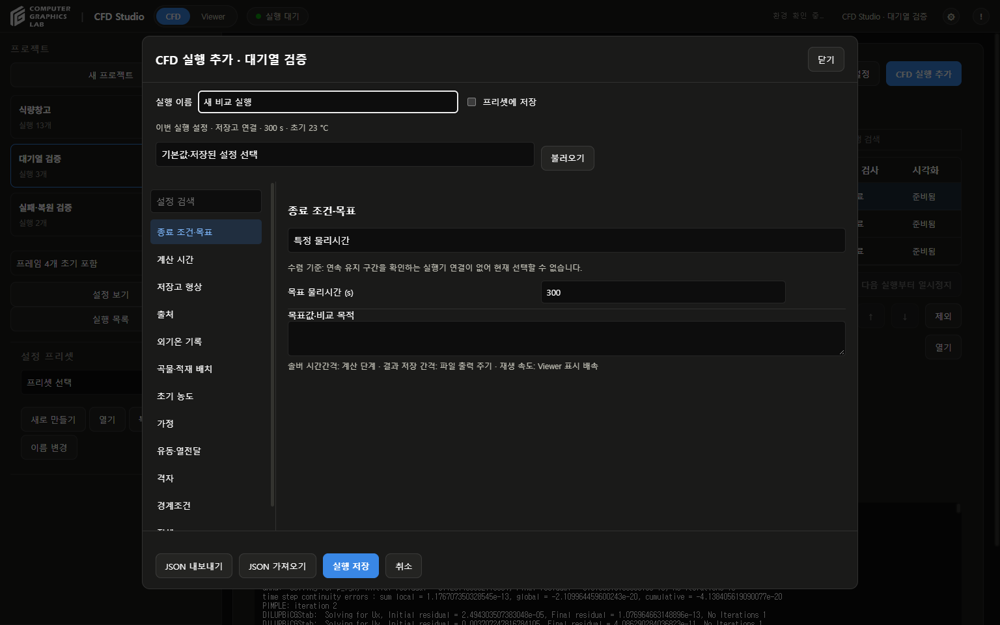
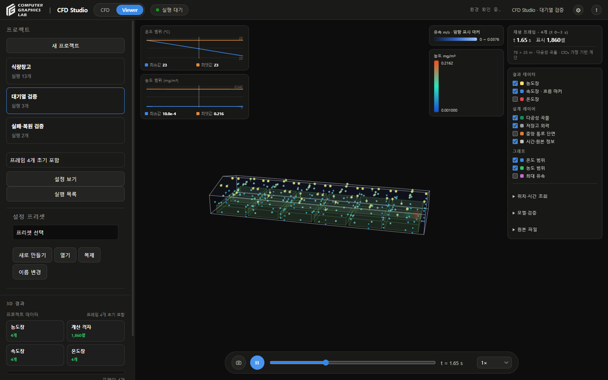

# 프로젝트와 실행 검토

- 검토일: 2026-09-28
- 작업 저장소: 기존 CFD-Studio Git 저장소
- 대상: 프로젝트·설정 프리셋·개별 실행·대기열·결과 열람
- 기존 솔버 방정식·물성 기본값: 변경 없음
- [사용법](CFD-STUDIO-USER-GUIDE.md) · [설명서](CFD-STUDIO-MANUAL.md) · [검사 기록](execution-queue-review-20260928.json)

## 구현

| 구분 | 현재 동작 |
|---|---|
| 프로젝트 | 이름·설명·기본 프리셋 참조·여러 실행 보관 |
| 기본 프리셋 변경 | 이후 새 실행에만 적용 |
| 설정 프리셋 | 왼쪽 독립 영역에서 생성·조회·복제·사용자 프리셋 이름 변경 |
| 실행 편집 | 실행 전 개별 설정·목표·종료 조건 편집, 오래된 편집 화면의 덮어쓰기 차단 |
| 프리셋에 저장 | 기본 해제, 체크하면 별도 이름으로 새 파일 생성, 이름 충돌 시 기존 파일 보존 |
| 실행 시작 | 고정 입력 사본·SHA-256·별도 시도 폴더 생성 |
| 대기열 | 순차 실행·순서 변경·미시작 실행 제외·현재 실행 후 일시정지 |
| 실패 | 대기열 정지·원인 표시·재시도·건너뛰기, 다음 실행 시작은 명시적 선택 |
| 완료 이력 | 자동 재실행 차단, 새 실행 복제로 재계산 |
| 재시작 | 프로젝트·초안·적용 설정·시도·결과 연결·대기열 복원, 이후 실행 일시정지 |
| 결과 | 실행별 로그·폴더·설정 조회·동일 Viewer, 생성·업데이트·열기 구분 |
| 상태 | 실행 상태·수치 검사·시각화 준비 별도 표시 |



## 설정 보존

- 프로젝트 기본 프리셋: 참조만 보관
- 실행 초안: 생성 시 설정·비교 기준 사본 보관
- 실행 시작: `runs/<attempt>/input.json` 고정
- 기존 실행기 적용 입력: `applied_input.json` 추가 보관
- 실행 후 편집: 차단, **이 설정으로 새 실행** 제공
- 프리셋 체크 해제: 원본 프리셋 변경 없음
- 프리셋 체크: 새 이름 저장 성공 후 실행 초안 반영
- 프리셋 저장 실패: 실행 초안 유지, 기존 프리셋 유지
- 파일 게시: 완전한 임시 파일을 덮어쓰기 없이 원자적으로 게시
- 사용자 프리셋 이름 변경: 프로젝트 참조 갱신, 기존 실행 입력 유지



## 실제 실행

- 별도 검토 저장소에서 프로젝트 **대기열 검증** 생성
- 기존 저장고 실행기를 이용한 1,860셀 CFD 3개 순차 실행
- 운영 프로젝트 목록·원본 결과에 검토용 실행 추가 없음
- 계산 시간간격을 각각 다르게 지정
- 종료 방식 2종 검사: 물리시간, 저장 프레임 수
- 프레임 종료: 초기 프레임 포함·제외를 각각 검사

| 실행 | 종료 조건 | 저장 프레임 | 실행·출력 검사 |
|---|---|---:|---|
| 시간 2초 | 물리시간 2초 | 3개, 초기 포함 | 통과 |
| 프레임 3개 초기 제외 | 초기 제외 3개 | 총 4개 | 통과 |
| 프레임 4개 초기 포함 | 초기 포함 4개 | 총 4개 | 통과 |

- 위 통과 범위: 실행 종료·출력 개수·원본과 저장 배열 일치·기존 보존 검사
- 격자·시간간격 수렴: 미완료
- 독립 실험 검증: 미완료
- 물리적 정확도 검증 완료를 뜻하지 않음
- 실제 입력·출력: 로컬 `output/playwright/queue-review/`에 보존
- GitHub: 해시·완료 기록·검사 요약·화면 자료만 보관

## 화면 검사

- 프로젝트 생성: 이름·설명·기본 프리셋 입력
- 실행 3개: 개별 편집·대기열 추가·순차 계산·완료 상태 확인
- 프리셋 체크 해제: 기본 저장고 프리셋 원본 바이트 불변
- 프리셋 체크: **프레임 3개 검증** 새 프리셋 생성·사이드바 표시
- 새 편집창: 체크박스 다시 해제 상태 확인
- 오류 입력: 실행 전 입력 검사 실패·뒤 실행 대기 유지
- 서버 재시작: 완료 3개·실패 이력·미시작 대기열·설정·결과 연결 복원
- 재시도: 새 시도 폴더 생성, 앞선 실패 기록 유지
- 건너뛰기: 다음 실행 자동 시작 없이 일시정지 유지
- 완료 계산: 재시작 후 실행 횟수 증가 없음
- 저장고 Viewer: 같은 캔버스·재생 막대·물리량 선택 사용, WebGL 오류 없음
- 이중액침: 기존 5,250프레임 열람, 설정 조회·새 실행 편집창 확인
- 대용량 이중액침 상태 조회: 전 프레임 헤더 반복 읽기 제거, 관측 응답 약 0.14초
- 완료 판정·변환: 전체 파일 검사 유지, 백그라운드 처리
- 사이드바: 프리셋 영역과 결과 영역 겹침 수정




## 원본 보존

- 작업 전 결과 파일 545개: SHA-256 일치
- 이중액침 원본 표본 5개: SHA-256 일치
- 기존 식량창고 27개 실행·이중액침 1개 실행: 연결 유지
- 기존 미추적 `cfd_studio/configs/.initialized`: 보존, 커밋 제외
- 사용자 Chrome·기존 CFD 프로세스: 임의 종료 없음
- Studio 서버: 계산·변환 비활성 확인 후 해당 서버만 재시작

## 자동 검사

- Python: 134개 중 132개 통과·2개 건너뜀
- JavaScript: 41개 통과
- Windows 내장 Python: 관련 22개 통과
- 검사 범위: 독립 설정·스냅샷·저장 실패·순서·일시정지·재시도·재시작·중단 대상·프레임 수·기존 Viewer

```text
python -m unittest discover -s tests
node --test tests/test_viewer_review.js tests/test_settings_editor.js tests/test_shared_warehouse_viewer.js
```

- Windows 실행 환경: 앱에 포함된 Python 사용 가능
- 검토 서버 재현: 별도 작업 폴더와 결과 폴더 지정, 기본 읽기 전용

```text
python tests/serve_execution_review.py --folder output/playwright/queue-review/workspace --output output/playwright/queue-review/results --port 18751
```

- 실제 계산을 허용할 때만 `--allow-run` 추가
- 저장된 대기열은 서버 재시작 시 일시정지

## 제한

- **수렴 종료 미구현**: 연속 유지 구간과 최대 한계의 판정 어댑터 미연결, 선택 비활성
- 기존 잔차 기준 만족을 새 수렴 종료 완료로 간주하지 않음
- 종료 방식 3종을 각각 사용하는 실제 순차 실행 검사는 미완료
- 액침냉각·단상 저장고: 대기열 어댑터·단위·결과 준비 검사 연결, 이번 검토에서 새 CFD 순차 계산은 수행하지 않음
- 저장고 중단·실패 결과: 원본 보존, 부분 결과 Viewer 생성은 미지원
- 저장고 물리시간 종료: 현재 실행기 특성상 저장 간격의 배수 필요
- 현재 대기열: 앱 전체 한 개, 여러 프로젝트의 실행을 순서대로 처리
- 앱 재시작: 대기열 복원 후 명시적 **대기열 시작** 필요
- 기존 프리셋 덮어쓰기: 제공하지 않음, 별도 이름으로 저장
