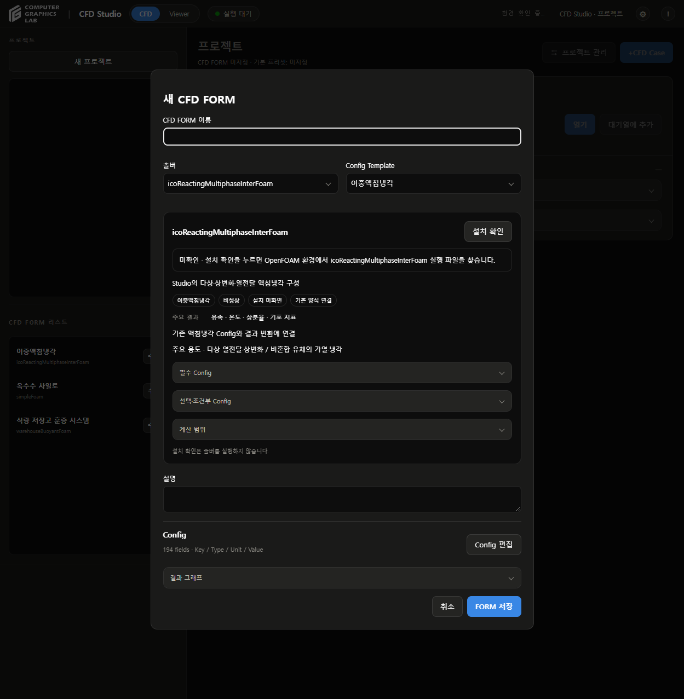

# 공통 기능 정리

- 날짜: 2026-09-29
- 버전: v203

## 변경

| 항목 | 적용 |
|---|---|
| 실행의 해석 이름 | 실행 시점 FORM 이름 우선, 현재 FORM·저장 모델 정보 순으로 표시 |
| Config 요약 | FORM 이름·솔버·종료값 표시, 특정 대상의 발열·온도 문구 제거 |
| FORM 생성 양식 | 서버에서 솔버별 연결 양식 제공, 화면의 모델 ID 목록 제거 |
| 솔버별 Config | 등록된 솔버의 결합 알고리즘·시간 기준 사용 |
| 출력 항목 | FORM별 선택지 적용, 저장된 사용자 항목과 빈 선택 유지 |
| 기본 출력값 | FORM 정보에서 가져와 편집 사본에만 적용 |
| 초기 결과 분류 | 미지정·혼합 프로젝트를 저장고로 간주하지 않음 |
| 기존 결과 최초 묶음 | 고정 연구 대상 이름 대신 가져온 결과 사용. 기존 프로젝트 이름 유지 |
| 로그 | Config에 지정한 솔버 로그 우선, 실제 log.* 파일 탐색, 격자 생성 로그 후순위 |
| 그래프 X축·저장 단위 | 특정 솔버 이름 비교 대신 솔버 정의와 저장 Config의 시간 기준 사용 |
| 실행 검색 | 화면에 표시한 FORM 이름도 검색 대상에 포함 |

## 파일

- `cfd_studio/internal/cfd_forms.py`: FORM별 출력 정보·솔버별 양식·이전 프로젝트 분류
- `cfd_studio/internal/solver_catalog.py`: 솔버 결합 알고리즘·결과 시간축 판정
- `cfd_studio/internal/execution_workspace.py`: FORM API·로그 탐색·저장 단위
- `cfd_studio/internal/execution_workspace.js`: 공통 화면의 FORM 정보 사용
- `cfd_studio/internal/config_editor.js`: 출력 항목 보존·Config 요약
- `cfd_studio/internal/result_series.py`: 그래프 시간축
- `cfd_studio/app.py`: 버전 표시

## 검증

- Python 관련 테스트 90개 통과
- JavaScript 관련 테스트 74개 통과
- FORM 생성 화면에서 simpleFoam·pimpleFoam·warehouseBuoyantFoam·icoReactingMultiphaseInterFoam 양식 전환과 Config 편집창 열기 확인
- 브라우저 검토는 별도 읽기 전용 서버 사용. 프로젝트·FORM 저장 없음
- Studio 재시작 후 프로젝트 2개·Case 28개 식별자와 상태, 대기열 보존 확인
- 기존 미커밋 격자 작업 보존
- CFD 실행 없음

## 재현

```sh
python -m unittest discover -s tests -p test_cfd_forms.py
python -m unittest discover -s tests -p test_solver_catalog.py
python -m unittest discover -s tests -p test_result_series.py
python -m unittest discover -s tests -p test_execution_workspace.py
python -m unittest discover -s tests -p test_project_storage.py
python -m unittest discover -s tests -p test_run_management.py
python -m unittest discover -s tests -p test_config_presets.py
python -m unittest discover -s tests -p test_solver_requirements.py
python -m unittest discover -s tests -p test_form_wizard.py
node --test tests/test_settings_editor.js tests/test_shared_warehouse_viewer.js tests/test_form_config_editor.js tests/test_data_sheet_viewer.js tests/test_viewer_review.js
```

## 화면



## 유지 범위

- 기존 화면 디자인·프로젝트 폴더·Raw·계산 결과 유지
- 솔버별 입력 생성·실행 제어·파일 형식 판독·형상 렌더링은 전용 처리 유지
- 물성·반응·격자·수치해석 조건 변경 없음
- 임의의 FORM 이름이나 사용자 출력 키만으로 새 계산·결과 변환이 연결되지는 않음
- 알 수 없는 출력 키는 편집 중 보존되며, 실제 실행 지원 여부는 솔버 연결 범위에 따름
- 기존 바이너리 형식의 채널 정의와 단위 변환, 검증된 실행기 제한은 유지
