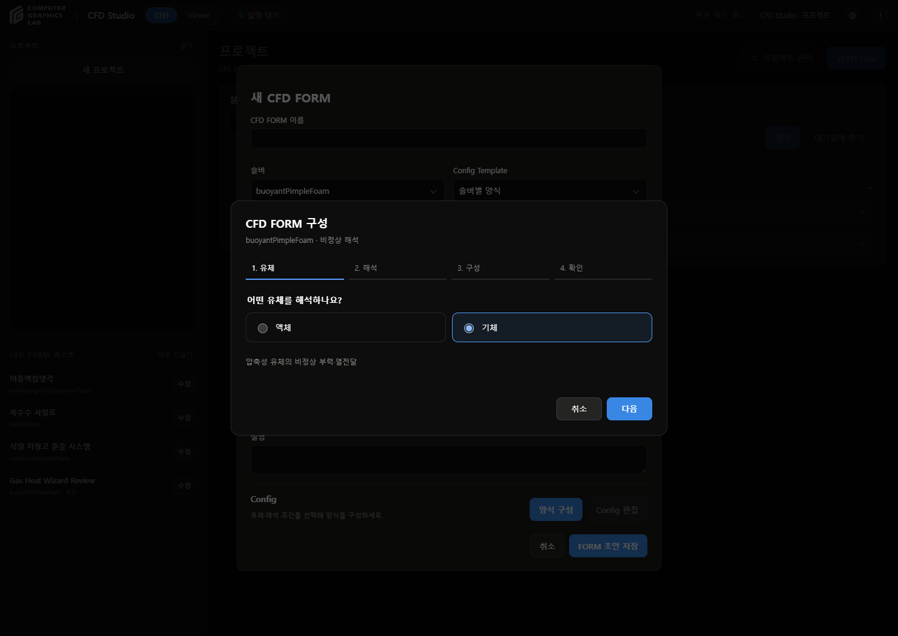
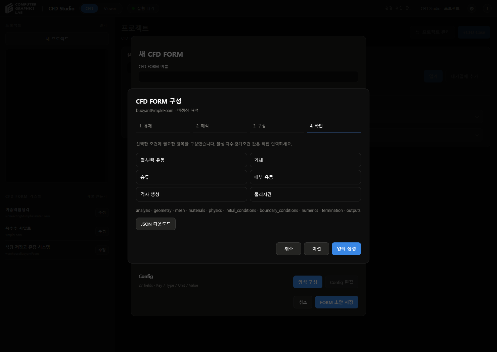
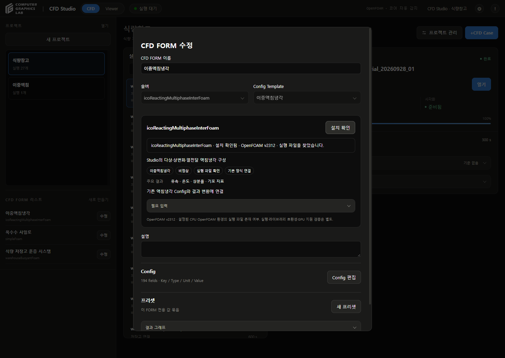

# CFD FORM

## 사용법

1. **새 CFD FORM**에서 이름·솔버 선택
2. **양식 구성** 선택
3. **유체**: 액체·기체·다상 조합 선택
4. **해석**: 해석 목적·층류 또는 난류 선택
5. **구성**: 내부·외부 영역, 기존 격자·격자 생성, 종료 조건 선택
6. **확인 → 양식 생성**
7. **Config 편집**에서 항목별 값 입력
8. **Download JSON**으로 파일 저장 또는 **Apply → FORM 초안 저장**

## 생성 항목

| 조건 | 구성되는 항목 |
|---|---|
| 단상 유동 | 유체 물성, U·p 초기장·경계조건 |
| 열·부력 유동 | 열물성, 온도, 중력, p_rgh |
| 다상 유동 | 상별 물성·상분율, 계면·표면장력 |
| 고체·유체 열전달 | 고체 영역·열물성·온도, 접합면 |
| 난류 | 사용자 지정 모델·계수·추가 초기장·경계조건 |
| 내부 유동 | inlet·outlet·wall 연결 항목 |
| 외부 유동 | far_field·body 연결 항목 |
| 기존 격자 | 격자 원본 입력 |
| 격자 생성 | 생성 도구·크기·세분화 영역 입력 |
| 정상 해석 | 수렴 조건·최대 반복 한계 |
| 비정상 해석 | 시간간격·Courant 수·물리시간 또는 프레임·수렴 조건 |

- 실제 메시 패치 이름·영역 이름은 사용자가 입력
- 액체·기체 선택만으로 물질·물성값 자동 지정 없음
- 난류 모델 이름과 이에 필요한 추가 장은 사용자 입력
- 빈 숫자 항목은 `null`. 0으로 대체하지 않음
- 단위가 있는 물리량은 JSON에 값·단위를 함께 저장
- 초기 프레임 포함 여부는 프레임 종료 조건의 `include_initial_frame`에 명시
- 상변화 모델·계수는 자동 선택하지 않음
- 정상·비정상 방식은 선택한 솔버에 의해 고정
- 지원하지 않는 조합은 질문 선택지에서 제외하고 API에서도 거절

## 편집

- 솔버별 미저장 Config는 창을 열어 둔 동안 각각 보존
- 저장한 FORM은 재시작 후에도 조건·Config·단위 복원
- **양식 다시 구성**: 마지막 단계의 **새 양식으로 교체**를 눌러야 현재 Config 교체
- 구성 중 취소: 기존 Config 유지
- JSON의 솔버·해석 방식이 FORM과 다르면 저장 차단
- 기존 프로젝트·Case·프리셋 자동 변경 없음

## 설치 확인

- 목적: 설정된 CPU OpenFOAM 환경에서 솔버 실행 파일 존재 확인
- 확인 중: 진행 메시지 표시
- 설치 확인됨: 솔버 이름·OpenFOAM 버전 표시
- 실행 파일 없음: 해당 환경의 설치·경로 확인 안내
- 확인 실패: 환경 확인 실패 또는 요청 오류 표시
- 버튼은 확인 후에도 **설치 확인**으로 유지
- Windows에서 WSL로 명령 전달 시 발생하던 CRLF 변환 오류 수정
- CFD 실행·라이브러리 호환성·Studio 어댑터 연결 확인은 별도

## 범위

- 입력 양식 생성·수치 입력·JSON 출력 지원
- 생성 결과는 FORM 초안. 임의 Config를 OpenFOAM 입력 파일로 만드는 실행 어댑터는 별도 구현 필요
- 입력 형식 검사는 물리 정확도 검증이 아님
- 이번 작업에서 CFD 계산 미실행

## 검사

- Python 관련 검사 24개 통과
- JavaScript 70개 통과
- 12개 솔버의 허용 응답 조합 모두에서 Config·스키마 일치 검사
- 화면에서 기체·열 유동 양식 생성, 숫자 입력, JSON 다운로드, 저장·새로고침 복원 확인
- 솔버 전환 시 편집값 분리 확인
- 설치됨·미설치·환경 실패·통신 실패 표시는 시험 응답으로 확인
- 실제 Windows 환경: OpenFOAM v2312, 등록 솔버 12개 실행 파일 확인
- 재시작 후 프로젝트 2개·실행 28개·대기열 상태 유지
- 적용 버전 v192

## 변경 파일

- `cfd_studio/internal/form_wizard.py`: 솔버별 질문·Config 생성
- `cfd_studio/internal/form_wizard.js`: 단계별 질문 화면
- `cfd_studio/internal/execution_workspace.js`: FORM·설치 결과 표시 연결
- `cfd_studio/internal/execution_workspace.py`: 질문·생성 API
- `cfd_studio/internal/form_config_editor.js`, `form_schema.py`: 빈 숫자 입력·단위 보존
- `cfd_studio/internal/cfd_forms.py`: 생성된 JSON의 솔버 일치 검사
- `cfd_studio/internal/solver_catalog.py`: Windows에서 줄바꿈 변환 없이 설치 확인 명령 전달
- `tests/test_form_wizard.py`, `tests/test_form_config_editor.js`: 생성·저장·입력 검사

## 근거

- 범용 솔버 분류: [OpenFOAM Solver Applications](https://doc.openfoam.com/2306/tools/processing/solvers/)
- 다상 열전달 기능: [OpenFOAM v1806](https://www.openfoam.com/news/main-news/openfoam-v1806/solver-and-physics)
- 전용 솔버: 저장소의 `tracer_transport/coupled_solver/warehouseBuoyantFoam.C` 및 기존 Studio 실행 연결 코드

## 솔버별 필수 입력

- 솔버 선택 시 주요 용도·필수 Config·선택 Config·계산 범위 확인
- 자동 생성 양식의 **Required** 항목 입력 후 **입력 검사**
- 누락 경로 확인·초안 저장 가능. 물리 정확도·실행 연결 검증은 별도
- [솔버별 입력 정의](solver-input-definitions-20260929.md)
