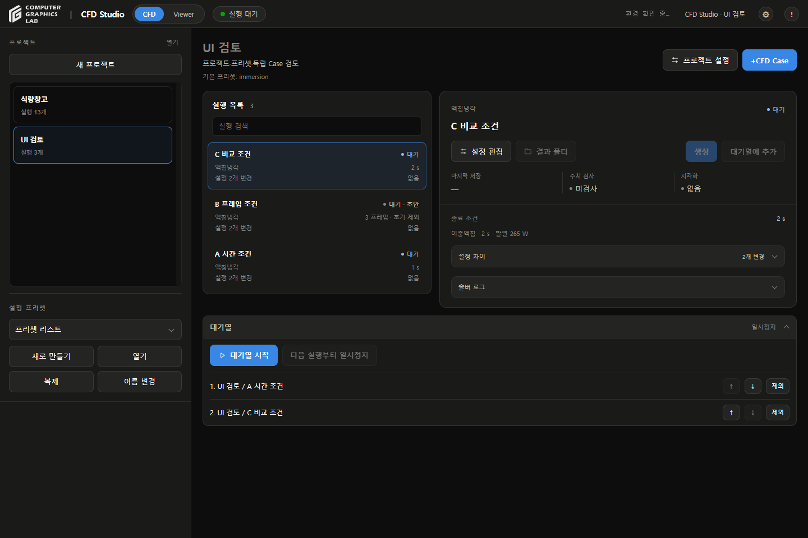
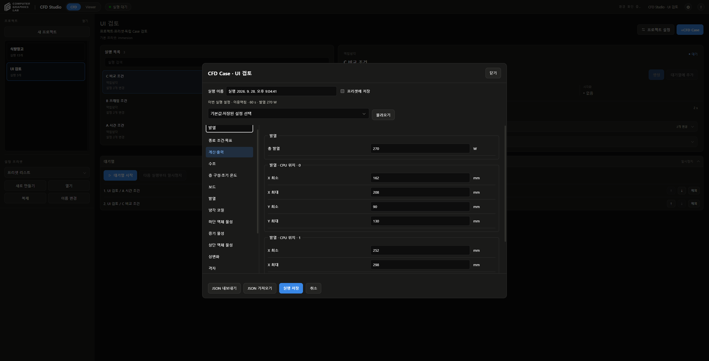

# 전체 검토

## 수정

| 문제 | 조치 |
|---|---|
| 종료 조건·출처 화면에서 설정 검색 무반응 | 검색 처리를 화면 분기보다 먼저 수행 |
| 표시 이름·분류 이름 검색 누락 | 화면과 검색에서 같은 항목명 사용, 분류·복수 단어·공백·대소문자 지원 |
| 출력 항목 검색 시 숫자 행 표시 | 체크박스 묶음 유지, 미선택 출력 항목도 검색 |
| 잘못된 JSON에서 검색 시 오류 유실 | 오류 표시와 입력 내용 보존 |
| Data Sheet에서 다시 읽기 중 스크립트 오류·이전 그래프 잔류 | Case 선택과 동일한 로딩 경로 사용, 준비 상태 초기화 |
| 실패한 이전 요청이 새 Case의 오류 상태를 변경 | 요청 완료 후 Case·요청 세대 재확인 |
| 읽기 실패 후 모드 전환 시 상태가 다시 로딩 중으로 표시 | 실패 상태 유지, 다시 읽기로 복구 |
| CFD 화면·버튼 조작 중 재생 단축키 작동 | Viewer 배경에서만 재생 단축키 처리 |
| 프로젝트 열기 실패 후 목록·파일 일부 변경 | 실패 시 기존 목록·설정·연결 파일 복원 |
| 기존 프로젝트 내부의 폴더를 별도 프로젝트로 열기 허용 | 프로젝트 경로 중첩 검사 |
| 이중액침의 짧은 프레임 수 조건 저장 거부 | 결과 간격과 복구 간격을 별도로 검사 |
| 단상 저장고에 액침냉각 그래프 항목 표시 가능 | 해당 Data Sheet 미지원 명시, 잘못된 항목·단위 표시 차단 |

## 검사 결과

| 검사 | 결과 |
|---|---|
| Python 전체 | 152개 통과 |
| JavaScript | 56개 통과 |
| Windows 프로젝트 저장 | 16개 통과 |
| 기존 스칼라 결과 | 13개 결과 폴더·253프레임·647,680개 값, 형식 오류 없음 |
| 저장고 결과 API | 열람 가능한 12개 결과의 시간 배열·단위·첫 프레임 검사, 오류 없음 |
| 운영 프로젝트 보존 | 프로젝트 2개·실행 연결 28개 동일 |
| 읽기 지연 | 메타데이터 응답 지연 후 Data Sheet 복구 |
| 읽기 실패 | 503 응답 후 실패 표시 유지, 다시 읽기로 복구 |
| Case·프리셋 | 화면에서 Case 3개 생성, 체크 기본 해제·새 프리셋 저장 확인 |
| 독립 설정 | A 1초, B 3프레임, C 2초 보존. 원본 프리셋 종료시간 60초 유지 |
| 대기열 | 추가·순서 변경·제외·페이지 재접속 후 목록 복원 확인 |
| 순차 실행·중단·재시도 | 테스트 실행기로 검증, 실제 CFD 실행 없음 |

## 설정 검색

- 편집 화면: `발열`, `냉각 코일`, `냉각 코일 온도`, `유속`, `출력 항목`, `종료시간`, `결과 프레임 저장 간격`, `복구 데이터 저장 간격` 확인
- 저장된 설정 조회: `계산 간격`, `초기 실내 온도`, `공극률` 확인, 읽기 전용 유지
- 검색·검색 해제·분류 전환 후 편집값과 출력 체크 상태 유지
- JSON 오류 시 원문 유지, 수정 후 검색 복구
- 출처는 기존 하단 메뉴에서 조회
- 기존 설정창 스타일 정의와 동일함을 비교 확인
- 화면 배치·색상·버튼 형태 변경 없음

## 범위

- 운영 프로젝트: 결과 읽기·Viewer 검사만 수행
- 설정·Case 생성: 별도 임시 등록부에서 검사, 원본 저장소 코드 사용
- 기존 Raw·계산 결과·프리셋 보존
- 사용자의 Chrome·계산 프로세스 종료 없음
- Studio 서버 갱신: 실행·변환·대기열 비활성 확인 후 진행
- 스칼라 파일 형식 검사는 물리적 정확도·독립 실험 검증이 아님
- 기존 스칼라 파일은 해시 기록이 없어 변경 이력까지 검증하지 않음
- 저장고 모든 시간의 원본장을 이번에 전수 대조한 것은 아님
- 수렴 종료는 기존 실행기의 연속 판정 미연결로 비활성
- 단상 저장고 Data Sheet는 미지원. 기존 3D Viewer 유지
- 새 CFD 계산·실제 솔버 3개 연속 실행·실험 검증은 이번 작업에서 수행하지 않음

## 변경 파일

- `cfd_studio/app.py`: 버전·키보드·복구 간격 입력 검사
- `cfd_studio/config_editor.js`, `config_presets.py`: 저장 간격 검사·검색 누락 수정
- `cfd_studio/data_sheet_viewer.js`: 요청 상태·실패 복구·지원 모델 구분
- `cfd_studio/execution_workspace.js`: 재로딩·Case 전환 취소
- `cfd_studio/project_storage.py`: 가져오기 복원·경로 중첩 검사
- 관련 Python·JavaScript 회귀 테스트

## 재현

```text
python -m unittest discover -s tests -p "test_*.py" -q
node --test tests/test_data_sheet_viewer.js tests/test_shared_warehouse_viewer.js tests/test_settings_editor.js tests/test_viewer_review.js
python tests/audit_saved_results.py cfd_studio/Project
```

## 화면





- 임시 Case 편집 화면. 화면의 변경값은 저장하지 않고 취소
