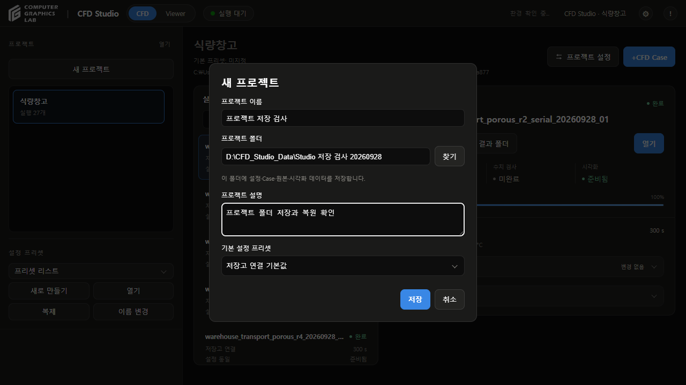
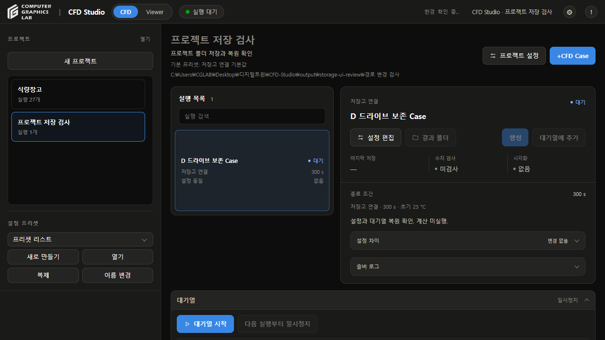
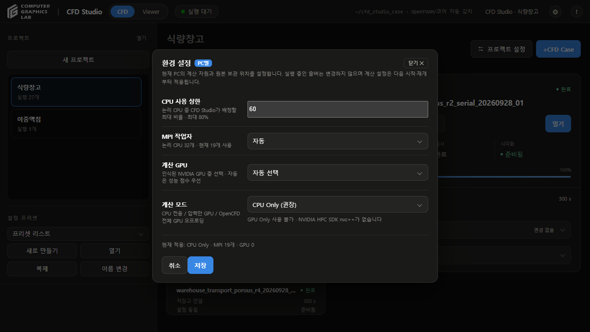

# 프로젝트 저장 검토

- 날짜: 2026-09-28
- 버전: v181

## 변경

- 프로젝트 생성·설정 창에 저장 폴더 입력과 찾기 추가
- 프로젝트 폴더 열기 추가
- Case 설정·대기열 기록을 프로젝트의 `ProjectSettings`에 저장
- 실행 스냅샷·로그·원본·결과를 Case별 시도 폴더에 저장
- 이중액침 변환 캐시를 실행 결과 폴더 안에 저장
- Studio 공통 목록은 프로젝트 경로와 대기열 순서 참조
- 소프트웨어 설정의 전역 Raw 위치 항목과 변경 API 제거
- 과거 전역 Raw 위치에 따른 자동 프로젝트 이관 중지
- 독립 프리셋 관리 유지

## 보존

- 기존 프로젝트 2개, 실행 28개의 ID와 원본 경로를 변경 전·후 대조
- 식량창고 27개, 이중액침 1개 연결 유지
- 기존 결과 자동 이동·삭제 없음
- 기존 미커밋 `configs/.initialized` 유지
- 위치 변경 시 복사와 SHA-256 검증 후 연결 변경
- 원본 폴더 보존
- 복사 실패 시 기존 연결 유지, 불완전한 복사본 열기 차단
- 계산·변환·보관 중 경로 변경 차단
- 다른 프로젝트와 겹치는 경로 및 비어 있지 않은 대상 폴더 차단

## 화면 확인

- 별도 검토 서버에서 D드라이브의 한글·공백 경로로 프로젝트 생성
- Case 설정 저장과 대기열 추가
- D드라이브에서 C드라이브로 프로젝트 경로 변경
- 서버 재시작 후 이름·설정·종료 조건·대기열 복원
- 대기열은 일시정지, CFD 실행 없음
- 실제 Studio의 소프트웨어 설정에서 Raw 위치 입력 제거 확인
- 기존 화면의 프로젝트·프리셋·실행 카드 디자인 유지








## 검사

| 검사 | 결과 |
|---|---|
| WSL Python 전체 검사 | 149개 통과 |
| Windows Python 저장·실행·백그라운드 창 검사 | 43개 통과 |
| JavaScript 설정·Viewer 검사 | 43개 통과 |
| D드라이브 설정 파일 | Windows·WSL SHA-256 일치 |
| 기존 결과의 D드라이브 복사본 | 프레임 조회값·단위 일치, 원본 파일 경로만 변경 |
| 새 Studio 목록에서 프로젝트 열기 | Case·설정·대기열 복원 |
| 오프라인 경로의 이동된 프로젝트 다시 열기 | ID 유지, 대기열 복원, 자동 실행 없음 |
| 저장 실패 | 기존 Case·프리셋 보존 |
| 기존 결과 조회 | 프로젝트 내부 경로와 이전 경로 모두 지원 |

```sh
python3 -m unittest discover -s tests -p 'test_*.py'
node --test tests/test_shared_warehouse_viewer.js tests/test_settings_editor.js tests/test_viewer_review.js
```

- 전체 Python 검사는 NumPy가 있는 WSL 환경에서 실행
- Windows 번들 Python은 저장·실행 관리 등 표준 라이브러리 검사에 사용
- Windows 번들에서 전체 검사를 시도한 결과 NumPy 및 Linux 전용 실행 환경 부재 확인. 전체 검사 결과는 WSL 기준

## 범위

- 신규 CFD 계산 미실행
- 새 저장 경로에서 장시간 CFD 계산부터 원본 보관까지의 전체 실행은 미검증
- Windows 폴더 선택 대화상자의 직접 클릭은 미검증. 실제 경로 지정 검사는 입력란 사용
- 기존 대용량 결과는 원래 경로 연결 유지. 프로젝트 위치를 변경하면 복사·검증 수행
- 이중액침 솔버의 계산 작업 공간은 기존 WSL 폴더 사용. 완료 후 프로젝트에 원본 보관하는 연결 추가
- 독립 프리셋은 프로젝트 폴더 백업에 포함되지 않음. 실행에 적용한 설정은 프로젝트 안에 보관
