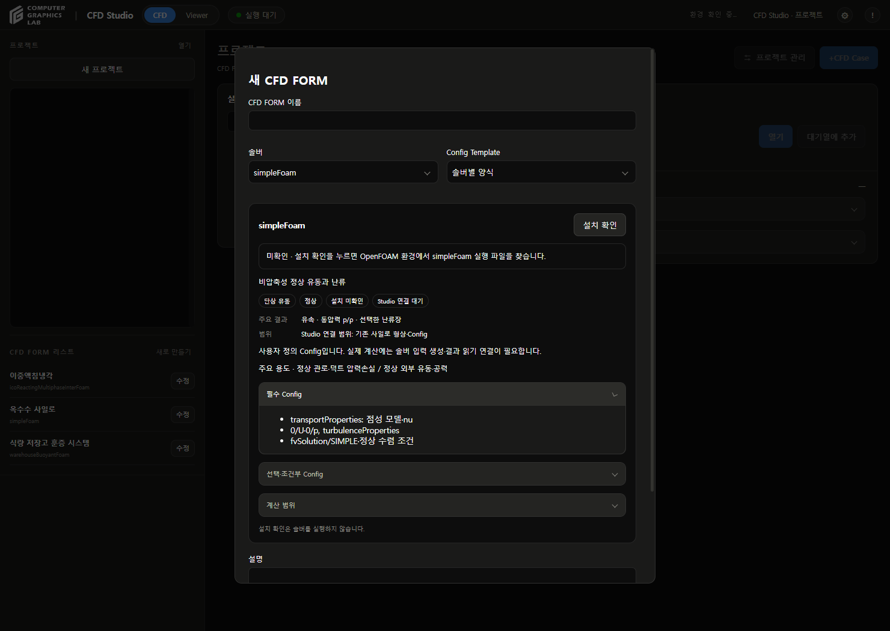
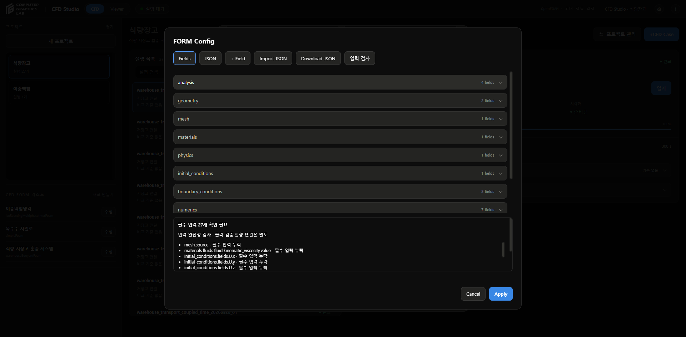
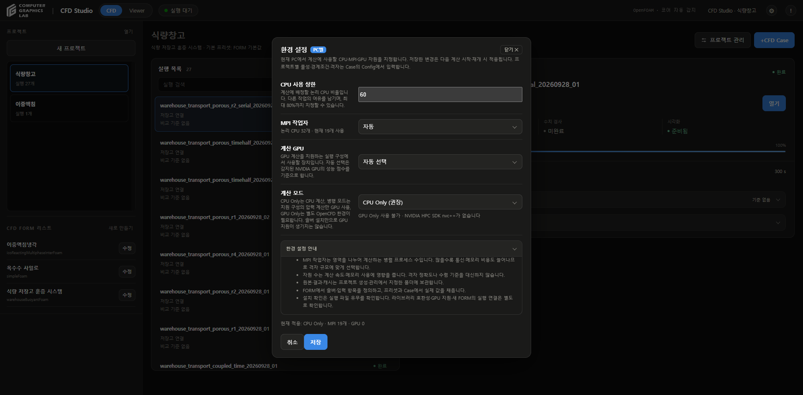
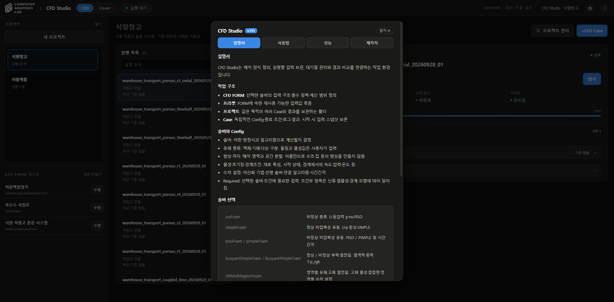

# 솔버별 입력 정의

## 사용법

- 해석 조건 설문 → 추천 솔버의 주요 용도·출력·제한 확인 → 솔버 선택
- **양식 생성 → 양식 편집**으로 입력 구조 정의
- 프로젝트 생성 시 **Config 입력**에서 **Required** 항목 작성
- **입력 검사**로 누락 경로·형식·기본 범위 확인
- Template은 빈 양식으로 저장 · 프로젝트 Config의 필수값은 저장 전 입력
- 물성·경계조건·난류 모델별 세부 계수는 사용자가 입력

## 솔버 정의

OpenCFD OpenFOAM v2312 소스와 저장소 전용 솔버 기준

- [최근 검토·보완 항목](solver-template-audit.md)

| 솔버 | 대표 용도 | 필수 입력 | 선택·조건부 |
|---|---|---|---|
| icoFoam | 층류 채널·관내 유동 / 공동 유동·수치 검증 | transportProperties: nu 0/U·0/p 및 경계조건 fvSchemes·fvSolution/PISO·controlDict | 밀도: 힘·차원 압력 환산에 사용할 때 |
| simpleFoam | 정상 관로·덕트 압력손실 / 정상 외부 유동·공력 | transportProperties: 점성 모델·nu 0/U·0/p, turbulenceProperties fvSolution/SIMPLE·정상 수렴 조건 | RAS 모델별 k·epsilon 또는 k·omega MRF·다공성 저항·소스항 |
| pimpleFoam | 비정상 관내·외부 유동 / 이동 격자·시간에 따른 와류 | transportProperties·turbulenceProperties 0/U·0/p fvSolution/PIMPLE·deltaT·저장 간격 | RAS·LES 모델별 입력 dynamicMeshDict: 이동 격자 사용 시 |
| pisoFoam | 비정상 내부 유동 / 시간에 따른 비압축성 유동 | transportProperties·turbulenceProperties 0/U·0/p fvSolution/PISO·deltaT | RAS·LES 모델별 입력 MRF·소스항 |
| buoyantSimpleFoam | 정상 자연대류·환기 / 정상 열전달·열손실 | thermophysicalProperties: thermoType·mixture U·p·p_rgh·T 및 열 경계조건 중력 g·SIMPLE·정상 수렴 조건 | 복사 모델·흡수/방사 계수 난류·열원 |
| buoyantPimpleFoam | 가열·냉각 과도 응답 / 부력·환기 유동의 시간 변화 | thermophysicalProperties: thermoType·mixture U·p·p_rgh·T·중력 g PIMPLE·deltaT·열 경계조건 | 복사·열원 이동 격자·RAS·LES |
| chtMultiRegionFoam | 유체 냉각과 고체 전도 / 열교환기·전자부품 열관리 | regionProperties: fluid·solid 영역 영역별 thermophysicalProperties·fvSchemes·fvSolution 유체 초기장·고체 T·열 접합 경계조건 | 영역별 복사·열원 접촉 열저항·이방성 전도 모델 |
| interFoam | 자유표면·액면 운동 / 충전·댐 붕괴·두 비혼합 유체 | 두 상의 rho·nu·상 이름 U·p_rgh·alpha.phase_1·중력·표면장력 MULES 상분율 이송·PIMPLE·deltaT | 접촉각·벽 젖음 조건 이동 격자·난류 |
| interIsoFoam | 자유표면·계면 형상 추적 / 날카로운 계면 이송 | 두 상의 rho·nu·상 이름 U·p_rgh·alpha.phase_1·중력·표면장력 isoAdvector 상분율 이송·PIMPLE·deltaT | isoFaceTol·surfCellTol·bounding 설정 접촉각·이동 격자·난류 |
| rhoPimpleFoam | 압축성 과도 유동 / 압력·밀도·온도가 변하는 유동 | thermophysicalProperties: 상태방정식·에너지·수송 모델 U·p·T 및 경계조건 PIMPLE·deltaT·압축성 수치 기법 | 난류·열원 이동 격자 |
| icoReactingMultiphaseInterFoam | 다상 열전달·상변화 / 비혼합 유체의 가열·냉각 | phaseProperties·상별 thermophysicalProperties 각 상분율·U·p_rgh·T 중력·계면 모델·PIMPLE·상분율 이송 | 질량·열 전달 모델별 계수 복사·난류·성분별 모델 입력 |
| warehouseBuoyantFoam | 전용 저장고 열·유동 모델 / 수동 스칼라 수송 연구 | 전용 transportProperties·Boussinesq 열물성 U·p_rgh·T·스칼라 정의·확산계수 중력·PIMPLE·전용 격자·경계 연결 | 다공성 영역별 저항 스칼라 경계·소스의 사용자 정의 |

## JSON과 OpenFOAM

| Studio Config | OpenFOAM 입력 역할 |
|---|---|
| mesh / geometry | polyMesh, 메시 생성 설정, regionProperties |
| materials.fluids.*.kinematic_viscosity | 비압축성 transportProperties의 nu |
| thermophysical_properties.thermoType / mixture | thermophysicalProperties의 모델 조합·물성 계수 |
| initial_conditions / boundary_conditions | 0/U, 0/p, 0/p_rgh, 0/T, 0/alpha 등 |
| numerics.schemes | fvSchemes의 ddt·grad·div·laplacian·interpolation·snGrad |
| numerics.linear_solvers | fvSolution의 장별 선형 솔버. energy는 선택한 h/e/T 방정식에 맞게 연결 |
| numerics.controls | SIMPLE / PISO / PIMPLE 제어 사전 |
| numerics.regions | 다중 영역별 fvSchemes·fvSolution 정의 |
| physics.turbulence | turbulenceProperties 및 모델별 초기장·경계조건 |
| termination / outputs | controlDict와 Studio 종료·저장 정책 |

- 대응 역할 설명. 이 JSON을 OpenFOAM이 직접 읽는 입력 파일로 간주하지 않음
- 기존 실행 연결 템플릿은 기존 Config 계약과 검사를 유지
- 새 솔버 양식은 별도 입력·실행·결과 어댑터가 필요

## 필수와 조건부

- 불필요한 필수값 구분: icoFoam의 밀도는 기본 U·p 계산 필수값에서 제외
- interFoam·interIsoFoam: p와 두 번째 상분율을 초기 입력에서 제외. 유도 출력으로 유지
- interFoam: MULES. interIsoFoam: isoAdvector. 계면 이송 방법 별도 정의
- 열역학 솔버: thermoType의 모델 조합·mixture 계수 입력 필수. 단순 밀도·비열값만으로 완료 처리하지 않음
- kEpsilon: k·epsilon. kOmegaSST: k·omega의 초기값·경계조건 확인
- LES: 모델·delta 정의 확인. 모델 세부 계수 검토는 별도
- fixedValue: 해당 장의 경계값 필수. zeroGradient는 고정값 요구 없음
- 상변화 모델 사용 시 전달 계수 확인. 모델별 계수 의미·상 연결은 별도 검토
- CHT: 유체·고체 영역, 접합면, 고체 물성·초기 온도, 영역별 수치 사전 확인
- SI 기준 단위·양수 물성·정수 종료 조건·상분율 0~1·종료/최대 시간 관계 검사

## 검사 범위

- 필수 입력 누락·기본 자료형·일부 범위·단위 검사
- 정의된 필수 항목 작성 완료와 물리 검증·실행 준비 완료는 별도
- 메시 파일 존재·patch 대응·모든 OpenFOAM 런타임 모델 조합·경계조건별 전체 계수 검증 미포함
- 사용자 난류 모델·상변화 모델의 미지원 세부 검토 사항 표시
- 기존 FORM 자동 재작성 없음. 새 구조 적용은 양식 다시 구성으로 명시적으로 선택
- 검사 결과는 FORM의 input_review에 보관. 기존 Case·프리셋·결과 변경 없음

## 환경 설정과 설명서

- 우측 ⚙: CPU 사용률·MPI·GPU·계산 모드의 의미·적용 시점·프로젝트 저장 위치 설명
- 우측 !: FORM·프리셋·프로젝트·Case 관계, 솔버 분류, Config 개념, 상태 구분, Viewer 사용 범위 설명
- 예제 저장고의 치수나 계산 기록을 일반 CFD 기능 설명으로 사용하지 않음

## 확인

- Python 관련 검사 30개 통과
- JavaScript 71개 통과
- 실제 화면에서 솔버별 설명·Required·누락 검사·입력 후 누락 감소·초안 보관 확인
- 새 양식 정의 작업. CFD 계산 미실행
- 실제 환경 설정창·설명서·입력 검사 화면 확인
- 재시작 후 프로젝트 2개·실행 28개·대기열 유지
- v193

## 수정 파일

- `cfd_studio/internal/solver_requirements.py`: 12개 솔버 입력 정의·필수 검사
- `solver_catalog.py`, `form_wizard.py`: 용도·입력 구조·메타데이터 연결
- `form_config_editor.js`, `execution_workspace.js`: Required·입력 검사·솔버 설명
- `execution_workspace.py`, `cfd_forms.py`: 검사 API·결과 보관
- `cfd_studio/app.py`: 환경 설정·설명서 확대
- `tests/test_solver_requirements.py`: 솔버별·조건부·누락·범위 검사

## 근거

- 설치된 OpenFOAM v2312의 applications/solvers 하위 각 솔버 .C·createFields.H
- [OpenFOAM 표준 솔버](https://www.openfoam.com/documentation/user-guide/a-reference/a.1-standard-solvers)
- [icoFoam 설명](https://doc.openfoam.com/2312/tools/processing/solvers/rtm/incompressible/icoFoam/)
- [수치 제어](https://www.openfoam.com/documentation/user-guide/6-solving/6.3-solution-and-algorithm-control)
- 전용 솔버: tracer_transport/coupled_solver의 createFields.H·readTransportProperties.H
