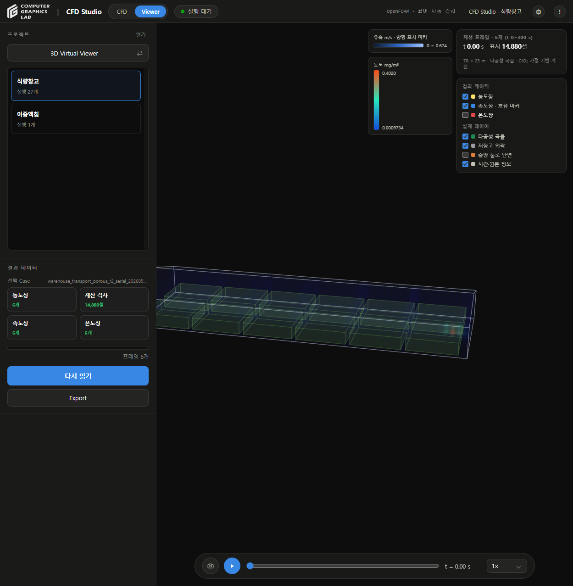
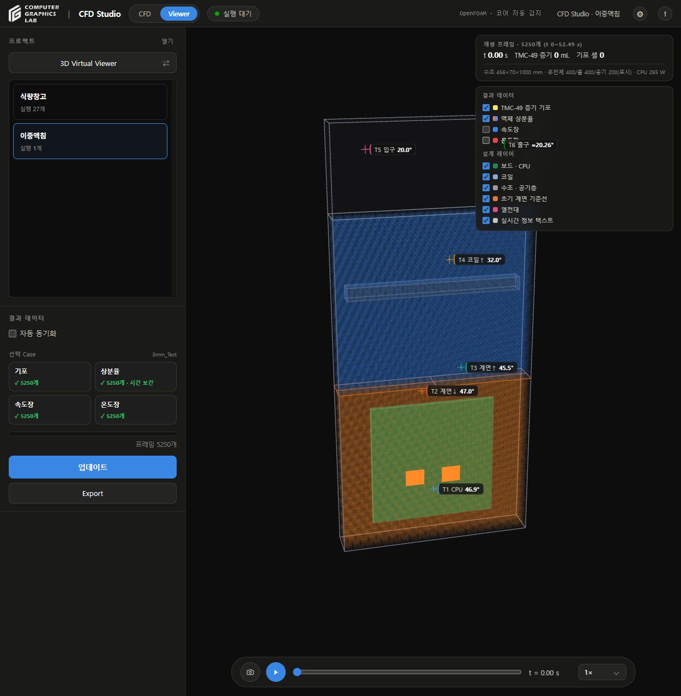

# 폴더 정리

## 위치

- 프로그램: `C:\Users\CGLAB\Desktop\식량창고 프로젝트\CFD-Studio`
- 실행: `식량창고 프로젝트\CFD Studio.lnk`
- 저장고 프로젝트: `CFD-Studio\cfd_studio\Projects\식량창고_910fe842`
- 이중액침 프로젝트: `D:\CFD Studio\Projects\이중액침_32ff4aa4`
- 정리 기록: `식량창고 프로젝트\90_이전작업_보관\CFD_폴더정리_20260928`

## 정리 내용

| 항목 | 처리 |
|---|---|
| 원본 Git 저장소 | 폴더 이동, Git 이력·원격 유지 |
| 기존 `Project` 결과 13개 | 저장고 프로젝트의 `Results`로 이동 |
| 저장고 계산 폴더 14개 | 저장고 프로젝트의 `Cases`로 이동 |
| 이중액침 결과·Raw | D드라이브 프로젝트의 `Results`로 이동 |
| 프로젝트 연결 | 실행 ID 유지, 프로젝트 내부 상대경로로 갱신 |
| 빈 `Project`·`frames`·`Trash` | 제거, 새 호환 데이터는 `_runtime`에 저장 |
| Raw 경로 링크 29,402개 | 프로젝트 내부 상대경로로 전환 |
| 이전 UI 검토·임시 파일·Python 캐시 | 복구 가능한 보관 폴더로 이동 |
| `Setup`·`configs`·`Studies` | 실행 환경·프리셋·이전 실험 이력으로 유지 |
| 별도 작업 브랜치 | 기존 위치 보존, 이동한 Git 저장소와 연결 복구 |

- 프로그램과 계산 결과는 같은 드라이브 안에서 폴더 이동
- C→D 이동은 이중액침 프로젝트의 소규모 등록 정보만 복사 검증
- 기존 등록 정보·변경 메타데이터 원본·경로 대응표 보관
- Raw·설정 스냅샷·수치장 파일의 내용 변경 없음
- UI 디자인 변경 없음

## 확인

- 이동 전후 764,017개 파일의 크기·수정시각·파일 식별자 대조
- 결과·설정 표본 파일 SHA-256 대조
- Git 추적 파일 307개의 SHA-256 동일
- 프로젝트 2개·실행 28개·기존 상태 동일
- 저장고 12개 결과의 메타데이터·첫 프레임 API 읽기 확인
- 이전 추적자 결과 13개·253프레임·647,680개 값 형식 검사 통과
- 저장고·이중액침 3D Viewer 화면 확인
- 이중액침 기포·상분율·유속·온도 각 5,250개 프레임 인식
- Raw 링크 29,402개의 대상 경로를 이동 전 파일 목록과 대조, 표본 100개 실제 연결 확인
- Python 전체 155개 통과
- JavaScript 56개 통과
- 이동 후 Windows 저장·폴더 호환 검사 19개 통과
- 새 위치의 포함 Python으로 앱 시작 확인
- 실제 CFD 재계산·재개는 수행하지 않음
- 전체 Raw 바이트의 해시 전수 검사는 수행하지 않음

## 화면

