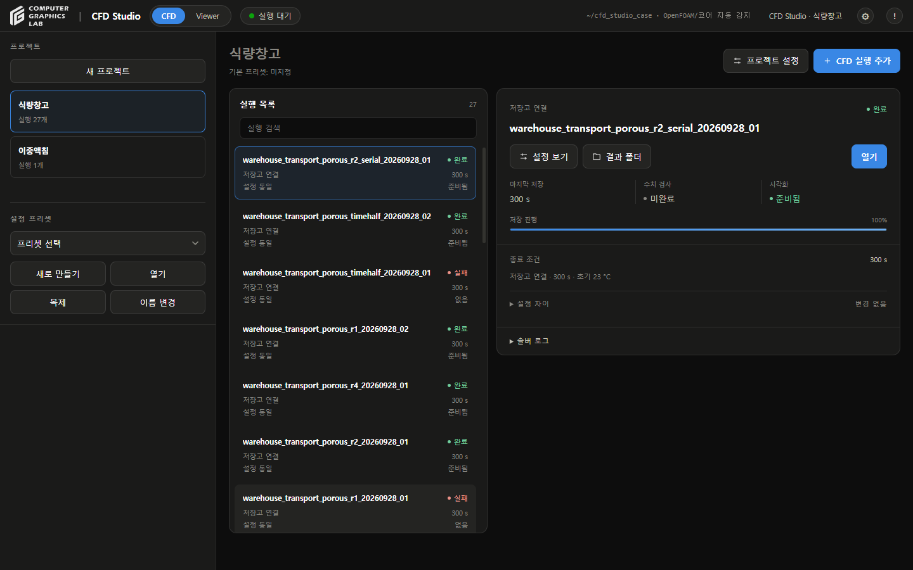
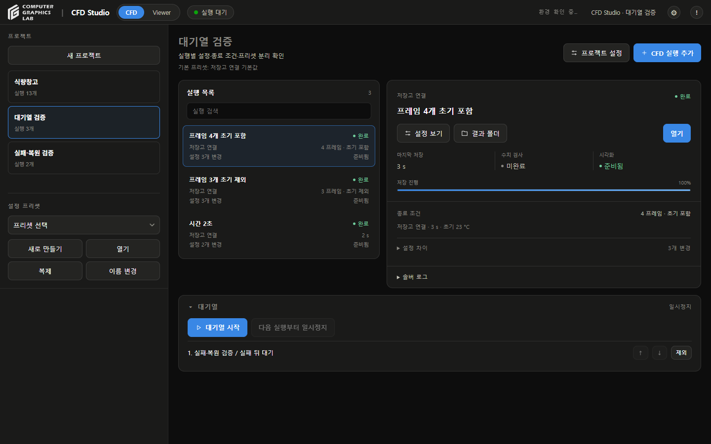

# 화면 검토

- 2026-09-28
- 기존 Studio의 색상·카드·버튼·진행 막대 스타일 적용
- 실행 목록과 선택 실행 상세를 두 영역으로 배치
- 좁은 창: 위아래 배치
- 상태: 색상 표시와 짧은 라벨 병용
- 긴 실행명: 목록에서 말줄임, 선택 상세에서 전체 이름 표시
- 로그·설정 차이: 펼침 영역
- 빈 대기열: 숨김
- 로그 파일 경로: 주요 화면에서 제거
- 출처·근거: 설정 목록 마지막 **출처** 항목으로 이동
- 원본 입력·프로젝트·결과: 변경 없음

## 검사

- 실제 화면: 실행 선택·설정 조회·새 실행 편집·Viewer 전환
- 1440×900, 1024×768: 주요 영역의 가로 넘침 없음
- 출처: 마지막 항목 배치·기존 근거 입력 접근 확인
- 프리셋에 저장: 기본 해제 유지
- 기존 저장고 결과: 4프레임 Viewer 연결 확인
- JavaScript 관련 검사: 42개 통과
- 이번 변경에서 새 CFD 계산: 수행하지 않음
