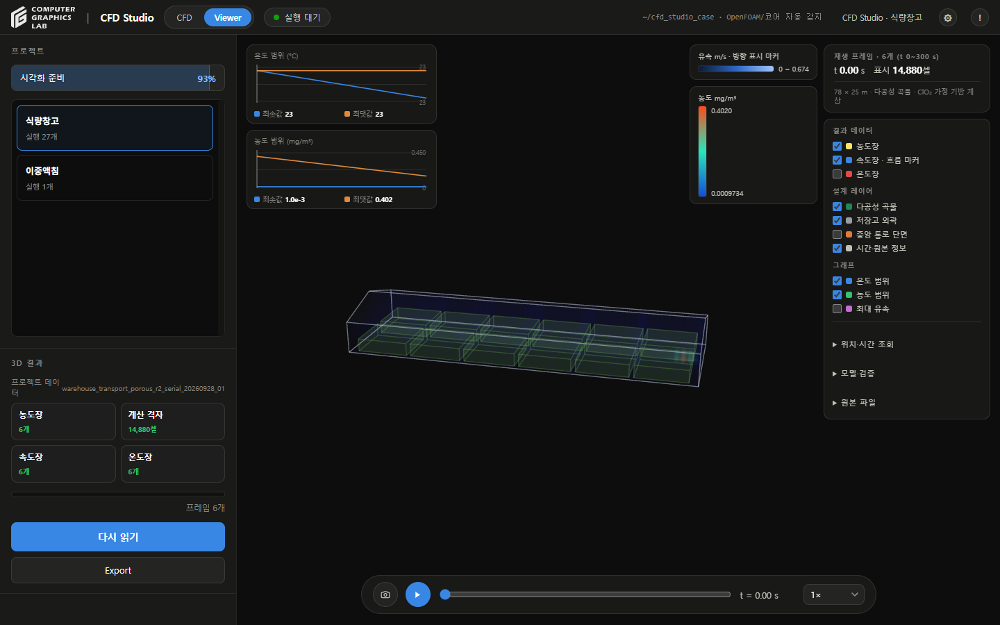
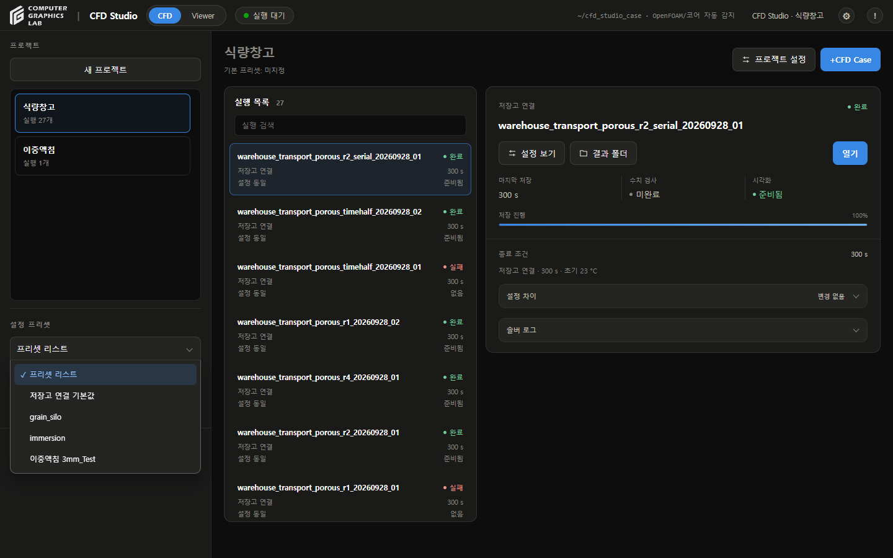
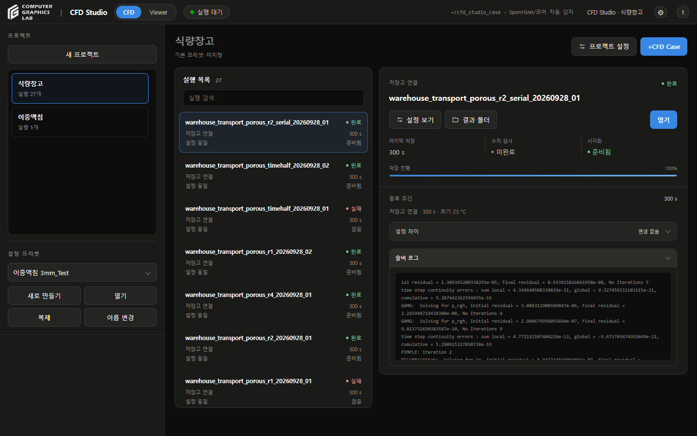
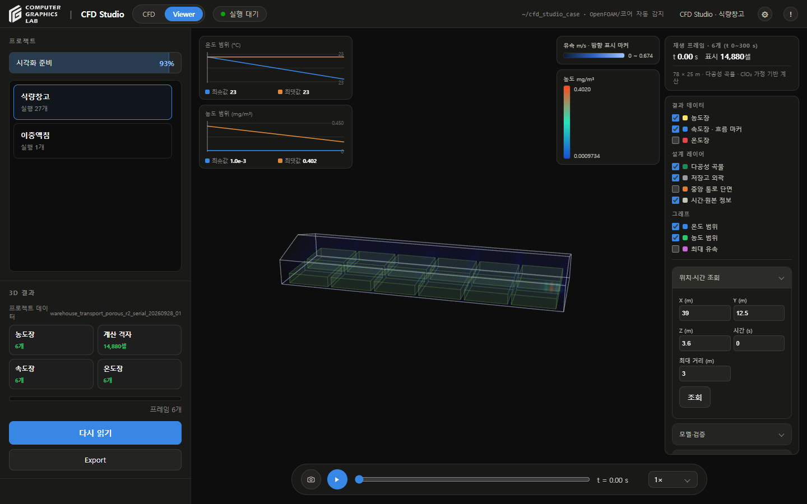

# 화면 검토

- 2026-09-28
- 기존 Studio의 색상·카드·버튼·진행 막대 스타일 적용
- 실행 목록과 선택 실행 상세를 두 영역으로 배치
- 좁은 창: 위아래 배치
- 상태: 색상 표시와 짧은 라벨 병용
- 긴 실행명: 목록에서 말줄임, 선택 상세에서 전체 이름 표시
- 로그·설정 차이: 펼침 영역
- 빈 대기열: 숨김
- 로그 파일 경로: 주요 화면에서 제거
- 출처·근거: 설정 목록 마지막 **출처** 항목으로 이동
- 원본 입력·프로젝트·결과: 변경 없음

## 검사

- 실제 화면: 실행 선택·설정 조회·새 실행 편집·Viewer 전환
- 1440×900, 1024×768: 주요 영역의 가로 넘침 없음
- 출처: 마지막 항목 배치·기존 근거 입력 접근 확인
- 프리셋에 저장: 기본 해제 유지
- 기존 저장고 결과: 4프레임 Viewer 연결 확인
- JavaScript 관련 검사: 42개 통과
- 이번 변경에서 새 CFD 계산: 수행하지 않음

## 사이드바 수정

- 실행 선택·설정 보기·실행 목록 묶음 제거
- 프로젝트 목록: 프리셋 영역 위까지 전용 스크롤 적용
- Viewer: 프리셋 관리 숨김, 새 프로젝트 버튼은 같은 자리의 시각화 준비율 게이지로 전환
- 이중액침 `3mm_Test` 실행 설정: 별도 프리셋 저장, 원본 설정과 동일성 확인
- `+CFD Case`: 이름 변경, 프로젝트 화면 우측 상단 유지
- 펼침 항목: 오른쪽 화살표 표시, 키보드 접근 유지
- 실제 Viewer: 기존 6프레임 열람·관리 영역 숨김 확인
- 관련 JavaScript 검사: 42개 통과

## 전환 연속성

- CFD: 새 프로젝트 버튼
- Viewer: 같은 위치·크기의 시각화 준비율 게이지
- 계산: 준비된 Case / 전체 Case, 빈 프로젝트는 0%
- 게이지 클릭: 실행 목록, CFD 복귀 시 프로젝트 생성 기능 복원
- 실제 화면: 전환 전후 버튼 308×38 px, 위치 (16, 93), 프로젝트 목록 시작 y=143 동일
- 현재 식량창고: 25/27 Case, 반올림 93%
- 생성창 복원·게이지 클릭 동작 확인, 검토 중 새 프로젝트 생성 없음
- 관련 JavaScript 검사: 43개 통과

## 펼침 메뉴

- 프리셋 기본 표시: **프리셋 리스트**
- 선택 메뉴·설정 차이·솔버 로그·대기열·Viewer 펼침 항목: 오른쪽 화살표
- 열린 패널: 제목과 이어지는 둥근 테두리
- 선택 메뉴: 사용 중인 Chrome의 기본 선택 기능 유지, 모서리·위치 스타일 적용
- 버튼 아래 공간이 부족할 때: 위쪽으로 열림
- 키보드 선택·Escape·설정 변경 이벤트·비활성 종료 조건 확인
- Viewer 위치 조회 패널·화면 하단 재생 배속 메뉴 확인
- 이전 시각화 준비율 게이지와 전환 위치 유지

