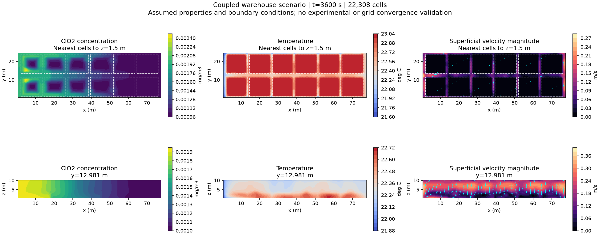
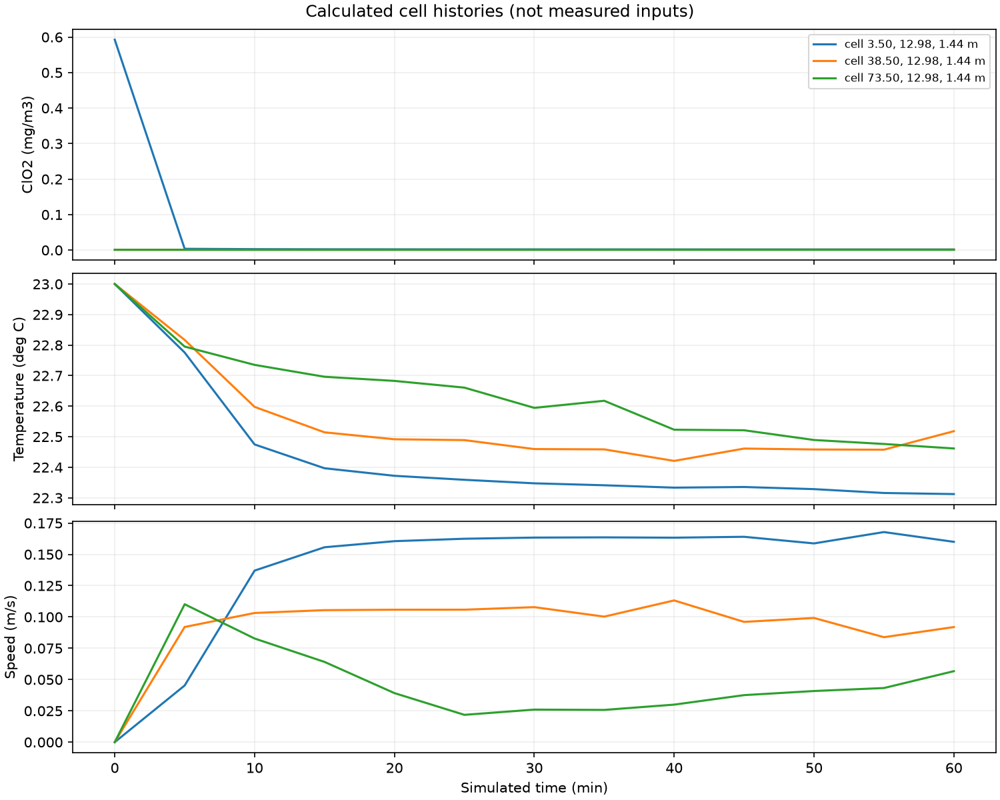

# 저장고 유속·온도·ClO₂ 농도 연결 계산 — 2026-09-28

## 이번에 실제로 한 일

기존 7일 시나리오는 **유속 0 + 공간 균일 기온 입력 + 농도 확산**이었다. 이번에는 OpenFOAM v2312의 압력·운동량·열전달 계산에 ClO₂ 이류·확산을 연결하고 **1시간 구간을 실제 실행**했다. 7일 전체의 연결 계산은 실행하지 않았다.

| 항목 | 현재 구현·실행 상태 |
|---|---|
| 유속장 U | 압력 보정·운동량 방정식, 열부력, k-epsilon 난류, 적재 블록의 선형 Brinkman 저항 |
| 온도장 T | 공간별 에너지 방정식, 적재물·공기 유효 열저장과 전도, 외기온에 따른 벽·지붕 열교환 |
| ClO₂ 농도장 C | 계산된 보존 유량에 의한 이류, 온도 의존 분자 확산, 자유공간 난류 확산, 다공성 저장항 |
| 위치·시간 조회 | C/T/U 원본과 저장 배열 대조, 농도·온도·벡터 유속 조회 |
| 화면 | 농도·온도·유속 선택, 전체/중앙 통로 단면, 속도 방향 화살표 |
| 수치 검사 | 질량·열수지, 연속방정식 잔차, 원본/배열 대조, 제한된 해석해 시험 통과 |
| 정확도 판정 | **저장고 격자 수렴 미완료**. 격자 변경 시 상당한 차이가 확인됨 |
| 실행 경로 | WSL 명령으로 실행, Studio 결과 화면에서 조회. Study 실행 버튼 연결은 아직 없음 |



그림은 저장된 셀 값을 단면 위에 보간한 표시다. 흰 점선은 이상화한 적재 블록 외곽이다. 실제 셀 경계·포대 외곽이 아니며, 각 패널의 색상 범위는 다르다.

## 화면 사용법

1. Studio의 **저장고 수송 결과**(`/warehouse/results`)를 연다. 이미 실행 중인 앱은 진행 중인 계산을 마친 뒤 다시 열어 새 서버 코드를 반영한다. 개발 중 사용자 Chrome·기존 계산을 중단하지 않았다.
2. `warehouse_transport_coupled_1h_20260928_01`을 선택한다. 0–3600 s, 300 s 간격, 13프레임이다.
3. **표시할 물리량**에서 농도, 온도, 유속·방향을 선택한다. **표시 영역**에서 전체 또는 중앙 통로 단면을 고른다.
4. 화살표 길이는 해당 프레임 최대속도에 대한 상대 크기다. 유속의 실제 단위는 m/s이며, 포대 사이의 공극 내 국소속도 대신 전체 단면 기준의 겉보기 유속이다.
5. 좌표(m), 시간(s), 최대 허용 거리(m)를 입력해 조회한다. 저장 프레임 사이의 선형 시간 보간이며 외삽하지 않는다. 조회 좌표는 기존 육면체 처리기의 **여섯 면 중심 평균인 근사 대표점**이다. 정확한 체적 중심과 구분해야 한다.
6. 농도 원본은 kg/m³ → 화면은 mg/m³, 온도 원본은 K → 화면은 °C, 유속 원본·화면은 m/s다. C/T/U 중 하나라도 배열과 다르면 표시·조회가 오류로 끝난다.

이전 `warehouse_transport_plan_20260928_01`의 57프레임은 여전히 정지 공기 확산 결과다. 결과 선택에 따라 모델·온도 계산 여부가 달라진다. 메인 화면 오른쪽 위 `!`의 사용법·성능 설명도 갱신했다.

## 형상·열경계·물성의 근거

- 상세계획서의 PNS/PAES 419:2015 도면에 따른 **78 × 25 m 저장동 공칭 외형**, 처마 7.2 m, 지붕 상승 3.5 m를 사용했다. 벽 두께를 반영한 실내 순치수로 확정한 것은 아니다.
- 12개 적재 블록은 계획서의 이격·통로·높이 제약으로 만든 가정 배치다. 실제 최종 적재 도면으로 확정하지 않았다. 블록은 셀 중심 마스크로 근사한다. 팔레트 틈과 개별 포대 표면은 해상하지 않는다.
- 5 m 부속실은 해석 영역에 포함하지 않았다. 연결면을 밀폐·단열 경계로 처리했다.
- [Agrafioti 등(2021), Fig. 1의 적재 컨테이너 외기온](https://doi.org/10.1016/j.compag.2021.106087)을 도표에서 3시간 간격으로 읽었다. 원본 시계열 대신 도표 판독값이며 약 ±0.5°C의 판독 불확도를 가정했다. **이번에는 내부 기온 강제가 아닌 지붕·외벽의 외기 열경계**에 적용했다. 해당 논문의 일사·풍속·벽체 모델 전체를 재현하지 않았다.
- [Lee 등(2015)의 공기 중 ClO₂ 확산계수](https://doi.org/10.1016/j.jfoodeng.2014.07.008): 5/23/40°C에서 1.29/1.45/1.73 × 10⁻⁵ m²/s. 온도 사이 선형 보간은 추가 가정이며 범위 밖 계산은 중단한다.

다음은 모두 **미보정 시나리오 입력**이다. 해당 논문에서 가져온 쌀·포대·창고 물성이 아니다.

| 입력 | 가정값 |
|---|---:|
| 초기 내부 공기·적재 온도 | 23°C |
| 공기 밀도·비열 | 1.2 kg/m³, 1005 J/(kg·K) |
| 공기 동점성계수 | 1.5 × 10⁻⁵ m²/s |
| Pr / 난류 Pr / 난류 Sc | 0.71 / 0.85 / 0.7 |
| 적재 공극률 / 굴곡도 | 0.4 / 2 |
| 적재 투과도 | 1 × 10⁻⁷ m² |
| 고체 체적 열용량 | 1.2 × 10⁶ J/(m³·K) |
| 적재 유효 열전도율 | 0.12 W/(m·K) |
| 지붕·외벽의 유효 외피 열통과 계수 | 2 W/(m²·K) |
| 바닥·부속실 경계 | 단열 |
| 초기 난류 k / epsilon | 10⁻⁵ m²/s² / 10⁻⁶ m²/s³ |

유효 열저장은 `eps*rhoCp_air + (1-eps)*rhoCp_solid`이다. 공기와 고체가 셀 안에서 같은 온도를 갖는 국소 열평형을 가정한다. 희박한 ClO₂는 유동에 영향을 되돌려주지 않는 수동 성분으로 취급했다. 초기 농도 분포는 기존 시나리오의 가정 펄스이며 공급·발생을 제어하지 않는다.

## 실행 결과와 계산 시간

아래 시간은 이 PC에서 측정한 케이스 준비부터 솔버 종료까지의 벽시계 시간이다. 일부 독립 시험은 동시에 실행했으므로 순수 성능 비교표가 아니다.

| 사례 | 셀 | 모의시간 | 실제 소요 | 프레임 | 질량수지 상대오차 | 열수지 상대오차 |
|---|---:|---:|---:|---:|---:|---:|
| 초기 연결 시험 | 22,308 | 600 s | 59.5 s | 11 | 7.93e-14 | 1.79e-6 |
| 1시간 연결 계산 | 22,308 | 3600 s | 327.2 s | 13 | 1.25e-13 | 7.22e-8 |
| 세분 격자 시험 | 85,800 | 600 s | 467.6 s | 11 | 2.18e-13 | 1.69e-6 |
| 시간 제어 세분 시험 | 22,308 | 600 s | 129.9 s | 11 | 3.04e-13 | 2.08e-7 |

1시간 마지막 프레임의 온도 범위는 **21.4563–23.0000°C**, 최대속도는 **0.42991 m/s**다. 모두 가정한 시나리오의 계산값이며 실측값이 아니다.

7일을 단순 비례하면 거친 격자는 약 15시간, 세분 격자는 약 5.5일에 해당한다. 유속 변화·자동 시간간격·병렬화·출력 조건에 따라 크게 달라지므로 완료시간 예측으로 확정하지 않는다. 앞선 빠른 7일 확산 계산 시간은 연결 계산에 적용할 수 없다.



[실행 검사 JSON](assets/warehouse-coupled-20260928/execution_checks.json), [프로브 CSV](assets/warehouse-coupled-20260928/coupled_probes.csv).

## 검사 통과와 정확도의 구분

### 제한된 해석해 시험

인공적인 주기 상자에서 (1) 열용량을 포함한 코사인 온도장의 전도 감쇠, (2) 비영 사인 유속장의 점성 감쇠를 각각 해석해와 비교했다. 중력·난류는 꺼서 해당 방정식을 분리했다.

| 시험 | 거친 조건 RMSE | 세분 조건 RMSE |
|---|---:|---:|
| 온도 전도 | 0.0010513 K | 0.00029174 K |
| 비영 유속 감쇠 | 4.5600e-6 m/s | 1.5618e-6 m/s |

불변 온도/유속과 균일 추적자도 유지됐다. 이 시험은 **창고의 자연대류·다공성 난류 정확도 인증이 아니다**. [수치시험 기록](assets/warehouse-coupled-20260928/analytical_verification.json).

### 저장고의 민감도

600 s에서 비교했으며, 격자 비교는 같은 x 열 안의 최근접 셀값으로 대응했다. 비보존적·비체적가중 비교이고 최대 대응 거리는 0.332 m다.

| 비교 | 배경농도를 뺀 농도 상대 L2 차이 | 유속 벡터 상대 L2 차이 | 온도 RMSE |
|---|---:|---:|---:|
| 22,308 → 85,800셀 | **30.94%** | **46.56%** | 0.08171°C |
| 같은 격자, Co 제한 0.5 → 0.25 | 1.408% | 1.568% | 0.005022°C |

격자를 바꾸면 적재 마스크·초기 이산 질량과 자동 시간간격도 변한다. 따라서 첫 행은 **시간간격을 고정한 순수 격자 수렴시험이 아니다**. 세 격자 Richardson/GCI 판정도 하지 않았다. 농도 최고값은 0.005183 → 0.010333 mg/m³로 달랐다. 이 때문에 `numerical_pass=false`, `experimental_validation=false`를 유지한다. [비교 원자료](assets/warehouse-coupled-20260928/sensitivity.json).

질량·열수지 통과만으로 국소 농도·유속의 정확도가 보장되지 않는다. 현재 1차 이류·시간 이산화의 수치 확산과 적재 경계 해상도가 중요한 남은 문제다.

### 프로그램·저장 검증

- Python 전체 검사: 98개 통과. JavaScript Viewer 검사: 27개 통과.
- 추가 독립 원본 검사에서 각 사례의 모든 저장 프레임 `C/T/U`와 NPZ 배열 최대 차이 0. 시간 적분 배열도 별도 대조했다.
- NumPy가 없는 Windows 내장 Python에서 연결 계산의 마지막 프레임을 실제 읽었다.
- 별도 검토 브라우저에서 세 물리량 전환·단면·위치/시간 조회를 확인했다. 사용자 Chrome과 기존 계산에는 손대지 않았다.

## 재현 명령

원래 저장소에서 실행하며 출력마다 **존재하지 않는 새 폴더**를 사용한다. OpenFOAM v2312, NumPy와 그림용 Matplotlib가 필요하다. Python 환경은 설치된 환경에 맞게 선택한다.

```bash
source /usr/lib/openfoam/openfoam2312/etc/bashrc
wmake tracer_transport/coupled_solver
python3 -m tracer_transport.warehouse_coupled \
  --config tracer_transport/warehouse_coupled_pilot.json \
  --output output/warehouse_transport_my_coupled_1h
python3 -m tracer_transport.plot_coupled output/warehouse_transport_my_coupled_1h
python3 tests/audit_warehouse_case.py output/warehouse_transport_my_coupled_1h
python3 -m tracer_transport.verify_coupled \
  --output output/warehouse_transport_my_analytical_checks
```

비교용 설정은 `warehouse_coupled_smoke.json`(600 s 기준), `warehouse_coupled_fine.json`(85,800셀), `warehouse_coupled_time_refined.json`(시간 제어 세분)이다. 각 설정을 별도 새 출력 폴더에 실행한 뒤:

```bash
python3 -m tracer_transport.compare_coupled \
  --reference output/warehouse_transport_my_smoke \
  --grid output/warehouse_transport_my_fine \
  --time output/warehouse_transport_my_time \
  --output output/my_new_sensitivity.json
```

솔버 계보·방정식·GPL 라이선스는 [솔버 설명](../tracer_transport/coupled_solver/README.md)에 있다. 원본 OpenFOAM은 설치 위치에서 수정하지 않았다. 입력 파일·격자·원본장·실행 로그는 로컬 `output/warehouse_transport_coupled_*`에 보존했다. GitHub에는 코드·설정·요약 검사·그림·프로브 CSV를 올리며 대용량 Raw 전체는 포함하지 않는다.

## 남은 범위

실제 벽체/열경계, 적재 저항·열용량·열전도·난류 처리, 포대 내부/막 전달, ClO₂ 흡착·반응·누출은 아직 미확정 또는 미구현이다. 일사·외풍·습도, 부속실 공기, 개별 포대는 이번 모델에 없다. 재시작·이동격자 및 생성/공급 자동제어도 이 추가 솔버에서 검증하지 않았다. 이후 정량 예측에는 적재 경계를 맞춘 격자, 독립 시간간격 연구, 더 높은 차수 이산화와 난류·열경계 모델 검토가 필요하다.

사용자 요청대로 첫 CFD 실행에 실측 시계열 제출을 전제조건으로 두지 않았다. 실측·독립 검증이 없는 현재 결과를 실제 훈증 성능이나 공급조건 최적화 근거로 판정하지 않는다.
