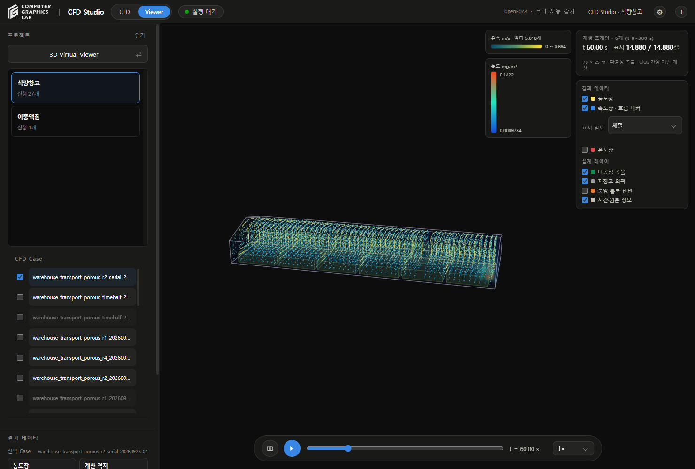
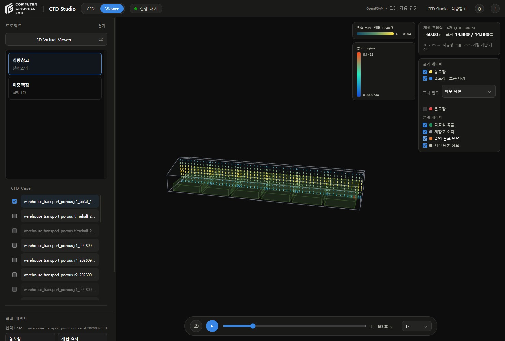
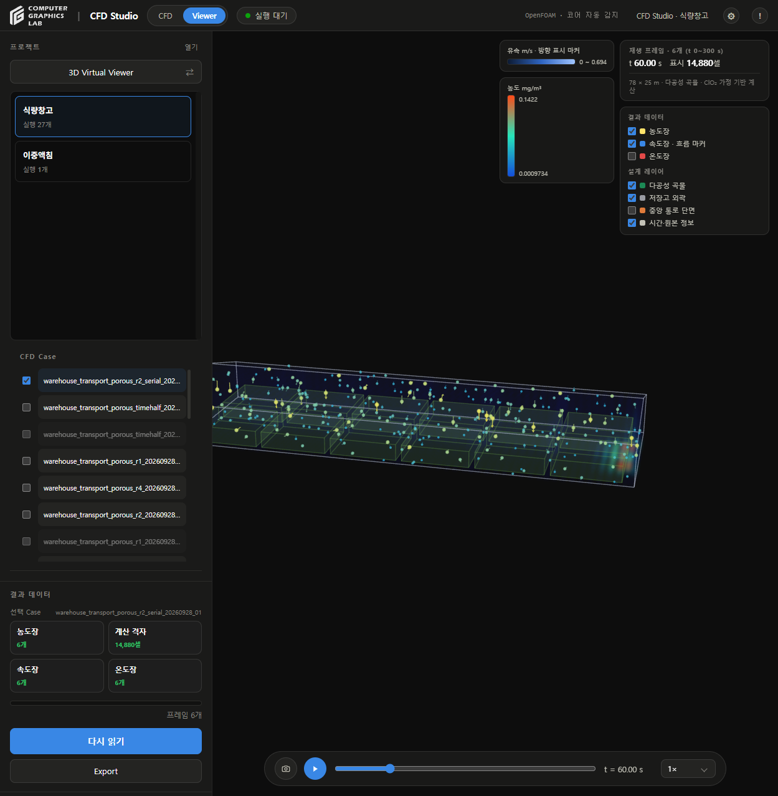

# 저장고 시각화

## 변경

- v187
- 속도 벡터: 기존 최대 약 350개 → 표준 1,500개 / 세밀 6,000개 / 매우 세밀 18,000개
- 기본값: 세밀
- 전체 셀의 일정 인덱스 간격 추출 → 공간 구역별 실제 셀 선택
- 중앙 단면: 해당 셀을 먼저 고른 후 표시 밀도 적용
- 낮은 유속 숨김 제거, 거의 정지한 벡터만 생략
- 화살표 길이·이동 마커 크기 조절, 유속 범례 색상 일치
- 프레임 읽기: 최대 125,000셀
- 상단: 표시 셀 / 전체 셀, 유속 범례: 벡터 개수
- 정지 화면: 같은 벡터 버퍼 재사용
- 큰 프레임: 캐시 2~8개로 조절
- 기존 화면 배치·Case 선택·재생 방식 유지

## 검사

| 항목 | 결과 |
|---|---|
| 저장고 Python 검사 | 26개 통과 |
| Windows 내장 Python 경로 검사 | 4개 통과 |
| JavaScript Viewer·Config 검사 | 61개 통과 |
| 기존 r2 결과 60초 | 14,880셀, 세밀 5,618벡터 |
| r2 매우 세밀 | 14,880개 셀의 벡터 표시 |
| r2 중앙 단면 | 1,240벡터 |
| 기존 r4 결과 | 119,040셀 전체 읽기, 표본 간격 1 |
| r4 기본 밀도 | 5,724벡터 |
| r4 매우 세밀 | 16,492벡터 |
| Case 전환 | 표시 밀도·중앙 단면 선택 복원 |
| WebGL 오류 | 검사 시 0 |
| 프로젝트·Case | 2개 프로젝트·28개 실행 ID 유지 |

- 실행한 CFD 계산 없음
- 기존 Raw·계산 결과·입력값 수정 없음
- 변경 범위: 저장된 결과의 표시 생략 축소
- 계산 격자 세분화·물리 정확도 개선을 의미하지 않음
- 125,000셀을 넘는 결과는 표본 표시, 표시 / 전체 셀 수로 구분
- 화살표는 방향과 상대 유속을 표현, 실제 입자 이동 궤적 아님

## 사용법

- Viewer → 속도장 → 표시 밀도
- 기본 확인: 세밀
- 더 많은 벡터: 매우 세밀
- 내부 흐름: 중앙 통로 단면
- 느린 PC: 표준

### 세밀

### 중앙 단면

### 변경 전

