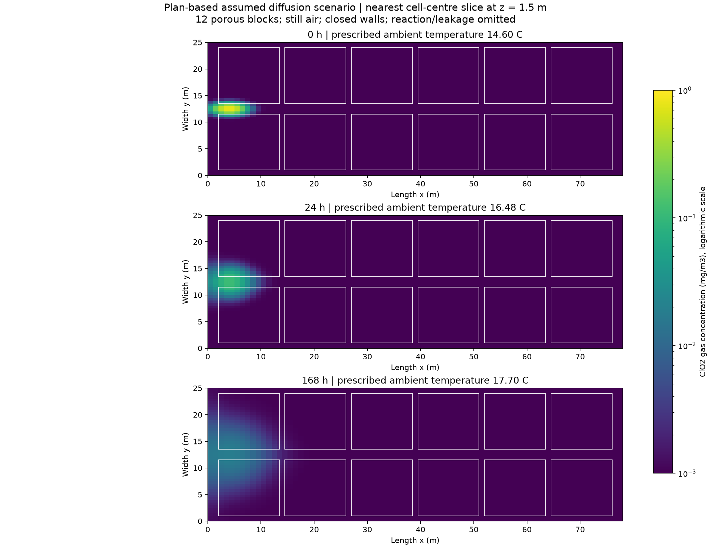
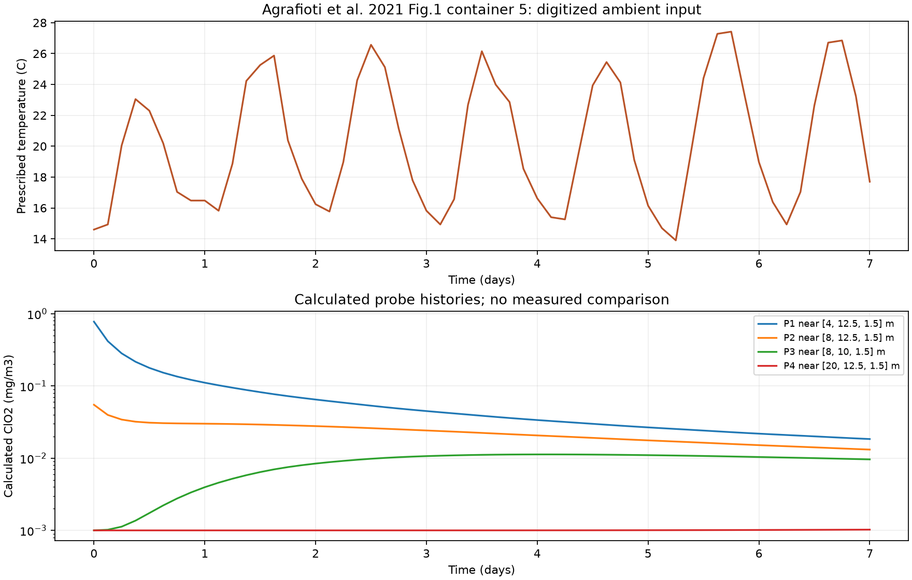

# 상세계획서 기반 ClO₂ 확산 시나리오 — 2026-09-28

실측 자료를 기다리지 않고 첫 농도장을 얻기 위해 상세연구계획서의 도면·제약과 명시적 가정으로 OpenFOAM 유한체적 수송 계산을 실행했다. 액침냉각·단상 저장고는 이번 작업 범위에서 제외했다.

## 형상 정의

상세연구계획서(2026-09-25) 4–5쪽에 실린 PNS/PAES 419:2015 부록 도면을 사용했다. 저장동 길이 78 m, 폭 25 m, 처마 높이 7.2 m, 용마루 상승 3.5 m를 계산 공기 영역으로 채택했다. 도면 공칭 경계를 실내 경계로 사용하는 단순화이며 벽 두께는 생략했다. 계획서가 구분한 5 m 전면 부속실은 폐쇄 연결벽 뒤의 별도 공간으로 두고 이번 영역에서 제외했다.

계획서에는 최종 적재 블록 좌표가 없고 벽·블록 간격 1 m 이상, 중앙 통로 2 m, 적재 높이 3 m 이하의 제약이 있다. 이에 따라 다음 12개 블록을 첫 배치로 정의했다.

- 길이 방향: 6개, 각 길이 11.5 m, 블록 사이 1 m, 양 끝 여유 2 m.
- 폭 방향: 2열, 각 폭 10.5 m, 양쪽 벽 여유 1 m, 중앙 통로 2 m.
- 높이: 바닥 위 0.15–3 m. 하부 틈 0.15 m는 팔레트 공간 가정.
- 블록 공극률 0.4, 굴곡도 2: 보정되지 않은 시나리오 값. 유효 확산 전도도는 공극률/굴곡도 × 공기 중 확산계수.
- 셀 중심으로 블록을 구분하는 체적 근사이며 개별 포대나 포대 경계막을 해석하지 않는다.

## 기온·농도 조건

[Agrafioti 등(2021)](https://doi.org/10.1016/j.compag.2021.106087) 원문 3쪽 Figure 1의 적재 컨테이너 5 외기온 곡선을 3시간 간격으로 도표에서 읽었다. 입력 범위는 약 13.9–27.42°C이며 도표 판독 오차는 약 ±0.5°C로 취급한다. 원 논문은 외기온·풍속·일사를 경계조건으로 사용했다. 이번 계산은 외기온 곡선만 전 공간에 같은 기온으로 부여했으며 원 논문의 열·자연대류 계산을 재현한 것은 아니다.

ClO₂ 공기 확산계수는 [Lee 등(2015)](https://doi.org/10.1016/j.jfoodeng.2014.07.008)의 5/23/40°C 값 사이를 선형 보간했다. 온도별 확산계수의 시간표를 솔버에 입력하여 매 시간 단계 확산항을 갱신했다. 온도는 주어진 값이고 운동량·열 방정식은 풀지 않았다.

농도 시계열 자체를 작성하지 않고 초기 농도 분포를 가정한 뒤 이후 시계열을 계산했다. 초기 배경은 0.001 mg/m³이고, 중심 (4,12.5,1.5) m에 가우시안 분포를 더했다. 추가분의 수학적 최대값은 1 mg/m³, 표준편차는 (1.5,0.5,0.5) m다. 이는 계산 입력의 크기이며 실제 훈증 운전량·살충 조건을 제안하는 값이 아니다. 셀 중심에서의 초기 최대값은 0.777 mg/m³다.

공기 속도 0, 벽·문·환기구·부속실 연결부 폐쇄, 누출·반응·흡착·추가 공급 0을 이번 시나리오 가정으로 두었다. 따라서 결과는 적재 영역을 포함한 정지 공기 확산이다.

## 실행 결과

| 항목 | 값 |
|---|---|
| OpenFOAM | v2312, porousTracerFoam |
| 격자 | 85,800셀, checkMesh 통과 |
| 계산 기간·시간간격 | 604,800 s (7일), 900 s |
| 저장 | 10,800 s (3시간) 간격, 57프레임 |
| 상대 질량수지 오차 | 3.2301×10⁻¹³ |
| 음수 농도 | 없음 |
| 원본장 대조 | 4,890,600개 스칼라값의 최대 차이 0 |
| 초기·마지막 최대 농도 | 0.776985 → 0.020681 mg/m³ |



그림은 z=1.5 m에 가장 가까운 셀 중심을 선택한 평면이며 실제 선택 높이는 약 1.31–1.69 m다. 흰 테두리는 이상화한 적재 블록 경계다. 모든 시점에 동일한 로그 색 범위를 사용한다.



[조회 지점의 계산 시계열 CSV](assets/warehouse-plan-20260928/probe_timeseries.csv)를 제공한다. 실험 검증과 이번 시나리오의 격자·시간 수렴 검사는 수행하지 않았다. 기본 질량수지·비음수·파일 대조 검사는 실행 오류를 확인하기 위한 검사다.

## 열기와 재현

Studio에서 `/warehouse/results`를 열고 `warehouse_transport_plan_20260928_01`을 선택한다. 흰 선으로 적재 블록을 표시하며 프레임·위치별 농도와 입력 기온을 조회할 수 있다. 실행 결과는 로컬 `output/warehouse_transport_plan_20260928_01`에 보존하며 Git에는 코드·입력·이 문서와 요약 그림만 올린다.

```bash
source /usr/lib/openfoam/openfoam2312/etc/bashrc
cd tracer_transport/solver && wmake && cd ../..
python3 -m tracer_transport.warehouse_scenario \
  --config tracer_transport/warehouse_plan_scenario.json \
  --output output/warehouse_transport_plan_new
python3 tests/audit_warehouse_case.py output/warehouse_transport_plan_new
python3 -m tracer_transport.plot_warehouse_scenario \
  --case output/warehouse_transport_plan_new \
  --output output/warehouse_transport_plan_new/figures
```

그림 생성에는 NumPy·Matplotlib가 필요하다. Studio에서 저장 결과를 읽을 때에는 Windows 내장 Python의 표준 라이브러리를 사용한다. 원문 도면·논문은 수정하거나 Git에 재배포하지 않았다.
