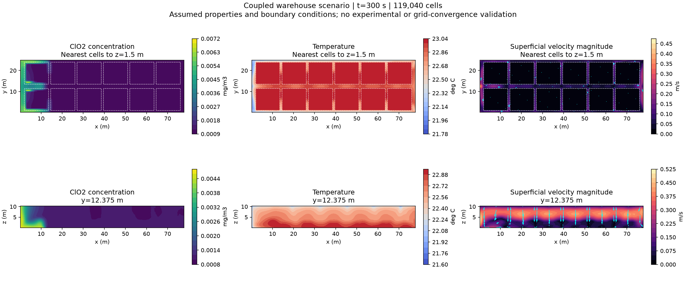

# 누출 제외·다공성 곡물 모델과 격자 비교

## 현재 범위

사용자 요청에 따라 **누출은 제외**했다. 외벽·문·부속실 연결면은 가스가 통과하지 않는 경계다. 누출을 이번 단계의 미완료 과제로 취급하지 않는다.

포대에 담긴 곡물은 **균질 다공성 영역**으로 정의했다. 현재 도면의 12개 적재 블록을 등가 영역으로 사용하며, 개별 포대의 막과 포대 사이 작은 틈을 각각 해상한 모델은 아니다. 곡물 영역에는 공극률, Darcy–Brinkman 유동 저항, 유효 열저장·전도, 공극 내 농도 저장·확산을 적용한다.

공극률 0.4, 굴곡도 2, 투과도 1e-7 m² 등은 앞서 명시한 **미보정 가정값**이다. 실측 물성으로 확정하지 않았다. 농도 C는 공극 가스의 체적당 농도이며 질량은 `sum(eps*C*V)`로 계산한다. 상세 물성·열경계의 근거와 가정은 [연결 계산 보고서](warehouse-coupled-cfd-20260928.md)에 있다.

## 무엇을 개선했는가

1. **적재 경계 정렬:** 격자 면이 곡물 블록의 바닥·상단·측면에 맞도록 여러 블록으로 구성했다. 팔레트 아래 0.15 m 공기층도 포함했다. 격자를 바꿔도 곡물 외곽은 움직이지 않는다.
2. **같은 초기 조건:** 초기 Gaussian 농도를 점에서 읽는 대신 각 셀의 체적 평균으로 넣었다. 세 격자의 초기 가스 총량이 같다.
3. **같은 계산 조건:** 시간간격 0.1 s, 초기 300 s 구간, 열경계·물성·선형 솔버·공간 이산화를 고정했다. CPU 프로세스 수는 실행 조건으로 별도 기록했다.
4. **보존적 비교:** 작은 셀 값을 체적으로 가중하여 대응하는 큰 셀에 합쳤다. 과거 최근접 셀 비교에서 생기던 위치 차이의 영향을 제거했다.
5. **정확한 조회 좌표:** 새 사례는 해석적으로 구한 체적 중심·셀 부피를 OpenFOAM 출력과 대조한다. 과거 사례의 면 중심 평균 근사와 구분해서 표시한다.
6. **원본 경로 보존:** `239.99999999999065` 같은 원본 시간 폴더를 변경하지 않고 `frame_sources.json`으로 표시 시간과 연결한다. 원본 C/T/U를 계속 대조한다.

새 메시는 `porous_mesh` 설정으로 제어한다. 기존 두 블록 메시의 `geometry_spec.mesh` 숫자가 새 메시의 셀 수를 결정하는 것은 아니다. 실제 셀 수·부피·품질은 `model_contract.json`, `geometry_report.json`, `mesh_quality.json`에 기록한다.

## 실제 계산 결과

격자 수렴은 **칸을 더 잘게 나눠도 결과가 충분히 비슷한지 확인하는 것**이다. 서로 다른 세 격자에서 오차 감소와 적용 가능한 지표의 GCI를 검토했다. [NASA/NPARC의 공간 수렴 안내](https://www.grc.nasa.gov/www/wind/valid/tutorial/spatconv.html)는 관측 수렴 차수와 점근 영역 확인을 위해 세 단계 격자를 권장한다.

| 항목 | 거친 격자 | 중간 격자 | 세분 격자 |
|---|---:|---:|---:|
| 셀 수 | 1,860 | 14,880 | 119,040 |
| 각 방향 분할 배수 | 1 | 2 | 4 |
| 곡물 영역 부피 | 4,129.65 m³ | 4,129.65 m³ | 4,129.65 m³ |
| 곡물 공극 부피 | 1,651.86 m³ | 1,651.86 m³ | 1,651.86 m³ |
| 초기 가스 총량 | 2.070442393384e-5 kg | 동일 | 동일 |
| 시간간격 / 종료시간 | 0.1 / 300 s | 동일 | 동일 |
| 솔버 실행시간 | 약 42 s | 약 104 s | 약 586 s |
| 질량수지 상대오차 | 1.47e-13 | 4.74e-11 | 5.66e-13 |
| 열수지 상대오차 | 3.41e-9 | 3.24e-7 | 1.97e-7 |

시간은 솔버 로그의 ClockTime이다. 준비·내보내기를 포함한 총 소요시간과 다르며, 거친 격자는 단일 프로세스, 나머지는 4개 프로세스로 실행했다. 일부 계산은 동시에 진행했으므로 하드웨어 성능 비교표로 해석하지 않는다.

**판정: 격자 수렴 기준 미달.** 300 s의 중간 → 세분 격자 차이는 다음과 같다.

| 지표 | 차이 | 설정한 수치 목표 |
|---|---:|---:|
| 배경농도를 뺀 농도장의 체적가중 상대 L2 | 32.95% | 5% 이하 |
| 유속 벡터장의 체적가중 상대 L2 | 35.12% | 5% 이하 |
| 온도장의 체적가중 RMSE | 0.04822°C | 0.05°C 이하 |

60–300 s 전체 저장 시점 중 가장 큰 차이는 농도 82.93%, 유속 55.05%, 온도 0.07204°C였다. 기준은 이 검사를 위한 공학적 목표이며 실험에서 확인된 허용 오차가 아니다. 마지막 온도 지표 하나가 작다고 전체 계산을 통과시키지 않는다.

곡물 내부 가스 총량은 격자 차이가 감소하지 않았고, 평균 냉각량은 비단조 변화여서 GCI를 적용 가능한 수렴 결과로 인정하지 않았다. RMS 유속의 세분 격자 GCI 추정도 약 66.75%로 컸다. 따라서 `grid_converged=false`, `numerical_pass=false`, `experimental_validation=false`를 유지한다. [비교 수치·기준·GCI 원자료](assets/warehouse-porous-20260928/grid_assessment.json).



그림은 **실행된 가정 시나리오**다. 수렴한 정량 예측이나 실측 결과로 사용하지 않는다. 단면은 셀 값으로 보간한 표시이며 포대 표면을 재현한 그림이 아니다.

### 시간간격을 줄인 추가 검사

중간 격자 14,880셀에서 **동일한 단일 프로세스**로 0.1 s와 0.05 s를 각각 300 s까지 실행했다. 솔버 실행시간은 약 196 s와 356 s였다. 두 계산 모두 질량·열수지·연속방정식 검사를 통과했다.

| 지표 | 마지막 300 s 차이 | 전체 저장 시점의 최대 차이 |
|---|---:|---:|
| 농도 상대 L2 | 1.168% | 9.202% |
| 유속 상대 L2 | 1.503% | 3.448% |
| 온도 RMSE | 0.002897°C | 0.004747°C |

농도의 최대 차이가 5% 목표를 넘으므로 **시간간격 민감도 검사도 전체 통과로 판정하지 않았다.** 두 시간간격만 비교했으므로 시간 수렴 차수도 확정하지 않았다. [시간 비교 원자료](assets/warehouse-porous-20260928/time_assessment.json).

같은 중간 격자·0.1 s의 단일/4개 프로세스 결과도 별도로 비교했다. 마지막 300 s 차이는 농도 0.0852%, 유속 0.2254%, 온도 0.000255°C였다. 이번 격자 차이보다 작지만 다른 격자·시간간격에서의 병렬 실행 정확도를 보증하지 않는다. [프로세스 수 비교](assets/warehouse-porous-20260928/process_comparison.json).

## 검사와 알려진 문제

- 새 메시의 체적·공극·초기 총량 불변성 및 보존적 셀 대응을 자동 검사했다.
- 세 사례 모두 checkMesh, 질량·열수지·연속방정식 검사, OpenFOAM/해석적 셀 기하 대조를 통과했다.
- 모든 저장 프레임의 C/T/U 원본과 배열 차이는 0이며, 원본 폴더 이름과 시간 대응도 별도로 검사했다.
- Python 전체 검사 105개, JavaScript Viewer 검사 27개가 통과했다.
- Windows 내장 Python 및 별도 검토 브라우저에서 세 물리량·단면·보간 조회와 원본 추적을 확인했다. 사용자 Chrome이나 기존 계산을 중단하지 않았다.
- 최초 거친 격자 병렬 실행과 시간간격 세분 병렬 실행은 국소 연속방정식 검사에 미달했다. 실패 기록을 보존하고 완료 결과 목록·격자 판정에서 제외했다. 기본 실행은 단일 프로세스이며 병렬 실행을 모든 조건에서 검증한 것으로 주장하지 않는다.
- 병렬 기하 출력에 포함된 OpenFOAM `sliced` 패치의 재구성 문제는 내부 셀 배열과 `cellProcAddressing`으로 조립하는 방식으로 수정했다. 해당 사례의 CFD 원본 계산을 버리거나 다시 계산한 것처럼 보고하지 않았다.

[실행 검사 요약](assets/warehouse-porous-20260928/execution_checks.json), [원본·배열 대조와 파일 해시](assets/warehouse-porous-20260928/storage_audits.json), [세분 격자 프로브 CSV](assets/warehouse-porous-20260928/coupled_probes.csv)를 함께 보관한다. 대용량 원본장은 로컬 계산 폴더에 그대로 보존한다.

## 화면 사용

Studio의 **저장고 수송 결과**에서 `warehouse_transport_porous_r4_20260928_01`을 고른다. 다음을 확인할 수 있다.

- **곡물 모델:** 균질 다공성
- **가스 경계:** 밀폐·누출 제외
- **곡물/공극 부피**, **OpenFOAM과 대조한 셀 체적 중심**
- **격자 수렴 기준 미달**, 비교 구간 300 s
- 농도(mg/m³), 온도(°C), 유속·방향(m/s), 위치·시간 조회

메인 화면 오른쪽 위 `!`에도 최신 사례와 설명서 링크를 추가했다. 앞선 1시간 및 7일 확산 결과는 별도 이름으로 그대로 보존했다.

## 재현

원래 저장소에서 OpenFOAM v2312와 NumPy 환경을 준비한다. 모든 출력 경로는 **새 폴더**여야 한다. 아래 `python3`는 NumPy가 설치된 환경의 실행 파일로 바꿀 수 있다.

```bash
source /usr/lib/openfoam/openfoam2312/etc/bashrc
wmake tracer_transport/coupled_solver
python3 -m tracer_transport.warehouse_coupled \
  --config tracer_transport/warehouse_porous_convergence.json \
  --refinement 1 --processes 1 --output output/warehouse_transport_new_r1
python3 -m tracer_transport.warehouse_coupled \
  --config tracer_transport/warehouse_porous_convergence.json \
  --refinement 2 --processes 4 --output output/warehouse_transport_new_r2
python3 -m tracer_transport.warehouse_coupled \
  --config tracer_transport/warehouse_porous_convergence.json \
  --refinement 4 --processes 4 --output output/warehouse_transport_new_r4
python3 -m tracer_transport.assess_porous_convergence \
  output/warehouse_transport_new_r1 output/warehouse_transport_new_r2 \
  output/warehouse_transport_new_r4 --output output/my_new_grid_report.json
python3 tests/audit_warehouse_case.py output/warehouse_transport_new_r4
python3 -m tracer_transport.plot_coupled output/warehouse_transport_new_r4
```

판정 도구는 물리 입력, 시간간격, 솔버 소스 버전, 이산화·선형 솔버 설정, 초기 총량, 곡물 부피가 다른 비교를 거부한다. 초기 300 s의 국소 검토이며 정상상태·7일 전체의 수렴 판정으로 확대하지 않는다.

시간간격 비교는 두 계산의 프로세스 수까지 같아야 한다. 예를 들어 새 중간 격자를 단일 프로세스로 실행하고 아래처럼 시간간격을 줄인다.

```bash
python3 -m tracer_transport.warehouse_coupled \
  --config tracer_transport/warehouse_porous_convergence.json \
  --refinement 2 --processes 1 --output output/warehouse_transport_new_time_base
python3 - <<'PY'
import json
from pathlib import Path
from tracer_transport.warehouse_coupled import execute
spec = json.loads(Path('tracer_transport/warehouse_porous_convergence.json').read_text())
spec['porous_mesh']['refinement'] = 2
spec['coupled']['processes'] = 1
spec['numerics']['dt_s'] = 0.05
execute(spec, Path('output/warehouse_transport_new_time_half'))
PY
python3 -m tracer_transport.assess_time_refinement \
  output/warehouse_transport_new_time_base output/warehouse_transport_new_time_half \
  --output output/my_new_time_report.json
```

## 다음 정확도 개선

현재는 **누출 없는 다공성 곡물 CFD를 실행하고 검사하는 기능이 구축된 상태**다. 격자 독립적인 정량값은 확보하지 못했다. 이후에는 벽·적재 경계·초기 농도 분포 주변의 해상도를 높이고, 시간간격 오차와 난류·벽 열전달 처리를 따로 확인해야 한다. 검사 실패를 물리 계수 조정이나 허용 오차 완화로 숨기지 않는다. 누출 추가는 이 후속 범위에 포함하지 않는다.
